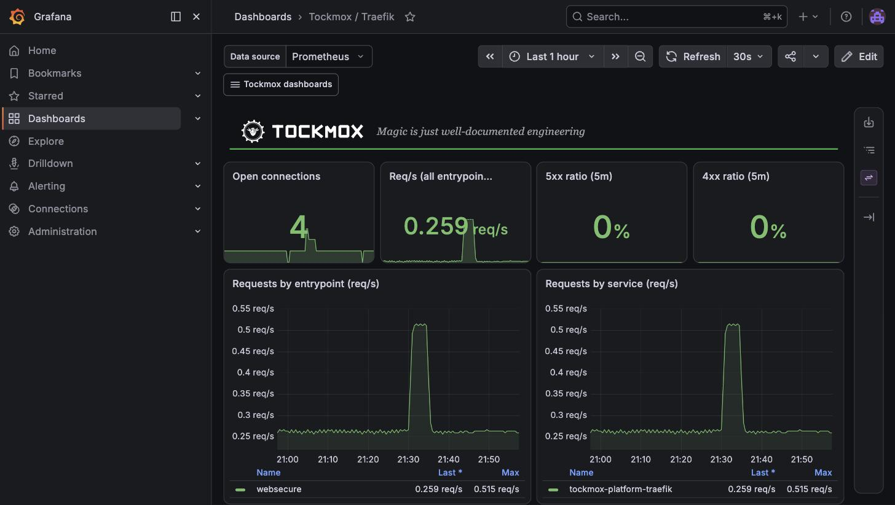
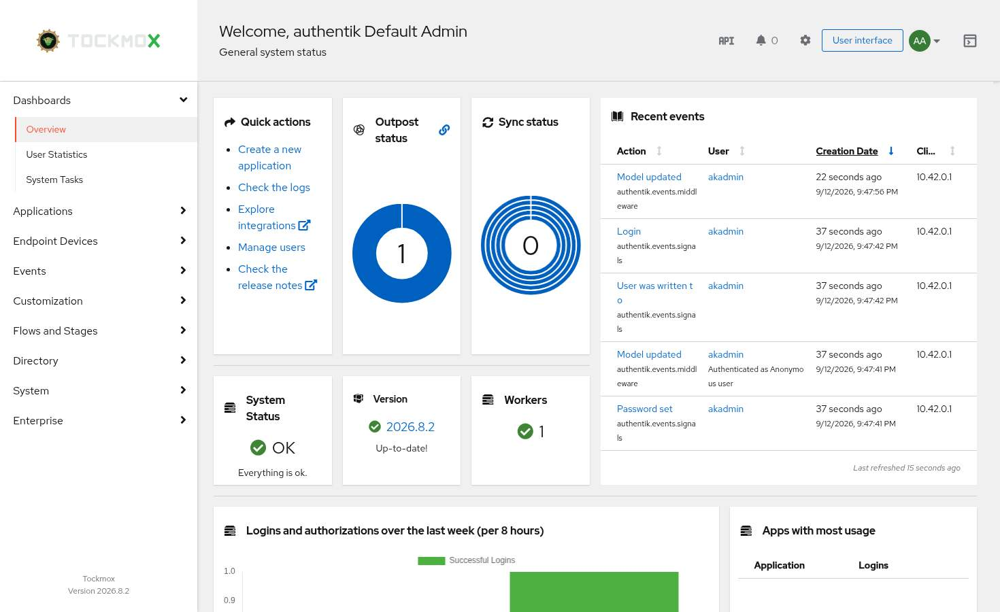

<div align="center">


# Tockmox

<em>Magic is just well-documented engineering.</em>

**A sovereign AI platform you actually own.**

Local first. Frontier by exception. Built to enterprise standards out of
best-in-class open source, and run every day by the guy who wrote it.

[Quickstart](#quickstart) ·
[Documentation](docs/) ·
[Architecture](docs/architecture.md) ·
[Contributing](CONTRIBUTING.md) ·
[Support](SUPPORT.md)

[](https://github.com/tockmox/tockmox/actions/workflows/ci.yaml)
[](https://github.com/tockmox/tockmox/actions/workflows/executed-docs.yaml)
[](LICENSE)
[](LICENSE-docs)

[](https://github.com/tockmox/tockmox/releases)
[](https://scorecard.dev/viewer/?uri=github.com/tockmox/tockmox)

</div>

<!-- HERO SCREENSHOT: the Tockmox UI home page, signed in, every layer healthy.
     Lands when the Tockmox UI leaves experimental. Path when it exists: docs/assets/tockmox-ui/home.jpg -->

---

## tl;dr

Ask your AI of choice whether you should take a look at this:

```text
Read AGENTS.md and docs/why-tockmox.md in https://github.com/tockmox/tockmox,
then tell me whether Tockmox fits my situation, including the reasons it might
not. Ask me only for what you need and don't already know.
```

(It knows your hardware and your constraints. We know Tockmox. Fit is the answer
neither of us can give alone.)

## What is Tockmox?

Tockmox is an opinionated platform for running your own AI, and everything an
AI needs around it to be safe, on hardware you control. Cloud AI treats local
as the exception. Tockmox flips that: your models, your data and your consoles
live on your hardware, and reaching out to a frontier model is a deliberate
decision you make per request, not a default someone made for you.

It's a Kubernetes platform, delivered as Helm charts and reconciled by GitOps,
that assembles proven open source components the way an enterprise platform
team would: single sign-on in front of everything, default-deny networking,
monitoring that pages a human, and backups that prove they restore. Read
those four with their edges: single sign-on fronts the three consoles wired to
it (Grafana, Open WebUI, Argo Workflows), with local break-glass logins beside
it, and the UIs that ship no login of their own (Prometheus, Alertmanager,
Longhorn) are off by default; default-deny is complete for ingress, while
egress is contained only for the AI namespace and the diagnostic one; the
scheduled restore drill covers the model-gateway database, not your chat
history or a whole-cluster rebuild. [What you get](#what-you-get) states each
in full. The opinions are stated, every component turns off individually, and
your configuration lives in your repository, not ours.

| Layer | What it gives you | Built on |
|---|---|---|
| **AI** | Private chat and a model gateway, pointed at *your* models | Open WebUI, LiteLLM, Ollama (optional) |
| **Identity** | One login for the three consoles wired to it; local break-glass logins stay on | Authentik |
| **Observability** | Metrics, logs, dashboards, and alerts that reach your phone | Prometheus, Alertmanager, Grafana, Loki, Alloy, ntfy |
| **Platform** | Storage, databases, ingress, certificates, patching | Longhorn, CloudNativePG, Garage, Traefik, MetalLB, cert-manager, kured |
| **Policy** | Default-deny networking (ingress in every namespace it creates, egress in the AI namespace and the diagnostic one, nothing in namespaces you create) and admission guardrails | Kubernetes NetworkPolicy, RBAC, ValidatingAdmissionPolicy |
| **DevOps** | Workflows, behind SSO | Argo Workflows (optional) |
| **Self-check** | A heartbeat that proves the alerting is alive | Tockmox |
| **Front door** | Is it OK, and where's everything? | Tockmox UI (experimental) |

Every component ships under a licence you can read; the two that are
source-available rather than open source are named on the
[licences page](docs/third-party-licenses.md).

- **It keeps working when the internet doesn't.** Every component runs locally.
  Losing your uplink degrades capability, not availability: a cloud model
  route you configured stops answering, and so does public certificate issuance
  if you use it. That is about running. Installing disconnected takes
  preparation, because the images, charts, git server, internal CA and time
  source all have to be carried in ([air-gapped operation](#air-gapped-operation)),
  and the one disconnected install was run on 2026-08-25 against an earlier
  build, not re-run for 0.8.0.
- **Upgrades can't overwrite your configuration.** Your settings live in a
  separate repository from the platform: the `/usr` versus `/etc` split, in
  GitOps terms. That promise is about files. Before 1.0 it does not freeze
  behaviour: only keys tiered `stable` are promised across releases, and the
  Service names, Secret keys and endpoints an application of yours depends on
  can change in a minor release
  ([no downstream ABI before 1.0](docs/administration/values-contract.md#before-10-there-is-no-downstream-abi)).
- **Every claim names its evidence and its kind.** Rendered artifacts are gated
  by CI on every commit; operational behaviour rests on named, dated runs on
  real clusters; documented procedures not yet executed verbatim say so on the
  page. [`tests/executed-docs/INVENTORY.md`](tests/executed-docs/INVENTORY.md)
  is the coverage boundary and names what is still open.

**It does not install** Kubernetes, Argo CD, sealed-secrets or a model. The
first three are prerequisites, and
[the list is short for a reason](docs/deployment/prerequisites.md). The model is
yours to choose: your own hardware, a frontier API, or both.

**You operate it.** It assumes an operator comfortable with Kubernetes, Helm and
GitOps, from one person with a mini PC to a research group. It is not a
one-click desktop application. The full argument:
[Why Tockmox?](docs/why-tockmox.md)

## A note from Jeff Maaks, maintainer

### What it really is

It's my homelab.

It started out as a tool I needed so I could do some other really cool (to me,
at least!) work: local, sovereign AI development and experimentation. Then I
looked at the scaffolding I'd built to hold all that up and realized it might be
useful to somebody besides me.

I've worked in practically every corner of IT:

| Where | What |
|---|---|
| **Down at the metal** | Hacker · real-time microcontroller developer · PLC programmer · Linux kernel contributor (almost!) |
| **Building things** | Software developer · database developer |
| **Moving packets** | Network engineer · ISP |
| **Architecting** | F/A-18 E/F Program Web and Security Architect · Enterprise Storage Architect · Kubernetes and DevSecOps Architect and Practice Lead |
| **Running the business of it** | Enterprise Professional Services Engineering, Methodology, PMO · Professional Services Leadership · Product Management and R&D, CTO |

But at the end of the day, I'm a Solutions Architect. Tockmox is my magnum opus.

I decided to build my own sovereign AI. And because it was going to hold my most
sensitive content... my notes, my writing, my health records, my money... I built
it to enterprise standards, out of best-in-class open source (two pieces are
source-available, and [named as such](docs/third-party-licenses.md)). No
"it's just a homelab" shortcuts. If I wouldn't sign off on it for a customer, it
doesn't run in my house.

So take it for what it is: my homelab. I use it every day, and it runs on this
very codebase... the same released charts you'd install, through a site
repository exactly like the one the installer generates for you. I also have a
handful of private extensions and capabilities that aren't here yet (see the
[roadmap](ROADMAP.md)). They'll land in Tockmox as they grow up.

What it isn't: a company with a support desk. It's one maintainer, best effort,
honest about what's proven and what isn't. Every claim in these docs names its
evidence, and where the evidence is thin, the page says so.

### OK, cool. But why the name Tockmox?

Tockmox was my main in World of Warcraft for years: a gnome mage who also
happened to be an engineer. When I finally stopped playing, I couldn't quite let
him go.

So he got a second life. He's the one at the top of this page, with a wrench in
one hand and a little green fire in the other... engineering and magic, which is
pretty much the job description. He runs the whole thing now. (He's an original design, drawn for Tockmox. Any
resemblance to a certain studio's gnomes is limited to the beard and the
attitude.)

And that's where the tagline comes from. To anyone outside the field, a platform
that signs you in everywhere, heals itself and pages you before you notice
anything is broken looks like magic. It isn't. It's well-documented engineering.
Tockmox is the gnome who wrote the documentation.

---

<a id="quickstart"></a>

## Quickstart ... generate your site, then bootstrap

This section gets you a site repository, the input ArgoCD needs, not a running
cluster: publish, mint your credentials and apply remain, and only you can do
them ([walkthrough](docs/deployment/install.md)). You need a Kubernetes cluster,
ArgoCD and sealed-secrets ([why that is all](docs/deployment/prerequisites.md)),
and comfort with Kubernetes, Helm and GitOps; hardware per tier is in
[sizing](docs/deployment/sizing.md). No cluster yet?
[Prepare a fresh cluster](docs/deployment/fresh-install.md). On a hypervisor, read
[virtual machines](docs/deployment/virtual-machines.md) first: four settings
break Tockmox on Harvester, OpenShift Virtualization, vSphere and Synology VMM.
OpenShift Virtualization is covered as the hypervisor under your cluster; no
install onto OpenShift itself, and no security-context-constraints profile, is
documented or shipped.

```bash
git clone https://github.com/tockmox/tockmox.git
cd tockmox

# Interactive: asks what it needs, writes your site repo
./install/tockmox-install.sh

# Or non-interactive from a config file
cp install/tockmox.yaml.example tockmox.yaml
$EDITOR tockmox.yaml
./install/tockmox-install.sh --config tockmox.yaml

# Or see exactly what would happen and change nothing
./install/tockmox-install.sh --config tockmox.yaml --dry-run
```

The installer generates your site repository and stops. **It doesn't apply
anything to your cluster**; the Applications have to point at a git repository
only you can create. Full walkthrough: **[docs/deployment/install.md](docs/deployment/install.md)**

### What a minimal install takes, and how long

**What it requires.** The smallest shape with single sign-on is the
[`household-sso` profile](docs/deployment/profiles.md): one node, a cluster with
ArgoCD and sealed-secrets already on it, and a model host the cluster can reach,
because Tockmox does not ship one. It was measured on one 8-core, 24 GB VM
([sizing](docs/deployment/sizing.md)). A person still does three things by
hand after the apply: DNS, naming a model host in the gateway, and granting a
model to users. The console's gateway key is minted and wired by the AI layer.

**How long.** On 2026-10-06 a **scripted** run, not a person following these
pages, took **11m22s from a cluster with nothing on it to the first chat reply**
and **15m02s from creating the VM**. The script did the hand steps too, so
they are inside the number. It leaves out reading time, it started with the model
host already running, and one harness retry of about 40 seconds is not counted.
This is one run, so it is a point and not a range. Expect a person reading as they
go to take longer; the range will widen when people other than the author time it
(TM-0280\*). The run log is kept with the maintainer's lab evidence for TM-0284\*.

<sub>\* Internal task-tracker references. You'll see these sprinkled throughout
the repository, in comments, commit messages and the executed-docs inventory.
They don't resolve publicly, and every sentence that carries one is written to
stand without it; one that doesn't is a documentation defect worth an issue
([the convention](CONTRIBUTING.md#tm--and-hl--identifiers)).</sub>

## What you get

One sign-on reaches the three consoles wired to it (Grafana, Open WebUI, Argo
Workflows), with local logins kept as break-glass. Silent failures page you, and
a heartbeat proves the alerting is alive. Default-deny **ingress** covers every
namespace the platform creates; egress is contained for the whole AI namespace
(the chat console included), and open elsewhere
([stated in full](docs/usage/what-you-get.md#network-containment)). The
model-gateway database proves it restores on a schedule, into a scratch copy
every week; the chat console's data volume has no scheduled drill. Longhorn
volumes have been restored from backup once, in production; Authentik's bundled
database has been restored from its nightly dump once, on a lab, with a login
after ([row by row](docs/operations/backup-restore.md)). Rebuilding a cluster
and restoring all of it has not been run as one exercise.
Every application turns off individually, every UI hostname derives from one
value, and TLS follows another.

<table>
<tr>
<td align="center" width="33%">
<a href="docs/assets/getting-started/chat-home.jpg"></a>
<br><strong>Chat, behind your single sign-on</strong>
</td>
<td align="center" width="33%">
<a href="docs/assets/monitoring/tockmox-traefik-board.jpg"></a>
<br><strong>Ingress you can watch</strong>
</td>
<td align="center" width="33%">
<a href="docs/assets/getting-started/grafana-dashboards.jpg"></a>
<br><strong>Dashboards on arrival</strong>
</td>
</tr>
<tr>
<td align="center" width="33%">
<a href="docs/assets/getting-started/authentik-admin.jpg"></a>
<br><strong>Your own identity provider</strong>
</td>
<td align="center" width="33%">
<a href="docs/assets/monitoring/longhorn-volumes.jpg"></a>
<br><strong>Storage that reports its own health</strong>
</td>
<td align="center" width="33%">
<a href="docs/assets/monitoring/ntfy-alert-delivered.jpg"></a>
<br><strong>Alerts that reach a human</strong>
</td>
</tr>
</table>

**The AI plane needs one decision from you: which models.** The chat console
(Open WebUI) ships pointed at the bundled model gateway (LiteLLM), on a key the
AI layer mints for it, and the gateway ships with an empty model list: no model
host and no cloud backend wired in, and a CI check that keeps the console on the
gateway. Name a model host on your hardware, any OpenAI-compatible endpoint
including frontier providers, or both, in the gateway's model list
([the AI plane](docs/usage/ai-plane.md)). A request sent outside your network
takes the conversation with it. The console cannot reach the internet; the
gateway may reach public HTTPS on port 443 so it can call a provider you
configure, and nothing on your LAN until you open it
([the AI plane](docs/usage/ai-plane.md) has the exact rule and how to narrow
it). Either way, Tockmox makes you make that decision.

Nine charts deploy on six sync waves: `crds`, `policy`, `platform`,
`observability` with `exporters`, `identity`, then `devops`, `ai` and
`selfcheck` together
([the nine layers](docs/architecture.md#the-nine-layers)).

## Upgrading

Change one line in your site repository and sync.

```yaml
# bootstrap/applications/*.yaml in your site repo
targetRevision: v0.8.0   ->   v0.8.1
```

Your values, secrets and own applications live in a different repository and are
never edited by an upgrade. A release can still ask you to change some: read its
Breaking entries in the CHANGELOG first. See
[upgrade.md](docs/deployment/upgrade.md).

## Making it yours

Your configuration lives in a different repository from the platform, so an
upgrade physically can't write a file you own. Four ways to change what Tockmox
ships, in the order to reach for them
([customising.md](docs/administration/customising.md)):

1. **Values.** Anything the charts expose. Free upgrades forever on keys tiered
   `stable`; a `provisional` or `experimental` key, or an upstream key Tockmox
   does not set, can move in a minor release.
2. **Extension points.** Drop a Grafana dashboard or a PrometheusRule into your
   repository and Tockmox picks it up. Replace one of ours by matching its UID.
3. **Kustomize patch** against the pinned base. Conflicts fail loudly at upgrade.
4. **Disable and replace.** Turn a shipped application off and run your own.

Reaching step 3 or 4 repeatedly means we failed to expose a value.
[Open an issue](https://github.com/tockmox/tockmox/issues): that is a bug
report, not a support request. Editing resources in the cluster by hand won't
work; ArgoCD reverts them. Change your site repository.

The component choices (Traefik, Longhorn, Authentik, Open WebUI, LiteLLM) are
stated, and each capability declines individually; where a swap isn't clean the
docs say so ([more](docs/project-status.md#opinionated-not-closed)).

## Bring your own agent

The repository carries [`AGENTS.md`](AGENTS.md), the model-neutral
[convention](https://agents.md), and five task-shaped skills in
[`docs/agent-skills/`](docs/agent-skills/README.md). The grounding closes a
dozen specific mistakes an agent makes from general Kubernetes knowledge; it
does not make the agent an expert. **Tockmox ships no agent and needs none**,
and a coding agent is not the AI plane. If yours runs against a hosted model,
your site values, hostnames and `kubectl` output leave your network. See
[working with a coding agent](docs/usage/working-with-an-agent.md#prompts-worth-starting-with)
and [project status](docs/project-status.md#bring-your-own-agent).

## Air-gapped operation

Tockmox distributes source, never binaries. Mirror the images in `images.txt`
into your registry, point every node's containerd at that mirror (the primary
mechanism; `global.imageRegistry` is the fallback and does not reach every
image), serve both git repositories inside the boundary, and sync. There is no
single-artifact offline installer, and we don't claim one. See
[airgap.md](docs/deployment/airgap.md).

## Documentation

| | |
|---|---|
| **[Deployment](docs/deployment/)** | Prerequisites, installation, virtual machines, upgrades, air-gap |
| **[Administration](docs/administration/)** | Configuration, secrets, identity, customising |
| **[Operations](docs/operations/)** | Day-2, backup and restore, troubleshooting |
| **[Usage](docs/usage/)** | What the platform gives you and how to use it |
| **[Architecture](docs/architecture.md)** | How the pieces fit, and why |
| **[Working with an agent](docs/usage/working-with-an-agent.md)** | What a coding agent buys you, what leaves your network, what it stays bad at. The grounding is [AGENTS.md](AGENTS.md) and the five [skills](docs/agent-skills/README.md) |
| **[Project status](docs/project-status.md)** | Pre-1.0 detail, what the claims rest on, release history |

---

<!-- EARLY-ADOPTER BLOCK ... remove at 1.0. Nothing outside it depends on it. -->

## For early adopters (pre-1.0)

This project is pre-1.0. This section goes away at 1.0.

> [!IMPORTANT]
> **The values interface is declared, and tiered rather than frozen whole.**
> Every key carries a tier in its schema: `stable`, `provisional` or
> `experimental`. A `stable` key does not move without a minor bump and a
> migration note at the top of the release notes; some are wired through
> six layers. Read the tiers from the tree with the `jq` in
> [values-contract.md](docs/administration/values-contract.md). Pin a tag, not a
> branch, and read [CHANGELOG.md](CHANGELOG.md) before every upgrade.

- **Solid.** All nine layers deploy, proven by teardown-and-greenfield installs
  of the tagged content, including a rehearsal that tore down to bare k3s,
  reinstalled from the site repository and restored one database beside the live
  one, verified row by row. The whole-cluster sequence has not been run as one
  exercise ([which steps have](docs/operations/backup-restore.md#what-is-not-certified-here)).
  Guards fail loudly, every application disables individually, and CI asserts on
  rendered artifacts. Restores are also proven by a weekly drill that destroys a
  database and restores it.
- **In production.** Since 2026-10-02 all nine layers on the maintainer's
  six-node homelab, used daily by a household, come from Tockmox's own charts
  through a site repository (0.8.0 since its first release candidate), migrated
  in place with every volume restored
  from backup and the nine in the hash scope matching a pre-move whole-tree hash
  ([architecture § revision channels](docs/architecture.md#revision-channels)).
- **Thin.** The glue: site-specific alert rules beyond the self-check set, and
  a few dashboards waiting on their scrapes (ten Tockmox-authored boards ship,
  and ArgoCD's as an eleventh once its metrics are on). All additive.
- **Support.** One maintainer, best-effort response, no SLA. Read
  [SUPPORT.md](SUPPORT.md) before depending on this for something that mustn't
  break.
- **What helps most.** Tell us where the configuration surface failed you: "I
  had to patch or fork something because Tockmox wouldn't let me configure it"
  is a bug we can close permanently. See [CONTRIBUTING.md](CONTRIBUTING.md).

<!-- END EARLY-ADOPTER BLOCK -->

## Releases and support

Releases follow [Semantic Versioning](https://semver.org/). A minor release
ships only after a teardown-and-greenfield install of its exact content passes
on a clean cluster; a patch that changes no chart logic is proved by what it
changed, on an existing install upgraded to it ([the patch bar](RELEASING.md#the-patch-bar)).
**The latest release is the supported one.**

**0.8.0 is the first public release.** Earlier versions were built and run in
a private repository and are not published, so there is no supported upgrade
from them; [CHANGELOG.md](CHANGELOG.md) starts at 0.8.0.

Supporting exactly one release is a deliberate limit of a one-maintainer
project. Until 1.0, treat every tag as capable of moving the values interface,
and read [CHANGELOG.md](CHANGELOG.md) before upgrading.

## Community

| You have | Go to |
|---|---|
| A question about how something works | [Discussions](https://github.com/tockmox/tockmox/discussions) |
| Something is broken | [Issues](https://github.com/tockmox/tockmox/issues) |
| A configuration gap you had to patch around | [Issues](https://github.com/tockmox/tockmox/issues), and thank you |
| A security vulnerability | [SECURITY.md](SECURITY.md), never a public issue |

[SUPPORT.md](SUPPORT.md) sets expectations, including what a solo maintainer can
and can't promise. [GOVERNANCE.md](GOVERNANCE.md) states who decides and what
happens if that person stops. [CODE_OF_CONDUCT.md](CODE_OF_CONDUCT.md) applies
to every space this project runs.

## Contributing

[CONTRIBUTING.md](CONTRIBUTING.md) covers review principles, the CI checks a
pull request must pass, and the DCO sign-off every commit carries.
[RELEASING.md](RELEASING.md) is the maintainer's release checklist, public
because the release gate is part of what a tag means. Documentation
corrections and small, obvious bug fixes can go straight to a pull request;
open an issue first for anything larger ([CONTRIBUTING.md](CONTRIBUTING.md)).

## Security

No public issue for a vulnerability. Use
[GitHub private vulnerability reporting](https://github.com/tockmox/tockmox/security/advisories/new)
or the address in [SECURITY.md](SECURITY.md), which states the response
timelines one maintainer can hold.

## License

Apache-2.0 for code, CC BY 4.0 for documentation. See [LICENSE](LICENSE),
[LICENSE-docs](LICENSE-docs) and [NOTICE](NOTICE). "Tockmox" and the logo are
trademarks. You may say your product works with Tockmox; you may not imply
endorsement, and a modified distribution must not identify itself as Tockmox.
See [TRADEMARKS.md](TRADEMARKS.md).
