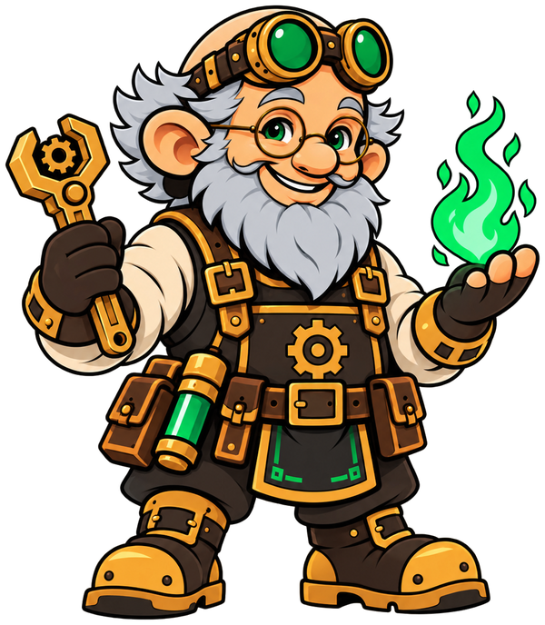
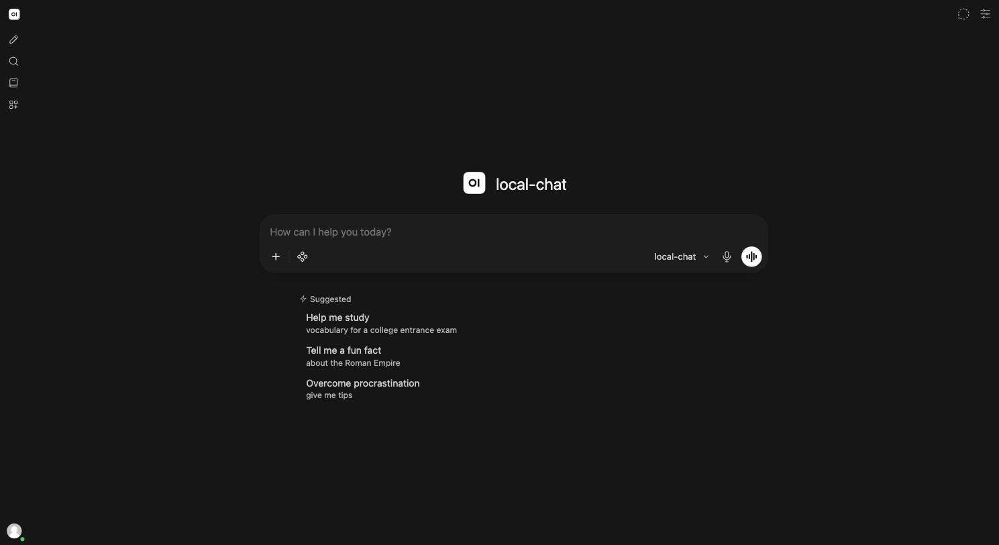
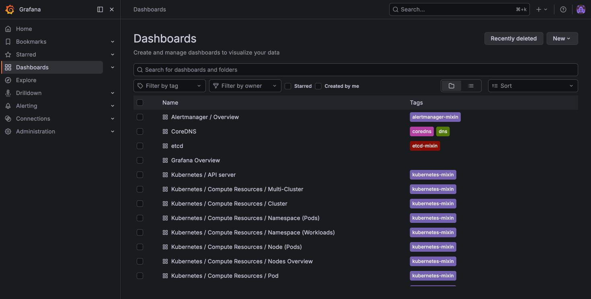
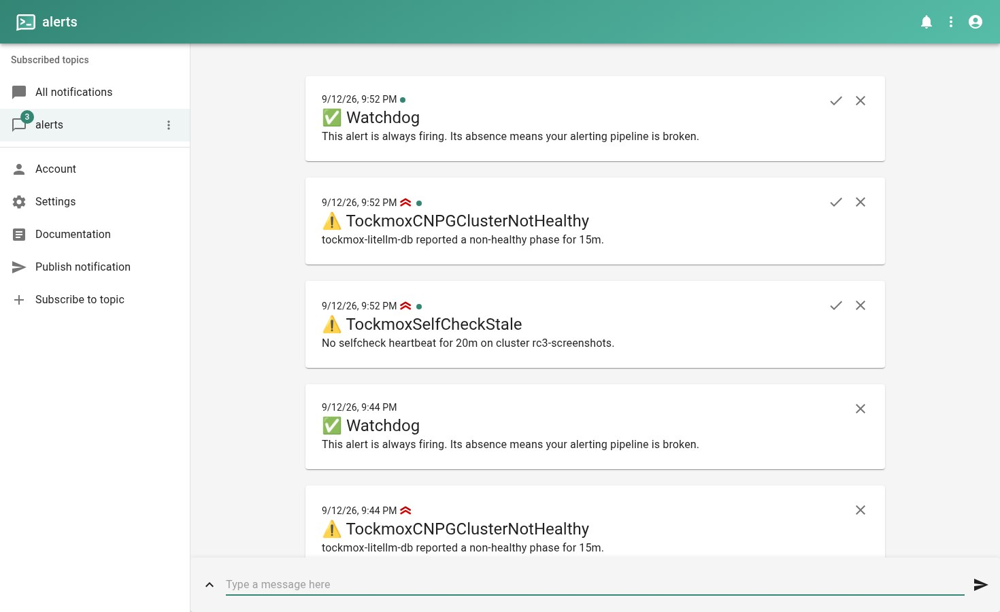

<div align="center">



# Tockmox

<em>Magic is just well-documented engineering.</em>

**A sovereign AI platform you actually own.**

Local first. Frontier by exception. Built from established infrastructure with identity, policy, observability, recovery and GitOps designed in.

[Get started](#get-started) ·
[Documentation](docs/) ·
[Why Tockmox?](docs/why-tockmox.md) ·
[Architecture](docs/architecture.md) ·
[Project status](docs/project-status.md)

[](https://github.com/tockmox/tockmox/actions/workflows/ci.yaml)
[](https://github.com/tockmox/tockmox/actions/workflows/executed-docs.yaml)
[](LICENSE)
[](LICENSE-docs)

[](https://github.com/tockmox/tockmox/releases)
[](https://scorecard.dev/viewer/?uri=github.com/tockmox/tockmox)

</div>

<!-- EARLY-ADOPTER BLOCK ... remove at 1.0. Nothing outside it depends on it. -->

> [!IMPORTANT]
> Tockmox is pre-1.0. It is running in the maintainer's production homelab, but it remains a one-maintainer project with a deliberately limited support model. Read [project status](docs/project-status.md) and [support](SUPPORT.md) before depending on it for something that must not break.

<!-- END EARLY-ADOPTER BLOCK -->

## In 30 seconds

Tockmox is an opinionated Kubernetes platform for running AI infrastructure on hardware you control.

It gives you private chat and model routing surrounded by the infrastructure that usually becomes a second project: single sign-on, storage, certificates, observability, alerting, backup and restore paths, network policy, admission guardrails and GitOps.

Your models can be local, hosted, or both. Tockmox makes reaching a hosted model an explicit routing decision rather than the default.

![Tockmox at a glance. A solid boundary marks your hardware and your control. Inside it, your browser reaches private chat (Open WebUI), which sends every request through the model gateway (LiteLLM) to local models. Around the AI plane sit the platform capabilities: identity (Authentik), policy (network policy and admission guardrails), storage (Longhorn), observability (Grafana and its stack) and recovery (backups), all on Kubernetes reconciled by GitOps. Outside the boundary, drawn dashed, frontier models are reachable over HTTPS only through the gateway and only as an explicit choice. The boundary describes ownership, not an air-gap guarantee.](docs/diagrams/rendered/platform-overview.svg)

### Tockmox is probably a good fit if

- you already operate Kubernetes, or are comfortable learning its operational model;
- you want your AI data, consoles and supporting infrastructure under your control;
- you prefer GitOps and declared configuration to hand-managed servers;
- you want to choose when a request stays local and when it reaches a frontier model;
- you would rather use an integrated platform than assemble identity, monitoring, storage, policy and recovery yourself.

### It is probably not a good fit if

- you want a one-click desktop AI application;
- you do not want to operate infrastructure;
- you need a bundled model or turnkey GPU appliance;
- you need a commercial 24×7 support organization or SLA;
- Kubernetes and GitOps are costs you specifically want to avoid.

Still deciding? Read [Why Tockmox?](docs/why-tockmox.md).

## What you get

| Area | What Tockmox provides |
|---|---|
| AI | Private chat and a model gateway for local and hosted models |
| Identity | Single sign-on for the consoles wired to Authentik, with local break-glass access retained |
| Observability | Metrics, logs, dashboards and alerts that can reach your phone |
| Platform | Storage, databases, ingress, certificates, load balancing and node patching |
| Policy | Default-deny ingress for Tockmox namespaces, additional AI-plane egress containment, RBAC and admission guardrails |
| DevOps | Optional workflows behind SSO |
| Recovery | Documented backup paths and scheduled restore proof for the model-gateway database |
| Self-check | A heartbeat that proves the monitoring and alert path is alive |

The exact boundaries matter. Tockmox deliberately distinguishes between what is configured, what has been tested, and what has not yet been proven.

[See the complete capability and limitation inventory →](docs/usage/what-you-get.md)

## See it

<table> <tr> <td align="center" width="33%"> <a href="docs/assets/getting-started/chat-home.jpg"></a> <br><strong>Private chat behind your SSO</strong> </td> <td align="center" width="33%"> <a href="docs/assets/getting-started/grafana-dashboards.jpg"></a> <br><strong>Dashboards on arrival</strong> </td> <td align="center" width="33%"> <a href="docs/assets/monitoring/ntfy-alert-delivered.jpg"></a> <br><strong>Alerts that reach a human</strong> </td> </tr> </table>

<!-- Replace this gallery with one strong Tockmox UI hero screenshot when the UI leaves experimental. -->

## How it works

Tockmox is delivered as Helm charts and reconciled by Argo CD.

The product and your configuration live in different repositories. Tockmox supplies the charts; your site repository supplies your values, sealed secrets and applications. Argo CD composes them at sync time.

That separation is intentional: upgrading Tockmox does not overwrite files you own.

Nine layers build the platform in dependency order:

crds → policy → platform → observability + exporters → identity → devops + ai + selfcheck

[Architecture →](docs/architecture.md)

<a id="get-started"></a>
<a id="quickstart"></a>

## Get started

### Before you start

You need:

- a Kubernetes cluster;
- Argo CD 2.6 or newer;
- sealed-secrets with your own key;
- an internal DNS zone;
- an address range for load balancing;
- a model endpoint the cluster can reach when you are ready to chat.

You do not need to preinstall cert-manager, MetalLB, ingress or storage. Tockmox supplies those.

No cluster yet? Start with [Prepare a fresh cluster](docs/deployment/fresh-install.md).

Already have Kubernetes? Start with [Prerequisites](docs/deployment/prerequisites.md) and follow the [existing-cluster path](docs/deployment/existing-cluster.md).

### Generate your site repository

```bash
git clone https://github.com/tockmox/tockmox.git
cd tockmox

./install/tockmox-install.sh
```

For a repeatable non-interactive install:

```bash
cp install/tockmox.yaml.example tockmox.yaml
$EDITOR tockmox.yaml
./install/tockmox-install.sh --config tockmox.yaml
```

To inspect what the installer would do without changing anything:

```bash
./install/tockmox-install.sh --config tockmox.yaml --dry-run
```

> [!NOTE]
> The installer generates your site repository; it does not apply Tockmox to your cluster. You still publish that repository, create the required credentials and bootstrap the Argo CD Applications.

Continue with the [full installation walkthrough →](docs/deployment/install.md).

### How long?

A scripted greenfield test on 2026-10-06 reached its first chat reply 11m22s after starting from an empty cluster and 15m02s after VM creation.

That is one automated run, not an estimate for a person following the documentation. The model host already existed and reading time was not included.

The [installation guide](docs/deployment/install.md) carries the evidence and qualifications.

## Your model, your decision

Tockmox does not choose a model for you.

The chat console is routed through the bundled model gateway, which starts with an empty model list. Point it at:

- an OpenAI-compatible model running on your own hardware;
- a hosted model provider;
- or both.

A request routed to a hosted provider takes its conversation outside your network. Tockmox makes that boundary explicit.

![The AI request path. Inside your network and your cluster, the browser reaches the chat console through ingress and single sign-on. The console holds only a scoped key and cannot reach a model host or the internet directly, so every request goes through the model gateway, which holds the provider credentials and whose model list ships empty. From the gateway: an optional in-cluster Ollama, off by default; a model host on your network, reachable once you add an egress entry for it; or, crossing the boundary on HTTPS port 443, a frontier provider, only if you add one to the model list. Local inference does not by itself make an installation air-gapped.](docs/diagrams/rendered/ai-request-path.svg)

[Configure the AI plane →](docs/usage/ai-plane.md)

## What happens after installation?

**First hour:** trust your CA, bootstrap identity, create your user and send your first message.

[Sign in for the first time →](docs/usage/getting-started.md)

**Operate it:** monitoring, routine maintenance, troubleshooting, backup/restore and recovery.

[Operations →](docs/operations/)

**Change it:** configuration, identity, storage, capabilities, integrations and your own applications.

[Administration →](docs/administration/)

**Upgrade it:** pin releases, read the changelog and follow the tested upgrade procedure.

[Upgrade Tockmox →](docs/deployment/upgrade.md)

## Not sure whether to try it?

You can also hand the repository to an AI you already use:

```text
Read AGENTS.md and docs/why-tockmox.md in https://github.com/tockmox/tockmox,
then tell me whether Tockmox fits my situation, including the reasons it might
not. Ask me only for what you need and don't already know.
```

Tockmox ships no agent and requires none. If your agent uses a hosted model, anything you provide to it may leave your network.

[Working with a coding agent →](docs/usage/working-with-an-agent.md)

## Documentation

| If you want to… | Go to |
|---|---|
| Decide whether Tockmox fits | [Why Tockmox?](docs/why-tockmox.md) |
| Understand the design | [Architecture](docs/architecture.md) |
| Install it | [Deployment](docs/deployment/) |
| Use it | [Using Tockmox](docs/usage/) |
| Configure or extend it | [Administration](docs/administration/) |
| Operate or repair it | [Operations](docs/operations/) |
| Understand what is proven today | [Project status](docs/project-status.md) |
| Browse everything | [Documentation index](docs/README.md) |

## Project and community

Tockmox is maintained on a best-effort basis with no SLA.

Questions belong in [Discussions](https://github.com/tockmox/tockmox/discussions). Bugs and configuration gaps belong in [Issues](https://github.com/tockmox/tockmox/issues). Security vulnerabilities do not belong in a public issue; follow [SECURITY.md](SECURITY.md).

See [CONTRIBUTING.md](CONTRIBUTING.md), [SUPPORT.md](SUPPORT.md), [GOVERNANCE.md](GOVERNANCE.md) and [ROADMAP.md](ROADMAP.md).

## License

Code is Apache-2.0. Documentation is CC BY 4.0.

See [LICENSE](LICENSE), [LICENSE-docs](LICENSE-docs), [NOTICE](NOTICE), [third-party licenses](docs/third-party-licenses.md) and [TRADEMARKS.md](TRADEMARKS.md).

Curious why a gnome mage runs an AI platform? There's a [story behind the name](docs/about.md#why-the-name).
