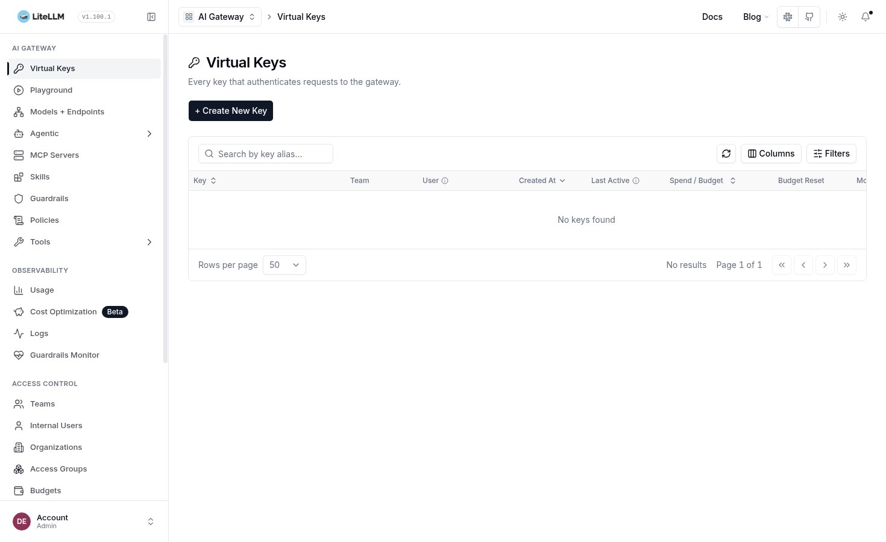

<!-- tockmox:banner:begin -->
<div align="center">


<em>Magic is just well-documented engineering</em>

</div>

---
<!-- tockmox:banner:end -->

# tockmox-ai

**Sync wave 5** · Implemented

The local AI plane.

Contains: Open WebUI (with its Redis), reachable at `chat.<internalDomain>`,
pointed at a model host you run. No cloud backend by default, enforced in CI.

Also contains, OFF by default: the LiteLLM model gateway at
`llm.<internalDomain>`, backed by a CloudNativePG `Cluster` this chart renders.
It ships off because it needs two things only your site can supply ... a master
key Secret you create and a model list naming hosts on your network. Turn it on
with `apps.litellm.enabled`. Planned: a RAG index.

Deliberately thin and independently adoptable ... someone who wants a local AI
plane and already has a platform should be able to take this layer alone. See
[the AI plane](../../docs/usage/ai-plane.md).




## Values

Globals are documented once in
[docs/administration/configuration.md](../../docs/administration/configuration.md).
This chart's own values are in `values.yaml`, and `values.schema.json`
rejects bad input at lint and at sync.

## Installing on its own

Every layer is an independent Argo Application, so you can take this one alone:

```bash
# once per clone: register chart repos and fetch dependencies
./tools/helm-deps.sh

helm template t charts/tockmox-ai \
  -f your-site/site/values/global.yaml \
  -f your-site/site/values/ai.yaml
```
