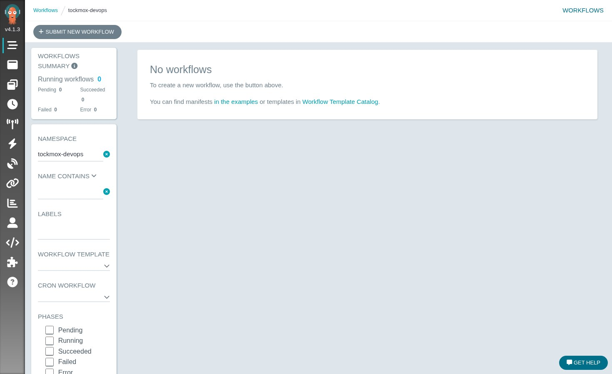

<!-- tockmox:banner:begin -->
<div align="center">


<em>Magic is just well-documented engineering</em>

</div>

---
<!-- tockmox:banner:end -->

# tockmox-devops

**Sync wave 5** · Implemented

Container registry and workflows.

Contains: Argo Workflows (`workflows.<internalDomain>`). Planned: a git forge
and object storage (planned).

No registry ships here as of 0.1.0. A registry is a prerequisite rather than a
component ... see `docs/deployment/registry.md`.

Both ship enabled. This namespace is guarded by `apps.devops_netpol` in
`tockmox-policy`, on by default: default-deny ingress plus the intra-namespace
mesh, Traefik, and Prometheus.




## The pull-through proxy cache


## Values

Globals are documented once in
[docs/administration/configuration.md](../../docs/administration/configuration.md).
This chart's own values are in `values.yaml`, and `values.schema.json`
rejects bad input at lint and at sync.

## Installing on its own

Every layer is an independent Argo Application, so you can take this one alone:

```bash
# once per clone: register chart repos and fetch dependencies
./tools/helm-deps.sh

helm template t charts/tockmox-devops \
  -f your-site/site/values/global.yaml \
  -f your-site/site/values/devops.yaml
```
