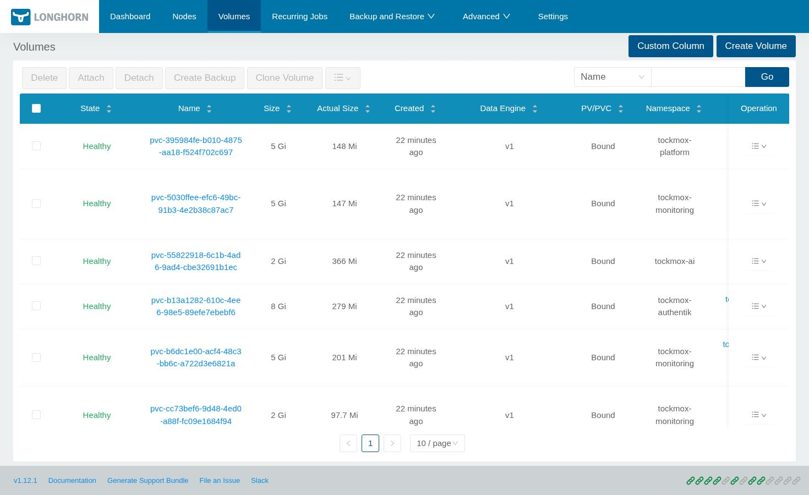

<!-- tockmox:banner:begin -->
<div align="center">


<em>Magic is just well-documented engineering</em>

</div>

---
<!-- tockmox:banner:end -->

# tockmox-platform

**Sync wave 2** · Implemented

Storage, networking, ingress, certificates, node lifecycle, database operators.

Contains: cert-manager (and the chart's own CA, `tockmox-ca`), MetalLB (and the
address pool built from your range), Traefik, Longhorn, the CloudNativePG operator
and its Barman Cloud plugin, kured, the CSI snapshot controller, and a Garage
object store. Each upstream chart sits behind an `apps.<name>.enabled` switch in
`values.yaml`. One more switch, off by default, adds a replica floor and a
disruption budget on the distribution's CoreDNS: `apps.corednsHa`, see
[the DNS section of sizing](../../docs/deployment/sizing.md#dns-in-the-ha-tier). It does
not contain kube-vip (the API endpoint is yours to supply, see
[the API endpoint](../../docs/administration/api-endpoint.md)), and it never
renders or replaces the distribution's CoreDNS Deployment. The brand asset
service is in the identity layer.



## Values

Globals are documented once in
[docs/administration/configuration.md](../../docs/administration/configuration.md).
This chart's own values are in `values.yaml`, and `values.schema.json`
rejects bad input at lint and at sync.

## Installing on its own

Every layer is an independent Argo Application, so you can take this one alone:

```bash
# once per clone: register chart repos and fetch dependencies
./tools/helm-deps.sh

helm template t charts/tockmox-platform \
  -f your-site/site/values/global.yaml \
  -f your-site/site/values/platform.yaml
```
