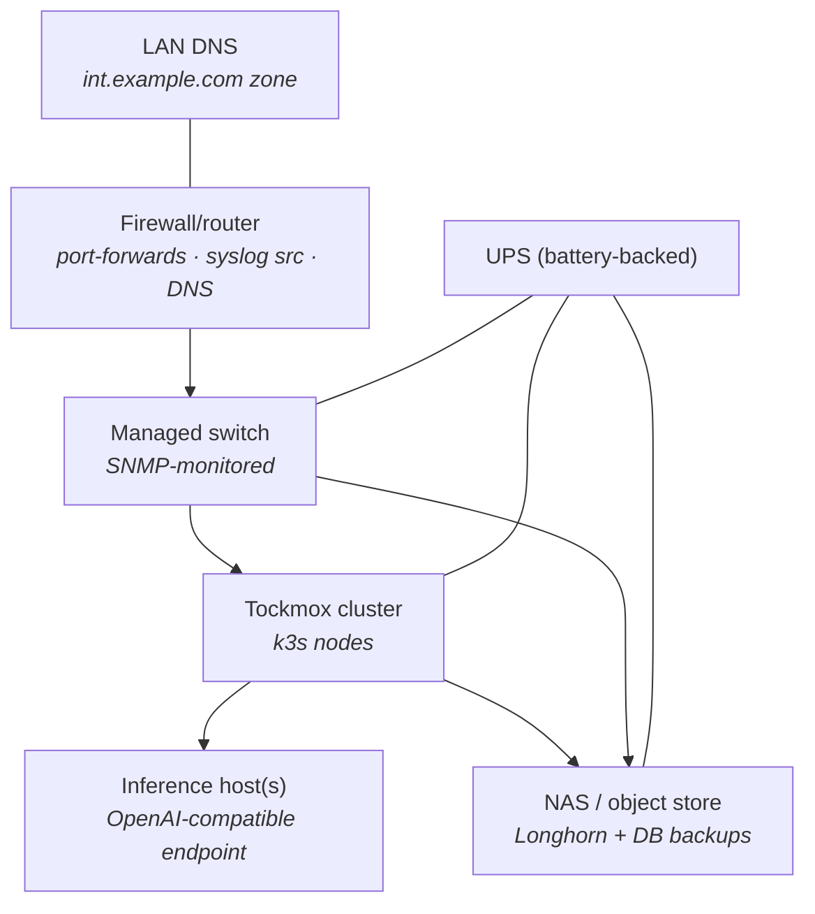

# External integrations

**This is a reference page, not a walkthrough.** A working Tockmox deployment
leans on equipment Kubernetes cannot see: a firewall, a switch, storage, power,
DNS, a registry, and (for the AI plane) an inference host. Each section below
is independent. Find your row in the table, read that section, ignore the rest.

Configuration is shown as it comes from the reference site, sanitized to
`int.example.com` and RFC1918 addresses. Where the integration point is a
Tockmox value it is shown exactly; where it is vendor UI, the shape is
described and any capable device fits.

## Which integration do you need

| Integration | Required? | What it costs you if you skip it |
|---|---|---|
| [DNS](#dns-reference-unbound-on-the-firewall) | **Required** | Nothing resolves and SSO fails at first login. This is the one that is not optional |
| [Firewall or router](#firewall-or-router-reference-opnsense) | Conditional | Only needed when clients sit on a different network than the cluster |
| [Managed switch](#managed-switch-reference-a-netgear-m4350-class-10g-switch) | Optional | No port utilisation, error counters or link state in Prometheus |
| [Storage or NAS](#storage-or-nas-reference-a-synology-raid-nas) | Strongly recommended | Longhorn backups and database backups stay on the cluster they are protecting |
| [Power](#power-ups) | Strongly recommended | A node that vanishes mid-write during a kured reboot or a Longhorn replica rebuild |
| [Inference host](#inference-host-reference-apple-silicon-macs-on-the-lan) | Conditional | Only needed if the AI plane points off-cluster. Open WebUI otherwise runs with no model behind it |
| [Container registry](#container-registry-the-pull-through-proxy-cache) | Optional when connected, **required** air-gapped | Every node pulls every layer from the internet, every time |
| [Policy bundles](#policy-bundles-for-workloads-tockmox-does-not-ship) | Optional | Workloads you installed yourself sit in namespaces with no NetworkPolicy |

**Tockmox does not ship a registry.** It stopped in 0.1.0, and a registry is a
prerequisite rather than a component. The reasoning, the licence argument
behind it, and the decision table for what to run instead are in
[registry](../deployment/registry.md). The Harbor procedures on this page are
for a Harbor **you** run, which is now the only kind there is.

## DNS (reference: Unbound on the firewall)

**Required.** One internal zone serves everything, and the default is **one
wildcard record**: `*.int.example.com` pointing at Traefik's LoadBalancer IP.
Per-host records are the alternative, for a resolver that cannot hold a wildcard
or a zone that must not answer for names nobody created.

**YOU SUPPLY:** the zone name, and the LoadBalancer IP. The zone is the
`global.internalDomain` you chose in
[fresh install § decide the four values](../deployment/fresh-install.md#8-decide-the-four-values).
The address comes from the MetalLB pool you reserved, and
`kubectl -n tockmox-platform get svc -l app.kubernetes.io/name=traefik` prints
the one Traefik actually took.

**The default, one record:**

```
*.int.example.com   A 192.168.1.240
```

On Unbound (OPNsense: Services, Unbound DNS, Host Overrides) a wildcard is a
host override with `*` as the host. Every console, and every app you add later,
resolves the day it ships, with no DNS change.

**A wildcard makes a whole class of mistake impossible**, and the class is real:
on the 0.5.0 clean-install test every console record shipped except `llm`, and
`TockmoxConsoleUnreachable` fired for precisely that hostname within ten
minutes. That is a dated observation from one install, not a general
measurement.

**The alternative, one record per hostname.** Every console needs its own line,
and each app you add needs another before it resolves:

```
grafana.int.example.com   A 192.168.1.240
chat.int.example.com      A 192.168.1.240
auth.int.example.com      A 192.168.1.240
workflows.int.example.com A 192.168.1.240
llm.int.example.com       A 192.168.1.240   # model-gateway console
ntfy.int.example.com      A 192.168.1.240   # alert topic, phones subscribe here
news.int.example.com      A 192.168.1.240   # your own apps join the zone
```

The full hostname list is
[configuration § hostnames and TLS](configuration.md#hostnames-and-tls).

**The names must resolve from workstations AND from inside the cluster.** The
OIDC code exchange and the discovery fetches are server-side, so a workstation
`/etc/hosts` entry is not enough. LAN DNS satisfies both, because CoreDNS
forwards unknown zones upstream. The full failure shape is in
[identity § DNS](identity.md#dns-one-requirement-worth-knowing).

**Success condition:** a random label under the zone resolves to Traefik's
address from the workstation and from a pod. A random label is the test because
no per-host record can satisfy it: it proves the wildcard, not one name that
happens to exist. The check is the one
[install § point DNS at Traefik's address](../deployment/install.md#point-dns-at-traefiks-address)
runs; if you chose per-host records, it fails by design, and
`dig +short grafana.int.example.com` plus the same lookup from a pod is the
check for each name instead.

## Firewall or router (reference: OPNsense)

Three jobs, only the first of which is conditional on your topology.

### Port-forwards for the way in ... Conditional

**If** your clients sit on a different network than the cluster, forward TCP
80/443 on the firewall to Traefik's LoadBalancer IP. If clients and cluster
share a LAN, skip this: they reach the address directly.

**One sharp edge, and it costs an hour to find.** On OPNsense a WAN pass rule
carries an implicit `reply-to` that forces return traffic out the upstream
gateway. When your clients are on the "WAN" side of an *internal* segment,
**disable reply-to** on the associated rule or connections hang ... they do not
refuse, they hang, which reads as a slow application rather than a routing
fault.

**Success condition:** a browser on the client network loads
`https://grafana.int.example.com` and gets the login page, not a timeout.

### Syslog into observability ... Optional

Devices ... the firewall itself, the switch, a NAS ... forward syslog to an
ingest receiver on TCP/UDP **1514** at a LoadBalancer IP from your pool. 1514
rather than 514 because the collector runs non-root and cannot bind a
privileged port.

**Tockmox does not ship that receiver.** What ships is the NetworkPolicy that
admits your device network to it, `apps.syslog_ingest_netpol`, off by default.
Order matters:

1. Deploy a second Alloy release named `syslog-ingest` in the monitoring
   namespace, with a syslog receiver on 1514. Tockmox ships one Alloy, and it
   is the log collector.
2. Then set `apps.syslog_ingest_netpol.enabled: true` in
   `site/values/policy.yaml`.
3. Then point devices at the address.

Pointing devices at 1514 before step 1 sends packets nothing is listening for,
and the silence is indistinguishable from a policy problem.

**Success condition:** a Loki query for whatever job label **your**
`syslog-ingest` release stamps returns lines from the device, within a minute
of it logging anything. Tockmox does not define that label, because Tockmox
does not ship the receiver ... you choose it when you author the second Alloy
release, and `kubectl -n tockmox-monitoring get svc` should show its 1514
Service holding an address from your pool before you go looking in Loki.

### DNS, often the same box

See [DNS](#dns-reference-unbound-on-the-firewall) above.

## Managed switch (reference: a NETGEAR M4350-class 10G switch)

**Optional.** The exporters layer ships `prometheus-snmp-exporter` as a
subchart. What you get: port utilisation, error counters and link state in
Prometheus. What you lose by skipping it: no visibility into the network under
the cluster, which is where an intermittent Longhorn replica fault usually
turns out to live.

**Two edits, and the first one is the one people miss.** The SNMP exporter sits
under the `hardwareTelemetry` capability, which **ships off** ... the reference
deployment is a virtual machine with no switch to poll. Setting the scrape
target without turning the capability on configures an exporter that never
deploys.

```yaml
# site/values/global.yaml ... turn the capability on FIRST
capabilities:
  hardwareTelemetry:
    enabled: true
```

```yaml
# site/values/exporters.yaml ... then point it at the device
prometheus-snmp-exporter:
  serviceMonitor:
    enabled: true
    params:
      - name: switch
        target: 192.168.1.2          # YOU SUPPLY: the switch's management IP
        module: [if_mib]
        auth: [public_v2]
```

**YOU SUPPLY:** the management IP, and SNMP enabled on the device (v2c
community or v3). `if_mib` is the standard module and fits any switch that
answers the interface MIB.

Setting `apps.snmp.enabled: true` on its own does **not** work: the coherence
preflight refuses to render a component switched on under a capability that is
off, and the error names the capability. See
[capabilities](capabilities.md).

**Success condition:**

```bash
kubectl -n tockmox-monitoring get pods -l app.kubernetes.io/name=prometheus-snmp-exporter
```

A pod exists and is `Running`. Then, in Grafana, `ifHCInOctets` returns series
labelled with your switch's target. The pod running and the series being empty
are different failures: the first is the capability, the second is SNMP on the
device.

The reference site pairs this with a per-switch dashboard shipped as a
ConfigMap labelled `grafana_dashboard: "1"`, which is the documented dashboard
extension point.

## Storage or NAS (reference: a Synology RAID NAS)

**Strongly recommended.** Three distinct roles; choose per need rather than
doing all three.

| Role | What you point at it | Why it is off-cluster |
|---|---|---|
| **Longhorn backup target** | An NFS export, as a Longhorn `Setting` or through its UI: `nfs://192.168.1.10:/volume1/longhorn-backup` | Volume backups stored on the cluster they protect are not backups. NFS is first-class in Longhorn; the NAS's own RAID and offsite job carry it from there |
| **S3 endpoint for database backups** | The `ObjectStore` CRs of [backup and restore](../operations/backup-restore.md), if the NAS speaks S3 (MinIO or Garage on it). Same CR, different `endpointURL` | Replaces the in-cluster demo Garage, which shares the failure domain of what it is backing up |
| **General NFS storage class** | Bulk media your own apps consume, through any NFS CSI provisioner alongside Longhorn | Keeps large sequential data off replicated block storage. **Keep databases on block storage** |

Why replication belongs at exactly one layer, and what one copy of a backup
actually covers, are in
[storage § the principle](storage.md#the-principle-replicate-at-exactly-one-layer)
and
[storage § the shipped object store](storage.md#the-shipped-object-store-and-what-one-copy-covers).

**Success condition** for the backup target: run a manual Longhorn backup of
one volume and see it appear as a file on the NAS. A configured target that has
never been written to is a setting, not a backup path.

## Power (UPS)

**Strongly recommended, and unglamorous.** The reference build runs the cluster
and the network gear on dual battery-backed UPS units. kured's reboot
orchestration and Longhorn's replica rebuilds both assume nodes do not vanish
mid-write; a node that loses power during a rebuild is the case those
mechanisms are weakest against.

**Minimum:** enough runtime for a clean shutdown of every node.

If the UPS is network-manageable its metrics join observability over SNMP
exactly like the switch ... same capability, same two edits ... and its syslog
joins the 1514 receiver.

## Inference host (reference: Apple-silicon Macs on the LAN)

**Conditional. If** you want the AI plane to use a model server you already
run, do this. Otherwise skip it: Tockmox can run models in-cluster, or the
plane can stay unset while you evaluate everything else.

The AI plane deliberately separates serving from the cluster, so models run on
hardware suited to them, and Open WebUI points at any OpenAI-compatible
endpoint.

**YOU SUPPLY:** the endpoint URL, as a model in the gateway's list. Since
0.8.0 the console goes through the model gateway by default (TM-0460), so the
host is named once, in the gateway, and the console needs no change:

```yaml
# site/values/ai.yaml
litellm:
  proxy_config:
    model_list:
      - model_name: local-chat                       # what the console shows
        litellm_params:
          model: openai/<model-id-the-host-serves>
          api_base: http://192.168.1.20:8080/v1      # YOU SUPPLY
```

A host on the LAN also needs an `aiEgress.litellm.extraEgress` entry in
`site/values/policy.yaml` (the policy layer reads it; `ai.yaml` does not reach
it), because the gateway's egress excludes the LAN by default:

```yaml
# site/values/policy.yaml
aiEgress:
  litellm:
    extraEgress:
      - to: [{ipBlock: {cidr: 192.168.1.20/32}}]
        ports: [{protocol: TCP, port: 8080}]
```

The entry is a NetworkPolicy egress rule as the API server takes it, not the
`{cidr, ports}` shape `providerAllow` uses; the render refuses the wrong one.
If the host wants a key,
`api_key: os.environ/<NAME>` reads it from the gateway pod's environment. Both
are in [the AI plane](../usage/ai-plane.md). Pointing the console at the host
directly instead (`open-webui.openaiBaseApiUrl`) is supported and re-opens
REQ-0004 AC-4.1 on your site; the same page says what that costs and how.

**Set the endpoint through values, not through `open-webui.extraEnvVars`.**
The upstream chart renders `OPENAI_API_BASE_URL` and `OPENAI_API_KEY` from its
own values, so naming either in `extraEnvVars` puts the key in the pod spec
twice ... which passes `helm template` and `helm lint`, then fails ArgoCD's
`ServerSideApply` with "duplicate entries".

**Secure the host side with a host-firewall allowlist** admitting only the
cluster's egress addresses: the node IPs, or the NAT address if the cluster
sits behind a router. The reference site manages this as configuration rather
than by hand. An unauthenticated model endpoint plus a host allowlist is a
deliberate trade: the models hold no data, and the allowlist bounds who can
burn your GPU cycles.

**Success condition:** Open WebUI's model picker lists models from the host. An
empty picker with the pod `Running` is the endpoint, not the chart.

## Container registry: the pull-through proxy cache

**Optional, and it is a performance decision rather than a correctness one.**
What you get: the cluster fetches each image layer once from the internet, and
serves every later pull, on every node, from local disk. Worth having on a
metered link, behind a rate-limited upstream, or on any cluster you rebuild
more than once. What you lose by skipping it: nothing works differently, you
just pull from upstream every time.

**A cache is not an air gap, and the difference decides whether a disconnected
install works at all.** The comparison, and the reason a node-side mirror
covers images that `global.imageRegistry` cannot reach, are in
[registry § a cache is not a mirror](../deployment/registry.md#a-cache-is-not-a-mirror-and-only-one-of-them-survives-a-cut-uplink).
For a genuinely disconnected install, go to
[install with no internet access](../deployment/airgap.md) instead of this
section.

### Before you begin

| What you need | Why | How to check |
|---|---|---|
| A Harbor you run, reachable from every node | Tockmox ships no registry; [registry § running Harbor alongside Tockmox](../deployment/registry.md#running-harbor-alongside-tockmox) has the chart and a reference values file | `curl -sSf https://harbor.int.example.com/api/v2.0/systeminfo` returns JSON |
| Harbor admin credentials | Steps 1 and 2 are Harbor UI, not Helm | You can reach **Administration** in its UI |
| Root or sudo on every node, and the ability to restart k3s | Step 3 edits a node file and needs a restart to take | `sudo -n true` on each |
| Node trust for Harbor's CA, if its certificate is internally issued | The pull fails at TLS before Harbor ever sees it | [TLS and trust](tls-and-trust.md) |

**The chart ships the registry, not the cache.** Harbor models a proxy cache as
a project bound to a registry endpoint, and both are rows in Harbor's own
database, created through its API after the pods are running. The upstream Helm
chart exposes no values for either, and Tockmox does not ship a Job that writes
to an application's API on every sync. So all three steps below are yours, and
**until all three are done nothing is cached** ... not partially, not for some
images. Pulls go straight upstream exactly as before, because nothing has told
containerd otherwise.

### 1. Create a registry endpoint per upstream

**Required.** In Harbor: **Administration → Registries → New Endpoint**.

Four endpoints cover every image in `images.txt` (verified against the 0.6.0
tree: its 44 entries resolve to exactly these four hosts):

| Provider | Endpoint URL |
|---|---|
| Docker Hub | `https://hub.docker.com` |
| Docker Registry | `https://ghcr.io` |
| Docker Registry | `https://quay.io` |
| Docker Registry | `https://registry.k8s.io` |

Give the Docker Hub endpoint an access token if you have one. Anonymous works
and is rate-limited, which is one of the problems the cache is solving.

**Success condition:** each endpoint shows **Healthy** in Harbor's registry
list. Harbor tests reachability when you save it, so an unhealthy row here is a
network or credential fault, not a later surprise.

### 2. Create a proxy-cache project per endpoint

**Required.** **Projects → New Project**, tick **Proxy Cache**, select the
endpoint.

Name the project after the upstream (`dockerhub`, `ghcr`, `quay`, `k8s`). The
name becomes a path segment, so `docker.io/library/postgres:17.10-bookworm` is
pulled as
`harbor.int.example.com/dockerhub/library/postgres:17.10-bookworm`.

Make the project **public** if you want nodes to pull without credentials.
Private works too and needs a robot account in step 3.

**Success condition:** four projects exist, each showing its bound endpoint and
the **Proxy Cache** badge. A project without that badge is an ordinary project
and will never fetch anything.

### 3. Point containerd at Harbor, on every node

**Required, and this is the step that actually redirects a pull.** Nothing
above changes a single pull by itself. On k3s, edit
`/etc/rancher/k3s/registries.yaml` on **every node**:

```yaml
mirrors:
  docker.io:
    endpoint: ["https://harbor.int.example.com"]
    rewrite:
      "(.*)": "dockerhub/$1"
  ghcr.io:
    endpoint: ["https://harbor.int.example.com"]
    rewrite:
      "(.*)": "ghcr/$1"
  quay.io:
    endpoint: ["https://harbor.int.example.com"]
    rewrite:
      "(.*)": "quay/$1"
  registry.k8s.io:
    endpoint: ["https://harbor.int.example.com"]
    rewrite:
      "(.*)": "k8s/$1"

# Only if the proxy-cache projects are private:
configs:
  "harbor.int.example.com":
    auth:
      username: 'robot$mirror'
      password: "YOUR_ROBOT_TOKEN"
```

**YOU SUPPLY:** your Harbor hostname in place of `harbor.int.example.com`, and
the robot token from **Projects → your project → Robot Accounts** if the
projects are private.

**`rewrite` is the part people miss.** The endpoint is Harbor's host; the
rewrite prepends the proxy-cache project name. Without it, pulls reach Harbor
and ask for a repository that is not there.

Then restart k3s on every node. On an agent node the unit is named `k3s-agent`
rather than `k3s`, so substitute that name there:

```bash
sudo systemctl restart k3s
```

**Success condition ... assert on the artifact, not the config.** Pull an image
this cluster has never pulled, then look for it under the proxy-cache project
in Harbor's UI. Run this on every node, or at least on the one you tested on:

```bash
sudo /usr/local/bin/k3s crictl pull docker.io/library/alpine:3.21
```

The image appears in Harbor's `dockerhub` project. **If it is not there,
containerd went straight to the upstream and nothing is wrong with Harbor** ...
the pull succeeding proves nothing at all, which is what makes this the only
check worth running.

Two consequences worth carrying forward: the first pull of anything still needs
the upstream reachable, and Harbor is now on the image-pull path for the whole
cluster including its own restart. Both are expanded in
[registry](../deployment/registry.md#the-pull-through-proxy-cache).

## Policy bundles for workloads Tockmox does not ship

Four NetworkPolicy bundles in `tockmox-policy` target namespaces that no
shipped workload lands in. They ship **off by default**: a NetworkPolicy whose
`podSelector` matches no pod is scaffolding rather than security, and it reads
as protection to anyone auditing the cluster. The principle is stated once, for
every off-by-default component, in
[architecture § deliberately not shipped, deliberately off](../architecture.md#deliberately-not-shipped-deliberately-off).

They are kept rather than deleted because each encodes reachability reasoning
that is tedious and error-prone to rederive, and because the reference site
runs all of them. That reasoning lives in the template comments.

| Flag | For | Namespace key |
|---|---|---|
| `apps.forgejo_netpol` | A Forgejo you installed yourself. Default-deny ingress, Traefik to 3000, git-SSH on 22 from any source (key auth is the real gate), optional Prometheus scrape | `namespaces.forgejo` |
| `apps.tailscale_netpol` | A Tailscale operator or subnet router you installed yourself. Ingress-only default-deny, so the tunnel data path and the advertised routes are untouched | `namespaces.tailscale` |
| `apps.syslog_ingest_netpol` | A second Alloy release named `syslog-ingest` on 1514, admitting `global.lanCIDR` and the pod CIDR | `namespaces.monitoring` |
| `apps.harbor_netpol` | A **standalone** Harbor you installed yourself, as its own release in its own namespace | `namespaces.harbor` |

### Enabling one

**Three edits, and the render refuses if you make only some of them.**

1. **Required.** Point the namespace key at where your workload actually runs.
2. **Conditional. If** you want Tockmox to create that namespace rather than
   adopting one you made, add the key to `namespaces.create`. The shipped list
   is eight entries; this adds a ninth.
3. **Required.** Set the flag.

```yaml
# site/values/policy.yaml
namespaces:
  create: [ai, monitoring, platform, authentik,
           diagnostic_identity, selfcheck, devops, node_agents, tailscale]
  tailscale: tailscale          # YOU SUPPLY: your workload's real namespace
apps:
  tailscale_netpol: { enabled: true }
```

**Success condition:**

```bash
kubectl -n tailscale get networkpolicy
kubectl -n tailscale get pods
```

Policies exist **and** the namespace holds pods. A namespace with policies and
no pods is the exact failure this whole section is about.

Enabling a bundle whose namespace name is blank fails the render with a message
naming the flag. That is deliberate: policies addressed to a namespace that
does not exist fail at sync time with an error that names neither.

### Harbor is the one to read twice

`apps.harbor_netpol` shipped enabled and never guarded the Harbor that used to
be in this repository. Harbor was a subchart of `tockmox-devops`; Helm installs
subchart resources into their release's namespace, and the installer points
that layer at `namespaces.devops`. So the four Harbor policies sat in
`tockmox-harbor`, which stayed empty, while Harbor itself ran in
`tockmox-devops` with no policy at all. That defect is one of the reasons the
registry was dropped rather than fixed ...
[registry § why it is a prerequisite](../deployment/registry.md#why-it-is-a-prerequisite-and-not-a-component).

The devops namespace is now guarded by **`apps.devops_netpol`, on by default**:
default-deny ingress, plus the intra-namespace mesh, plus the Traefik pod, plus
Prometheus. It is a separate bundle rather than the Harbor one repointed,
because Argo Workflows lives in that namespace and a Harbor-shaped allow set
would have taken the workflows UI and API down with it.

**Egress stays open in that namespace on purpose**, because the workflow
controller talks to the API server and to whatever artifact store you point it
at, and because anything you add beside it ... a registry, a scanner ... needs
to reach upstream. `policyTypes` omits `Egress` in every rule there.

`apps.harbor_netpol` remains, off, for a Harbor you install yourself somewhere
else. It no longer claims a shipped one. Its template refuses to render if
`namespaces.harbor` equals `namespaces.devops`, which would stack a second
default-deny on a namespace that already has one.

`tockmox-platform` and `tockmox-selfcheck` carry bundles of their own, new
since v0.5.0. Every namespace the policy layer creates is covered.

**`global.lanCIDR` is still required** with all four optional bundles off. Two
default-on rules need it: the diagnostic identity's egress to the Kubernetes
API, and the kube-prometheus-stack operator's admission webhook, which the API
server calls from a node address.

### Narrowing the default network rules

Three default-on rules are wider than their names read, and the policy layer
now has a key for each. In 0.7.x **all three defaulted to empty, which kept the
pre-0.7.0 behaviour**. Since 0.8.0 the first one is required: an empty
`nodeOriginSources` refuses to render rather than admitting the whole pod
network (TM-0798). The other two still default to the wider setting. Set them.

| Rule | Key | Empty | Set |
|---|---|---|---|
| Platform `allow-from-node-network` | `platformNetpol.nodeOriginSources` | **refuses to render** since 0.8.0 (until then: `lanCIDR` plus the whole `clusterCIDR` to every platform pod, every port) | `lanCIDR` plus exactly the listed node gateway addresses; no `clusterCIDR` block |
| Diagnostic identity, "the Kubernetes API" | `diagnosticIdentity.apiServerCIDRs` | the whole `serviceCIDR` and `lanCIDR` on 443 and 6443 | exactly those addresses on 443 and 6443 |
| Platform `allow-prometheus-scrape` | `platformNetpol.scrapePorts` | (already narrowed) the metrics ports the shipped monitors scrape | your list |

**Node-originated traffic (`nodeOriginSources`).** The kube-apiserver's webhook
calls, the kubelet reaching the CSI plugin and probing pods, and MetalLB with
`externalTrafficPolicy: Cluster` come from a node, not a pod. `global.lanCIDR`
covers the node addresses. What it does not cover is what a node-originated
packet carries when delivered to a pod on flannel, the k3s default: the node's
`cni0` gateway (the first address of that node's podCIDR) for a pod on the same
node, and its `flannel.1` address (the podCIDR's network address) across nodes.
Both sit inside `clusterCIDR`. Print the block for your cluster and review it:

```sh
./install/tockmox-install.sh --print-netpol-node-sources
```

```yaml
# site/values/policy.yaml ... one /31 per node (flannel.1 and cni0)
platformNetpol:
  nodeOriginSources:
    - 10.42.0.0/31   # node-a (podCIDR 10.42.0.0/24)
    - 10.42.1.0/31   # node-b (podCIDR 10.42.1.0/24)
```

The helper only prints. It never writes your site file. Before applying, confirm
one node with `ip -4 addr show cni0 flannel.1`: that the two addresses are the
podCIDR's `.1` and `.0` is inferred from how flannel numbers a subnet, not
measured here.

**The node-addition trap.** A node you add later has a gateway that is not in
the list. Nothing fails at once: pods on the new node cannot be reached by the
API server's webhooks, the kubelet's probes or the CSI plugin, and it presents
as an admission webhook timeout, a volume that will not attach, or a pod on
that node that never turns Ready, on that node only. Add the node's `/31` in
the same change that adds the node. The render refuses an entry equal to
`clusterCIDR` or `0.0.0.0/0`, which would restore the hole.

**A `lanCIDR` that contains the pod network defeats it.** The `lanCIDR` block is
always rendered. If `global.lanCIDR` is a supernet of `global.clusterCIDR`
(a `10.0.0.0/8` LAN against the k3s `10.42.0.0/16` pod range is the common
case), that one block admits every pod, and setting `nodeOriginSources` would
render as done while changing nothing. So the render refuses that combination,
with a message naming both values. Narrow `lanCIDR` to the node range. (Until
0.8.0 you could leave the list empty instead and keep the wide rule knowingly;
an empty list now refuses too.) The check compares the two
strings as IPv4 prefixes; it does not judge IPv6 or a value that is not
`a.b.c.d/n`, and it cannot know where your nodes really sit.

**What setting it changes for backups and monitoring.** The wide rule was also
what let Prometheus scrape and let databases write their backups to the object
store. Both now have their own rules: `allow-prometheus-scrape` is limited to
the metrics ports, and `allow-s3-from-backup-clients` admits the AI and identity
namespaces (plus `platformNetpol.extraS3ClientNamespaces`) to the object store's
S3 port 3900 only, never the admin port 3903. A new database that backs up to
the shipped object store needs its namespace on that list.

**The API endpoint (`apiServerCIDRs`).**

```sh
kubectl get endpoints kubernetes -o jsonpath='{range .subsets[*].addresses[*]}{.ip}{"/32\n"}{end}'
kubectl get svc kubernetes -o jsonpath='{.spec.clusterIP}/32{"\n"}'
```

The first prints the node address(es) the API is served from; the second the
Service address, which some CNIs match before translating it. List both. A
control-plane node you add later must be added.

**What this does not prove.** Every claim above is from rendered policy. That a
pod in another namespace is refused after `nodeOriginSources` is set, that a
certificate still issues, a volume still attaches and a LoadBalancer still
answers, are live measurements nobody has taken for this change; the adversarial
harness pins the first as `TOCKMOX_EXPECT_NODE_SOURCES=1` and is the way to take
it. Calico and Cilium source node traffic differently, and this list is
reasoned for flannel with the embedded policy controller only.

### The regression gate

`tools/check-no-ghost-policies.sh` runs in CI. It renders every layer into the
destination namespace the installer assigns it, with the optional applications
switched on, and fails if any namespace holding a NetworkPolicy holds no
workload. It carries no allowlist, deliberately.

## The dependency picture



**Text equivalent.** LAN DNS and the firewall/router sit together at the top;
the same box usually serves both. The firewall feeds the managed switch. The
switch feeds the Tockmox cluster and also the NAS or object store directly. The
cluster reaches out to the inference hosts for the AI plane, and to the NAS for
Longhorn and database backups. A battery-backed UPS underlies the cluster, the
switch and the storage ... all three, which is the point of drawing it.

## What is not certified here

Every value on this page was checked against the 0.6.0 tree on 2026-09-01:
the values keys exist and are spelled as shown, the four upstream hosts cover
all 44 entries in `images.txt`, and `hardwareTelemetry` does ship off.

**That is not a claim that any procedure here has been executed as written**,
and the vendor UI steps in particular describe a Harbor version this page does
not pin. Documented procedures are verified by running them, not by reviewing
them ... the [testing standard](../testing-standard.md) says which paths are
covered and which are not.

The dated observations on this page ... the `llm` record on the 0.5.0
clean-install test, and the OPNsense `reply-to` behaviour from the reference
site's build notes ... are single observations with a date, not measurements
that have been repeated.

<!-- tockmox:footer:begin -->

---

<sub>Tockmox v0.8.0 &middot; &copy; 2026 Tockmox LLC &middot; code Apache-2.0, docs CC BY 4.0 &middot; Tockmox is a trademark</sub>
<!-- tockmox:footer:end -->
