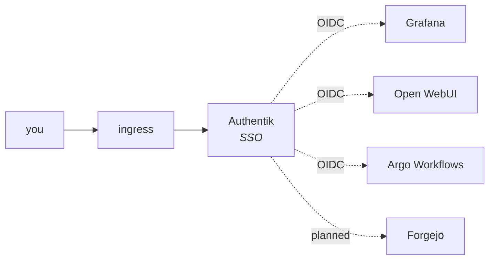

# Identity and access

**This is a reference page.** It states how single sign-on is wired, what you
administer day to day, and the two places where the behaviour surprises people.
The one procedure it touches ... restarting the consoles after an SSO change
... lives in [day-2](../operations/day-2.md) and is linked from here rather
than repeated.

## The shape

Single sign-on across the shipped consoles, backed by Authentik, with OIDC as
the protocol. The identity layer ships the wiring as blueprints; you supply the
client secrets (see [secrets](secrets.md)).



**Text equivalent.** You reach the ingress, which sends you to Authentik.
Authentik is the OIDC provider for three shipped consoles: Grafana, Open WebUI
and Argo Workflows. Forgejo is drawn as planned rather than wired ... Tockmox
does not ship Forgejo, and the policy layer's Forgejo bundle is for one you
installed yourself. ntfy has a tile on the portal too, but only as a link: it
has no OIDC, so Authentik signs nobody in to it
([below](#tiles-for-consoles-that-have-no-sso)).

## Two groups drive every role mapping

The blueprints create two Authentik groups. **Membership is the only thing you
manage**; each app maps the groups itself.

| Group | Grafana | Open WebUI | Argo Workflows |
|---|---|---|---|
| `tockmox-admins` | Admin | admin | `tockmox-argo-admin` ServiceAccount (full workflow control) |
| `tockmox-users` | Viewer | user | `tockmox-argo-viewer` ServiceAccount (read-only) |

**A login in neither group is refused by Authentik, before any console sees
it.** Every shipped application carries a policy binding to the group(s) named
by `sso.apps.<app>.access` in the identity layer's values (`users`, the shipped
default for all three: the user group and the admin group; or `admin`: the
admin group alone). Set a console to `admin` to hide it from users entirely.
The same `access` key sets who sees the link-only tiles under `sso.links`.
Changing it later works in both directions. Before 0.8.1, moving a console from
`users` to `admin` left the user-group binding an earlier sync had created, so
users kept access until someone deleted that binding by hand; 0.8.1 removes it
on the next sync.
Authentik then shows the application only to members and refuses the
authorization for anyone else ... the console never receives the login. The
role table above is what the consoles do *after* Authentik has let a member
through.

Until 2026-09-08 no binding existed, so Authentik authorized every
authenticated user for every application and the three consoles each did
something different with a user in neither group: Open WebUI refused, Grafana
let them in as Viewer, Argo gave them no ServiceAccount mapping. That shape is
still what `sso.access.enabled: false` renders. It exists so an operator who
has locked out the only administrator has a one-line way back, not as a
configuration to run; a site that sets it has chosen to let every account in
Authentik reach every console.

### The group is the authorisation, not a decoration on top of it

Open WebUI's refusal is worth spelling out, because "refused" and "signed in
with nothing" look the same to the person reporting it. The AI layer renders
`ENABLE_OAUTH_ROLE_MANAGEMENT=true`, `OAUTH_ROLES_CLAIM=groups`,
`OAUTH_ADMIN_ROLES` from `sso.adminGroup` and `OAUTH_ALLOWED_ROLES` from
`sso.adminGroup` and `sso.userGroup` together. An unlisted user is rejected at
the OIDC callback, before an account exists.

**Your group decides your role, except for the first Open WebUI account.**
From the second account on, the role is re-derived from the `groups` claim on
every sign-on. The first account is the exception, and it applies to SSO too.

### The first Open WebUI account is an administrator

*Corrected 2026-10-04 (TM-0856).* This page used to say arrival order does not
matter for SSO. That was wrong. The 2026-08-18 check it rested on had a `tockmox-admins`
member sign in **second**, after a local account already held the admin slot, so
it never exercised an SSO login into an empty Open WebUI.

What Open WebUI 0.12.3 does (`backend/open_webui/utils/oauth.py`, `get_user_role`
and `handle_callback`; read 2026-10-11 at 0.12.0, the same outcome as 0.11.3; the
0.12.3 changes to that file touch only token refresh, checked 2026-10-17): when its user
table is empty, the arriving login skips the group mapping, is inserted with the
default role and promoted to `admin` straight after, and while that account is
the only one it is forced back to `admin` on every sign-in. Group mapping takes over once a
second account exists, and the first account's role is corrected on its own next
sign-in. Measured on a 0.7.1 greenfield (lab, 2026-10-04): a `tockmox-users`
member signing in first read `admin`, `admin`, then `user` after an administrator
had signed in.

**Since 0.8.0 the window is closed by default** (TM-0859). The AI layer's
`open-webui.extraEnvFrom` carries an optional `tockmox-openwebui-bootstrap-admin`
entry, and `tools/mint-secrets.sh` (so `tockmox-install.sh bootstrap-secrets`)
mints that Secret with a random password and the address
`bootstrap-admin@tockmox.invalid`, which no Authentik user can hold. Open WebUI
creates it as an administrator at startup while it has no accounts, so the first
SSO login arrives as the second account and its group decides its role. A site
upgraded from 0.7.x gets the entry but not the Secret, and needs neither: its
accounts already exist. For a fresh site minted before 0.8.0, run
`tools/mint-secrets.sh --only openwebui` before the AI layer's first sync.

Measured on a 0.8.0 greenfield (household-sso, lab, 2026-10-06): before any
sign-in the only account was `bootstrap-admin@tockmox.invalid`, role `admin`; a
`tockmox-users` member signing in first through Authentik read role `user`; a
restart of Open WebUI with both accounts present changed neither.

**A `user` sees no models until someone grants them.** Open WebUI 0.11 shows a
model to a non-administrator only through an access grant, and a model that
arrives from a connection has none. As an administrator, grant read on each
model to everyone. Measured through the API: `POST /api/v1/models/model/access/update`
with `{"id": "<model>", "access_grants": [{"principal_type": "user",
"principal_id": "*", "permission": "read"}]}`, after which the `user` saw the model
and a browser chat streamed. The admin interface's equivalent was not checked.
TM-0912 tracks whether the chart should do this for you.

Before 0.8.0, and on a site that sets its own `extraEnvFrom`, the two ways to
close the window:

1. **Sign in first, as a `tockmox-admins` member**, before you give anyone else
   the chat address ([getting started, step 4](../usage/getting-started.md#4-sign-in-to-the-chat-console--required)).
   Measured: administrator first, then a `tockmox-users` member, read `admin`,
   `user`, `user`.
2. **Let Open WebUI create a local administrator before anyone arrives.** Open
   WebUI creates `WEBUI_ADMIN_EMAIL` / `WEBUI_ADMIN_PASSWORD` / `WEBUI_ADMIN_NAME`
   as an administrator at startup, only when its user table is empty. Put them in
   a Secret in the AI namespace and add it to Open WebUI's `extraEnvFrom` in your
   site's AI values. The list replaces the shipped one, so restate the shipped
   entry with it:

   ```yaml
   # site/values/ai.yaml
   open-webui:
     extraEnvFrom:
       - secretRef:
           name: tockmox-ai-sso-env
           optional: true
       - secretRef:
           name: tockmox-openwebui-bootstrap-admin
           optional: true
   ```

   Create the Secret (as a SealedSecret in a GitOps site) **before** the AI layer
   first syncs. Measured on the 0.7.1 lab: with it in place, a `tockmox-users`
   member signing in first read `user`, `user`; an administrator then read
   `admin`. Two rules: give it an email **no Authentik user has**, because
   `sso.mergeAccountsByEmail` would otherwise merge that person's SSO login into
   the local administrator; and treat it as a break-glass account, since it
   signs in through the local form with a password. On an install that already
   has accounts it does nothing, because the window is already behind you.

**Accounts made with a console's own login form are invisible to Authentik** and
carry none of the roles a group grants. That form is the break-glass path below,
not a second way to add people.

## SSO values that follow your site

Three values in the identity layer exist for a site whose hostnames or accounts
differ from the defaults. All three leave the shipped render unchanged until you
set them.

```yaml
# site/values/identity.yaml
sso:
  subMode: ""             # default for every provider; empty = Authentik's own
  apps:
    openWebui:
      host: llm.example.com   # empty = chat.<internalDomain>
      subMode: ""             # per-app; wins over sso.subMode
```

| Key | Default | What it does |
|---|---|---|
| `sso.apps.<app>.host` | empty (derives `grafana.`, `chat.` or `workflows.` plus `internalDomain`) | The hostname the blueprint registers as the OIDC redirect URI and as the tile's launch URL, for `grafana`, `openWebui` and `argoWorkflows`. |
| `sso.subMode` and `sso.apps.<app>.subMode` | empty (nothing rendered; Authentik applies `hashed_user_id`) | Authentik's `sub_mode` on the provider: `hashed_user_id`, `user_id`, `user_uuid`, `user_username` or `user_email`. Any other value fails the render. |

**Keep `host` equal to the app's own ingress host.** The identity layer cannot
read the AI or observability layer's values, so a site that moves Open WebUI off
`chat.` sets `ingress.apps.openWebui.host` in the AI layer and
`sso.apps.openWebui.host` here, to the same name. A mismatch is a
`redirect_uri` error at login, not a render error. The console probes in the
exporters layer derive their own hostnames separately.

**`subMode` matters when you bring existing accounts.** Grafana and Open WebUI
match an arriving login to an existing account by the `sub` claim or the email.
A provider created with `hashed_user_id` presents a new `sub` for everyone, so a
migrated Grafana reports "user not found" and Open WebUI reports the email as
already registered. Set `subMode` to what the previous provider used (commonly
`user_username`) before the first login. Changing it on a provider that already
has logins changes every user's `sub`, so decide it once.

Open WebUI has one more value, in the AI layer: `sso.mergeAccountsByEmail`
(default `true`), which sets `OAUTH_MERGE_ACCOUNTS_BY_EMAIL`. With it on, an SSO
login lands in the existing Open WebUI account that has the same email.
**Authentik does not enforce unique emails**, so two Authentik users who share
an address merge into one Open WebUI account on the second sign-in, with the
first user's role and history; and anyone who can edit their own email in
Authentik can reach another user's account the same way. Leave it `true` while
you move local accounts onto SSO and control every address, then set `false`.
With `false`, a login whose email matches an existing local account is refused
rather than merged.

## Tiles for consoles that have no SSO

ntfy cannot sign in through Authentik: its server offers its own user database
and access list and no OIDC, OAuth or trusted-header mode. It still gets a tile
on the portal, so the console that reaches your phone is listed with the others.
That tile is a **link-only application**: a launch URL, the ntfy icon, a
description and a group heading, opened in a new tab, with **no OAuth2 provider,
no client secret and no redirect URI**.

**The tile grants nothing.** The same `access` binding as the other tiles
decides who *sees* it, and ntfy still asks for its own username and password
afterwards. Its users and access list, set in the `tockmox-ntfy-auth` Secret
(see [secrets](secrets.md)), decide who may read or publish. The tile's
description says this, because after three consoles that open without a second
login, the fourth is expected to.

The tile appears when the `notifications` capability is on, and its address is
`ntfy.<internalDomain>/app`. The identity layer cannot read the observability
layer's values, so it cannot see per-component switches. If you turn ntfy off
or move it while leaving the capability on, state it here as well:

```yaml
# site/values/identity.yaml
sso:
  links:
    ntfy:
      enabled: false          # or host: alerts.example.com to follow a moved ingress
      # path: /               # if you changed notifications.ntfy.webRoot
```

The same shape serves any other console without OIDC. Add a key under
`sso.links` and the blueprint loop renders it, with no template change:

| Key | Default for `ntfy` | What it does |
|---|---|---|
| `enabled` | unset | Unset follows `capability`; `true` or `false` decides outright. An entry with no `capability` and no `true` renders nothing. |
| `capability` | `notifications` | The capability that owns the console. |
| `title`, `description`, `group` | `ntfy`, a sentence naming ntfy's own sign-in, `Observability` | What the tile says and the heading it sits under. |
| `hostPrefix`, `host` | `ntfy`, empty | The tile's host is `<hostPrefix>.<internalDomain>` unless `host` is set. Keep it equal to the console's own ingress host. |
| `path` | `/app` | Appended to the launch URL. ntfy's web app lives at `/app` while `notifications.ntfy.webRoot` is `app`. |
| `icon` | `app-ntfy.svg` | A file in `charts/tockmox-identity/brand/`, served in-cluster. A name that is not there fails the render. |
| `access` | `users` | `admin` or `users`, as for the OAuth tiles. |

A link needs `sso.enabled`, like every tile. Its slug is `tockmox-<key>`; a key
that matches one of the OAuth applications fails the render.

## Day-to-day administration

All user management happens in Authentik, at `auth.<internalDomain>`, behind
the **Admin interface** button: create the user, set credentials, add them to
one of the two groups. **No per-app account creation.**

**Every user needs an email address, and no two users may share one.** A user
without one cannot sign in to Open WebUI, whose error reads "The email or
password provided is incorrect. Please check for typos and try logging in again."
(there is no password; sign-in is SSO), and Grafana has failed on it with "Login
failed / InternalError". Two users with the same address are merged into one
Open WebUI account, because Open WebUI merges accounts that sign in with the same
email and Authentik does not enforce unique emails. The chart's merge-by-email
setting is in the [values reference](../values.md). Why, with the measurements:
[getting started § 3](../usage/getting-started.md#3-make-yourself-a-real-user--required).

Removing someone is removing their group membership or deactivating the user.
Their next token refresh or login fails everywhere at once.

**Success condition for any membership change:** sign in as that user and
confirm the role they land in. Membership takes effect on the next token
refresh, so an existing session may keep the old role until it expires.

## Naming the first admins: `sso.adminUsers`

A fresh install has the two groups and nobody in either. You can add the first
admin by hand in Authentik, or name them in values:

```yaml
sso:
  adminUsers: [alice, bob]
```

The default is an empty list, which renders nothing. With names in it the layer
renders one Job, `tockmox-authentik-admin-users`, an Argo CD PostSync hook: it
runs after the Authentik server is up, inside the same image and with the same
database settings as the server, and it adds each named user to the admin group
(`sso.adminGroup`). The previous Job is deleted before the next sync creates it,
so every sync runs it again, and the last run's log stays until then.

A hook is not something Argo CD compares, so the same list is also rendered as a
plain ConfigMap, `tockmox-admin-users-list`. Changing the list changes that
ConfigMap, the identity Application goes OutOfSync, its automated sync applies
it, and the Job runs after that sync. On a running install, adding a name is
therefore a values change and a push, nothing more.

It only adds. It never removes a member, and a user who is already a member is
left alone. A name that does not exist yet is not an error: the Job logs it and
carries on, so you can list someone before they have signed in for the first
time. Once they have, the Job adds them on the identity layer's next sync; with
the list unchanged, nothing starts that sync for you, so sync the
`tockmox-identity` Application yourself (or change the list). Usernames only, no
whitespace. Read the
result in the Job's log, one line per name: `added`, `already-member` or
`not-found`.

On a first install the Job also waits, at most five minutes, for Authentik's
bootstrap blueprint, the one that creates `akadmin`, so listing `akadmin` adds it
on the first sync. The log says `bootstrap blueprint: applied` before the names.

If the admin group does not exist when the Job runs (the worker applies the
groups blueprint a little after the server starts, so on a first install the Job
can win the race), the Job creates it by name, and the blueprint then finds that
same group.

Do not combine this with a blueprint that sets `users` on the admin group. A
blueprint's `users` list is the whole membership: each time it is applied it
removes everyone it does not name, including the people this Job added.

## Changing `sso.clientId` or a group name needs a restart you have to ask for

Editing user membership takes effect on the next token refresh, as above.
Editing the SSO **configuration** does not, and the difference has cost people
an afternoon.

`sso.clientId` and the two group names reach the consoles as environment
variables, sourced with `envFrom`. **Kubernetes does not restart a pod when the
Secret or ConfigMap behind an `envFrom` changes**, and the usual fix ... a
checksum annotation on the pod template that changes when the source changes
... is not available here: neither the Open WebUI nor the Grafana upstream
chart exposes `podAnnotations` in a way a parent chart can reach. That is an
upstream gap, not a decision.

So the value changes, GitOps reports the layer healthy and in sync, and the
running console keeps using the old client ID until something restarts it.
**Failed logins are the first symptom, and they point at Authentik rather than
at the console still holding a stale value.**

Restart the consoles yourself after any SSO configuration change:

```bash
kubectl -n tockmox-ai rollout restart statefulset/tockmox-ai-open-webui
kubectl -n tockmox-monitoring rollout restart deployment/tockmox-observability-grafana
```

**Two changes do not need this**, and the success condition that actually
proves the restart worked ... rather than proving a pod restarted ... are in
[day-2 § restart the consoles after an SSO change](../operations/day-2.md#restart-the-consoles-after-an-sso-change).

Which consoles carry which trust store, and why a private CA has to reach
inside the container at all, is in [TLS and trust](tls-and-trust.md).

## A changed blueprint reaches Authentik when the worker restarts

The identity layer ships its single sign-on wiring as blueprints in a ConfigMap
(`tockmox-sso-blueprints`) that the Authentik worker mounts. Authentik applies a
mounted blueprint two ways: a discovery pass when the worker starts, which
applies every file that changed, and a file watcher that notices Kubernetes
swapping the ConfigMap volume. **The watcher is a single thread and it can die
without a trace.** On one homelab both workers lost it to a stale database
connection. After that a changed blueprint is synced by GitOps, mounted in the
pod and never applied: every resource reports Synced and Healthy, the worker is
Ready, and the console keeps its old behaviour. Only the hourly discovery, or a
restart, would notice.

**The chart restarts the worker's container for you.** When the worker starts it
records a hash of everything mounted under `/blueprints/mounted`, and its
liveness probe compares that hash on every period. A blueprint that changed, or
a new one, makes the probe fail, Kubernetes restarts the container in the same
pod, and the restart's discovery pass applies the new files. The whole thing
takes a minute or two after the sync, most of it Kubernetes refreshing the
mounted ConfigMap, and it leaves one restart on the pod and a `Liveness probe
failed` event that says why:

```bash
kubectl -n tockmox-authentik describe pod -l app.kubernetes.io/component=worker \
  | grep -A1 'Liveness probe failed'
```

This covers the blueprints this chart ships and any a site mounts through
`authentik.blueprints.configMaps` or `authentik.blueprints.secrets`, because the
hash covers the whole directory. **It does not cover** a blueprint mounted
anywhere else (an `authentik.worker.volumes` entry outside
`/blueprints/mounted`), and it is lost if a site replaces
`authentik.worker.livenessProbe` without keeping the two `cat` lines. For
either, restart the worker yourself after the change, or run a restart
controller such as Stakater Reloader against it:

```bash
kubectl -n tockmox-authentik rollout restart deployment/<release>-authentik-worker
```

## Break-glass, deliberately

Local logins stay enabled alongside SSO:

| Console | Local credential |
|---|---|
| Grafana | The local admin, from the `tockmox-grafana-admin` Secret |
| Open WebUI | Email login |
| Argo Workflows | Client token auth |

**If Authentik is down you can still reach every console.** That is the point.
Treat local credentials as sealed break-glass rather than daily drivers: they
are outside the group model, so nothing about them shows up in a review of who
has access.

## DNS: one requirement worth knowing

`<app>.<internalDomain>` must resolve **both** from your workstation *and from
inside the cluster*. Browsers follow the authorize redirect, but each app's
server exchanges the OAuth code with Authentik directly.

Real LAN DNS ... the documented prerequisite ... satisfies both. **A
workstation-only trick like an `/etc/hosts` entry does not**, and the failure
is late and misleading: the console loads, the login screen appears, you
authenticate, and the token exchange fails with a DNS error naming the host.
CoreDNS custom zones are an acceptable cluster-side workaround for lab setups.

The check that catches this before you install anything is in
[external integrations § DNS](external-integrations.md#dns-reference-unbound-on-the-firewall).

## Reach the consoles over `https`, not `http`

Both answer, which is the problem: over `http` the platform looks fine and then
single sign-on fails in a way that does not name the cause.

The redirect URIs registered in Authentik are `https` and are matched
**strictly**. Open WebUI, meanwhile, derives the `redirect_uri` it sends from
the scheme of the request it received. Arrive over `http` and it sends
`http://chat.<internalDomain>/oauth/oidc/callback` against a provider registered
for `https://chat.<internalDomain>/oauth/oidc/callback`, so the handshake is
refused for a reason the browser reports as a generic provider error.

**Observed 2026-08-18:** over `http` the console renders, the model list
populates, and a real chat completion succeeds. Everything except sign-on works,
which is the worst possible shape for a misconfiguration to take.

This is the same class of failure as changing `global.certIssuer` without
changing the registered URIs in the same commit, described in
[TLS and trust](tls-and-trust.md#1-point-globalcertissuer-at-an-issuer--required).
Both are a scheme mismatch; only the direction differs.

## Two axes, deliberately separate

**Only privilege is implemented.** Nothing in this release enforces clearance,
and Tockmox does not yet ship a document index of its own for clearance to
govern. What follows is the design the later layers are held to.

Tockmox distinguishes **privilege** (what you may do) from **clearance** (what
you may see). They are not the same, and conflating them is how systems end up
granting administrators access to data they have no business reading. An
administrator can restart a service without being cleared to read the documents
it indexes.

**The two shipped groups express privilege only.** Clearance structures arrive
with the knowledge layers that need them, and nothing in this release
implements them.

## The greenfield rule for blueprints

**Every shipped blueprint must apply on an EMPTY Authentik** ... no references
to objects a site might not have. One invalid blueprint poisons discovery for
all of them, so a single bad reference takes out the whole set rather than
itself.

Three gates enforce different parts of that, and telling them apart is the
whole point of this section:

| Gate | Where it runs | What it proves | What it does not |
|---|---|---|---|
| Blueprint YAML parse | CI, every commit | The rendered blueprints are well-formed | Nothing about whether they apply. A blueprint can parse perfectly and still reference a group, brand or application a fresh install does not have |
| `tools/check-sso-bindings.sh` | CI, every commit | Every application the blueprints declare has a policy binding to a group declared **in the same blueprint**, so the binding cannot resolve to nothing on first boot | Whether Authentik accepted the binding, or who actually got in. It reads the render, not an instance |
| `tools/check-blueprint-discovery.sh` | **A live cluster only.** Never CI | Authentik discovered **and applied** every blueprint the chart ships, against the instance the gate install just created | Anything about a cluster it was not run on |

**This page overstated the first gate as the second, and the correction has its
own history worth keeping.** Until **2026-08-22** the page said CI parses every
blueprint "and the release gate asserts discovery reports all of them
`successful` on a clean install", while the release notes simultaneously listed
greenfield blueprint fragility as a known issue. Both were published and they
contradicted each other. *(An earlier revision of this paragraph dated that
correction to 2026-08-19. The commit is 2026-08-22; the wrong claim stood three
days longer than the page admitted.)*

**The greenfield gate now exists.** `tools/check-blueprint-discovery.sh` landed
on 2026-08-30 and is in the 0.6.0 tree, required by
[RELEASING § the one gate CI cannot run](../../RELEASING.md). It asserts the
expected set is **present**, then that each member is `successful`, then that
no blueprint on the instance, shipped or not, is in a failed state. The
presence check exists because a poisoned blueprint can be absent rather than
errored, and the obvious assertion passes happily over an empty table; the
third check exists because on Authentik 2026.5.6 a poisoned blueprint was
observed registering as `status=error` **on its own**, taking nothing else
down, which a presence-only gate reported as green (the 2026-09-02 poison
run). A timeout is a failure rather than a pass. *(This page said that gate
was "a 0.6 item, not a description of today" until 2026-09-01, which stopped
being true when the script landed. It then said absence was the only failure
mode until 2026-09-03.)*

**Run once, on 2026-09-02, and it went both green and red.** Against an
Authentik brought up by the installer's own six-layer site on a throwaway
cluster, the gate reported 5 of 5 present and successful; with the poison
blueprint mounted it exited 1, and exited 0 again once the poison was removed.
That was the devtest rig, not the reference lab, and a single run on one date.

**What is still not proven by reading anything.** The gate needs a live
cluster, so nothing in CI runs it and nothing in this tree records that it has
passed for a given release beyond the paragraph above. Treat the first
identity-layer sync as something to watch rather than assume, and read the
gate's own output during the release install rather than this paragraph.

## What is not certified here

Checked against the 0.6.0 tree on 2026-09-01: the two group names
(`tockmox-admins`, `tockmox-users`) and the two Argo ServiceAccounts
(`tockmox-argo-admin`, `tockmox-argo-viewer`) exist as written, the
`tockmox-grafana-admin` Secret is the Grafana local-admin source, and
`tools/check-blueprint-discovery.sh` exists and is wired into `RELEASING.md`.

**None of that is a claim that SSO has been exercised end to end for this
release**, and in particular the role each group lands in on each console is a
statement about configuration, not an observation of a login. The same holds
for the access bindings added on 2026-09-08: `tools/check-sso-bindings.sh`
proves they render, and only a login by a user in neither group, refused at
Authentik on a fresh install, proves they bind. The
[testing standard](../testing-standard.md) says which paths are covered.

The dates in the greenfield section come from the commit history of this
repository and are checkable there.

<!-- tockmox:footer:begin -->

---

<sub>Tockmox v0.8.1 &middot; &copy; 2026 Tockmox LLC &middot; code Apache-2.0, docs CC BY 4.0 &middot; Tockmox is a trademark</sub>
<!-- tockmox:footer:end -->
