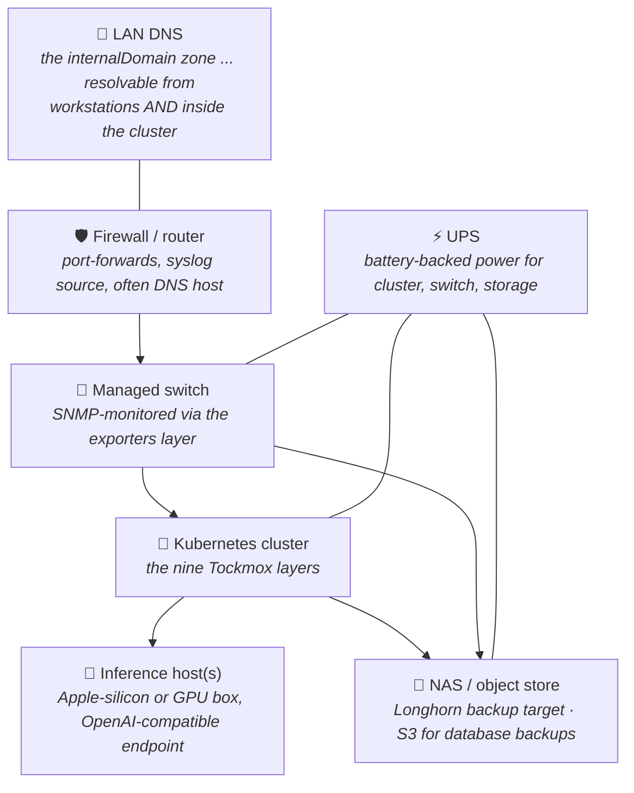
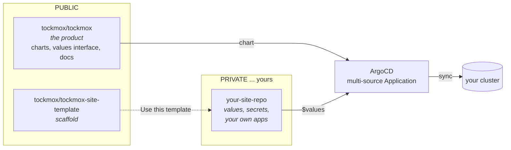
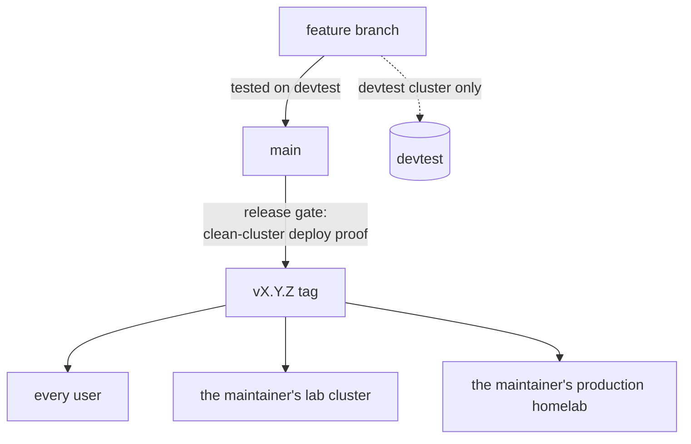
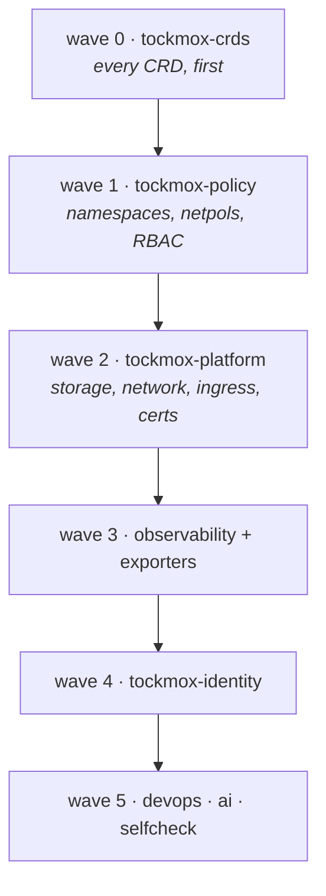
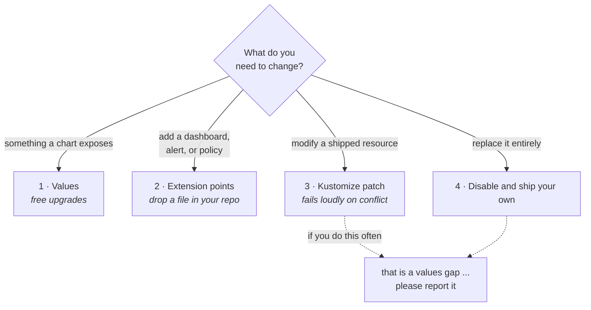
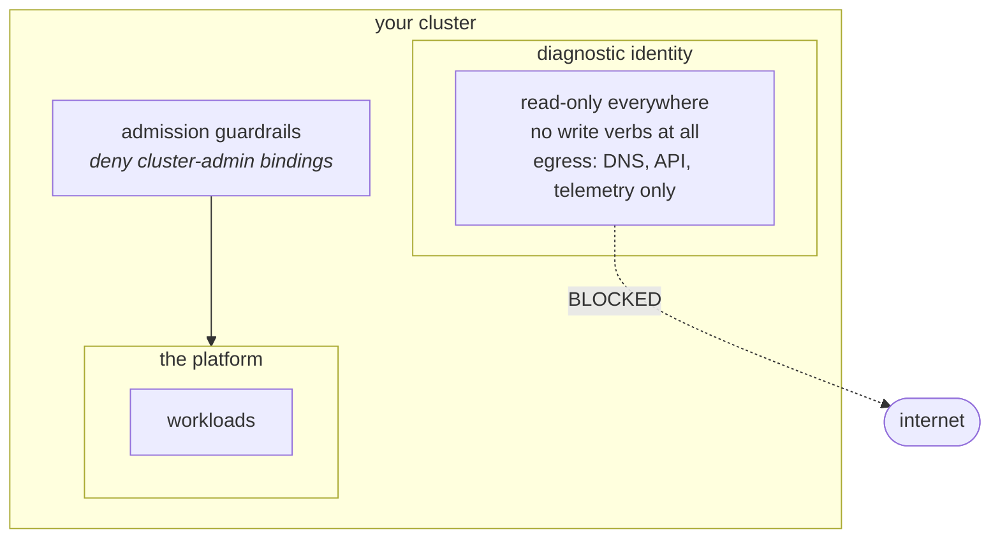

# Architecture

How Tockmox is put together, and the reasoning behind the parts that look
unusual.

## The whole system, including what Kubernetes cannot see

Tockmox the software runs inside the cluster; Tockmox the *deployment*
includes the equipment around it. These externals are part of the deployment
rather than accessories to it, and each
has a documented integration in
[external-integrations](administration/external-integrations.md):



None of these need to be the reference site's exact hardware ... any capable
firewall, any managed switch, any NAS or S3 endpoint, any
OpenAI-compatible model host. What matters is that they exist and are wired
in; [prerequisites](deployment/prerequisites.md) covers the minimums, and
[why-tockmox](why-tockmox.md) covers why the whole shape exists.

### Time is the external with no diagram box, and the worst symptoms

Clock is the one input the platform cannot supply and cannot check for you,
because time comes from below Kubernetes. Everything that compares timestamps
fails when it drifts, and **none of the error messages name the clock**:

| What you see | What it usually is |
|---|---|
| Certificates rejected as "not yet valid" or "expired" that are neither | node clock ahead of, or behind, the issuer |
| OIDC sign-ins that loop or refuse | the token's validity window misses the verifier's clock |
| Prometheus samples silently dropped or misordered | scrape timestamps out of order |
| Backup schedules firing at the wrong wall time | the node's idea of 03:00 |

The symptom worth memorising: **if TLS and SSO both misbehave at once, check
the clocks first.** A connected site usually gets this for free from public
NTP pools. A disconnected one does not, and
[install with no internet access](deployment/airgap.md) makes standing up a LAN
time source its first step for that reason;
[time synchronisation](deployment/time-sync.md) is the full treatment.

### Running disconnected and installing disconnected are different claims

Worth separating, because they get conflated.

**Tockmox runs disconnected.** Every component is local. Losing your uplink
degrades capability ... no upstream model APIs, no external certificate
issuance ... and does not stop the platform serving. That is a design property,
and the 2026-08-25 exercise recorded on
[install with no internet access](deployment/airgap.md) is the evidence for it
on that date and that build.

**Installing disconnected takes preparation.** Five separate dependencies, none
of them one artifact. It is not automatic.

Any claim from us about air-gap operation means the first. If you find
documentation implying the second, it is a bug.

## Three repositories, not one



The product and your configuration live in **different repositories**, and
ArgoCD composes them at sync time via a multi-source Application. The product
repository supplies the chart; yours supplies the values file it reads.

There are two ways to start your site repo, same result either way: run
[`tockmox-install.sh`](../install/tockmox-install.sh), which generates it from
your answers, or click **Use this template** on
[`tockmox-site-template`](https://github.com/tockmox/tockmox-site-template)
and fill in the values by hand.

**This is the decision that makes an upgrade safe.** Because your files are not in our
repository, an upgrade cannot overwrite them. Not "should not" ... cannot. It is
the same guarantee a Linux distribution gives you by keeping packages in `/usr`
and your configuration in `/etc`, and it is why Tockmox does not ask you to fork
anything.

Forking creates a permanent merge burden and drifts further from upstream every
month. We would rather you never fork.

### Why an edit made in the cluster does not stick

The same split is why **the repository is the truth** and `kubectl edit` is not
a way of changing anything. ArgoCD's `selfHeal` reverts a manual edit on its next
reconciliation, because the live object no longer matches the desired state the
Application resolved from your repository. That is the mechanism working, not a
race you lost.

This feels slower for about a week and then it stops feeling like anything,
because "what is running" and "what is committed" stop being different
questions. The cost is one commit per change; what you buy is that a cluster
rebuild, a node rebuild and a disaster recovery all reduce to pointing ArgoCD at
the same repository again.

**`selfHeal` reverts what you CHANGE. It does not revert what you ADD, and that
is a real limit rather than a detail.** ArgoCD compares the fields its manifests
declare. A field added by a different field manager ... a volume, a mount, an
environment variable, a sidecar ... is declared nowhere in the desired state, so
there is nothing to diff it against and the Application keeps reporting `Synced`
and `Healthy`. Measured on 2026-09-10: a `poison` volume and volumeMount patched
onto a Tockmox Deployment with `kubectl patch`, present in no chart, referencing
a ConfigMap that had since been deleted, survived **more than twenty minutes**
with the layer green and nothing reported.

So read "the repository is the truth" as: **the repository decides the value of
every field it names, and says nothing about fields it does not.** If you need
additive tampering detected, that is an admission-control or drift-detection job
and Tockmox does not do it for you today. It is tracked and it is not in 0.6.0.

The exception is anything ArgoCD does not manage, which on a Tockmox cluster is
ArgoCD itself and the operator-created Secrets. Those you do edit by hand, and
nothing puts them back if you get them wrong.

Editing is [day-2 § change a configuration value](operations/day-2.md#change-a-configuration-value);
the ladder of *how much* you are allowed to change is
[customising](administration/customising.md).

## Revision channels



Every user runs a tag, and so do both of the maintainer's clusters. The lab
cluster tracks releases exactly as yours does, which means the artifact being
validated is the artifact being shipped. **The maintainer's production homelab
runs Tockmox's own charts too, since 2026-10-02:** it is the reference
deployment Tockmox was extracted from, and it runs all nine layers from them
through its own site repository, the same arrangement
[installation](deployment/install.md) builds for you. It is a six-node k3s
cluster on openSUSE MicroOS, three of them control-plane and etcd, carrying a
household's daily use alongside the platform. So "the maintainer runs exactly
what you run" is now true of production as well as the lab, with two
qualifications: that cluster also runs site applications of its own beside the
platform, which no release ships; and while a release is in candidate testing
it follows that release's branch rather than a tag, so it runs every candidate
before you can.

Getting it there was a migration of a running cluster, not a fresh install,
and it was rehearsed on throwaway clusters before it touched production.
What it proved, and what it did not, is in
[backup and restore](operations/backup-restore.md#what-is-not-certified-here).

Nothing reaches a tag without passing a deploy proof on a cluster that has
never been touched by hand.

**What the tag number promises.** Versioning is semantic: a patch bump is fixes
only, a minor bump adds capability with values that still parse, and a major
bump is allowed to break and carries migration steps in its release notes. That
is the intent. It is not yet a guarantee, because major version zero is
explicitly unstable under [SemVer](https://semver.org/). Tockmox tiers its
values keys (`stable`, `provisional`, `experimental`) rather than freezing the
interface whole ... the disclosure, and what each tier promises, is in
[configuration § pre-1.0 stability](administration/configuration.md#pre-10-stability).

**The proof is about a fresh install, not about a transition.** The release gate
builds the new version on an untouched cluster. It does not exercise moving a
running cluster from the previous tag to this one, which is why
[upgrading](deployment/upgrade.md) is a procedure with a backup step rather than
a one-line edit.

## The nine layers

What each layer delivers, in the order it deploys. Every application in every
layer can be turned off individually, and eight
[capabilities](administration/capabilities.md) group them by the decision you
are actually making.

**Declinable** answers "can I decline this layer and still have a working
Tockmox": `No` means the rest depends on it, `Partly` means some of its
components can be declined through a [capability](administration/capabilities.md)
and the rest cannot. `policy` is `No` even though one policy bundle has an off
switch, because an escape hatch is not the same as declining the layer.

<!-- tockmox:layers:begin -->
<!-- Generated by tools/gen-docs-index.sh from charts/*/Chart.yaml (sync-wave), checked against install/tockmox-install.sh. Edit that, not this block. -->

| Layer | Wave | What it gives you | Declinable |
|---|---|---|---|
| `crds` | 0 | Every CRD, first: the prometheus-operator CRDs the other layers need | No |
| `policy` | 1 | Namespaces, default-deny networking, RBAC admission guardrails, PriorityClasses, a read-only diagnostic identity | No |
| `platform` | 2 | Storage, load balancing, ingress, certificates: cert-manager with a private CA, MetalLB with an address pool, Traefik, Longhorn, CloudNativePG, the shipped object store, kured | Partly |
| `observability` | 3 | Metrics, logs, dashboards, alerting: kube-prometheus-stack, Loki, Alloy, Grafana at `grafana.<yourdomain>`, and alerts that reach a phone through ntfy at `ntfy.<yourdomain>`, behind an Alertmanager bridge that alerts on its own delivery failures | Yes |
| `exporters` | 3 | Hardware and network telemetry: blackbox on; SNMP and smartctl are the `hardwareTelemetry` [capability](administration/capabilities.md) (a Capability, not an Add-on), off by default | Yes |
| `identity` | 4 | Single sign-on across every console: Authentik at `auth.<yourdomain>`. Credentials come from operator-created Secrets; the pods wait with a config error naming any that is missing | Yes |
| `devops` | 5 | Workflows: Argo Workflows at `workflows.<yourdomain>`, with client auth rather than the upstream authenticate-nobody default. Off by default | Yes |
| `ai` | 5 | Chat interface and model gateway: Open WebUI at `chat.<yourdomain>`, GitOps-authoritative config, no cloud backend, shipped pointed at no model. A LiteLLM model gateway at `llm.<yourdomain>` with a proven backup-and-restore-drill path, on by default since 0.8.0 with the console routed through it; naming a model host is [the one decision a default install leaves you](usage/what-you-get.md#the-one-decision-a-default-install-leaves-you) | Yes |
| `selfcheck` | 5 | Proves the platform's own guarantees: a heartbeat CronJob and the alerts that fire when monitoring itself goes quiet. Never invokes a model | Yes |

<!-- tockmox:layers:end -->

**600 resources** render with the CI values. Every UI hostname derives from one
`internalDomain` value, and TLS follows a single `certIssuer` value.

### Guards fail loudly rather than starting insecure

`tockmox-platform`'s MetalLB refuses to render without an address pool, and the
policy layer refuses to render a NetworkPolicy bundle aimed at a namespace you
haven't named. Missing credentials fail one step later, at the pod: they live
in operator-created Secrets referenced by name, so a render can't prove they're
there, and the workload waits with a config error naming the Secret it wants.
Expected Secrets are tabulated in
[secrets.md](administration/secrets.md).

### Deliberately not shipped, deliberately off

**Not shipped: a container registry.** It's a prerequisite rather than a
component, and [registry.md](deployment/registry.md) explains why.

**Off by default:** Ollama (pulling multi-gigabyte model images unasked is
rude), the SNMP and smartctl exporters (meaningless without your device list,
or on virtual disks), and four NetworkPolicy bundles that guard nothing on a
stock install (Forgejo, a Tailscale router, a syslog receiver, and a standalone
Harbor). A policy that selects no pod is scaffolding, and it reads as
protection to whoever audits the cluster next, so those render only when you
say you run the workload. `tools/check-no-ghost-policies.sh` fails CI if that
ever stops being true.

### Labels, and the reserved namespace prefix

Everything Tockmox *authors* ... namespaces, NetworkPolicies, guardrails,
Ingress ... carries consistent labels, so "ours" and "yours" stay
machine-distinguishable on a cluster running both:
`app.kubernetes.io/part-of=tockmox`, and `tockmox.com/layer=<layer>`
naming which of the nine put it there. That is what makes an inventory, a
targeted delete, and an upgrade audit possible without a hand-kept list.

**Authors, not ships.** Resources rendered by the upstream charts each layer
wraps carry their own chart's labels instead, so a label selector alone does not
enumerate a Tockmox install. Those resources are identifiable by the reserved
`tockmox-` namespace prefix below.

**The `tockmox-` namespace prefix is reserved for the same reason.** Your own
workloads belong in namespaces that do not start with it. Nothing enforces this
today ... it is a convention rather than a guardrail ... and breaking it mostly
hurts you: an uninstall, a layer disable, or any operation scoped by prefix
stops being able to tell your namespace from a shipped one.

The commands that use these labels are in
[day-2 § find what Tockmox manages](operations/day-2.md#find-what-tockmox-manages).

### Cluster-scoped state outlives the layer that installed it

Namespaced deletion does not touch cluster-scoped objects, so removing a layer
does not remove everything that layer created. Tockmox leaves behind, by
construction rather than by accident: the CRDs from `tockmox-crds`, the four
RBAC ValidatingAdmissionPolicies from `tockmox-policy`, and from
`tockmox-platform` the StorageClasses and the admission webhook configurations
belonging to Longhorn, CloudNativePG, MetalLB, cert-manager and
prometheus-operator.

**None of that is a Tockmox bug in the ordinary sense.** Each one is a
Kubernetes operator behaving normally: a controller owns a finalizer and the
finalizer outlives the controller; a cluster-scoped webhook configuration
outlives the namespaced Service it points at. All five of those operators do
this, and Tockmox ships all five. That is why removing Tockmox is a procedure of
its own rather than the reverse of installing it.

The consequence that matters is that the survivors are **actively harmful to the
next install** rather than merely untidy: a webhook configuration pointing at a
Service that no longer exists rejects the first matching resource a reinstall
tries to create, and the error names the new install rather than the old one.
The sweep is
[uninstalling](operations/uninstall.md#7-sweep-the-cluster-scoped-leftovers).

## Sync waves

Nine charts, six waves. ArgoCD waits for each wave to report healthy before
starting the next.



Two orderings are deliberate and were both learned the hard way on a clean
cluster:

**CRDs are a separate wave-0 chart** rather than living beside the things that
use them. Helm's own guidance, and it eliminates the entire class of
"custom resource applied before its definition existed" race rather than
patching individual instances of it.

**Policy precedes platform.** Policy creates the namespaces every other layer
deploys into. On an existing cluster this ordering does not matter because the
namespaces are already there; on a fresh one, getting it backwards fails the
sync. That is the argument for testing against clean clusters.

## The customisation ladder



Rung 3 is deliberately designed to break noisily. A patch that silently stops
applying because the base moved underneath it is worse than one that fails the
sync, because you find out at the wrong time.

## Why deterministic self-monitoring

`tockmox-selfcheck` runs scheduled checks that **never invoke a model**. Checks
fan in to a deterministic healthy-or-not decision; only an exception escalates
to anything intelligent.

Two reasons. A platform whose health monitoring depends on an AI being up has a
circular dependency at exactly the worst moment. And a status that can lie green
because a check silently stopped running is worse than no status at all, so
absence and staleness both render not-green, never green.

## Trust boundaries



The diagnostic identity is read-only by construction: its ClusterRole grants
`get`, `list`, and `watch` and nothing else, so an attempted write fails at
admission rather than relying on the caller behaving. Its NetworkPolicies allow
egress to DNS, the API server, and local telemetry, and nothing else ... so an
agent running under it has no path to the internet, provided
`diagnosticIdentity.apiServerCIDRs` is set. Unset, the "API server" rule is the
whole service and LAN ranges on 443/6443 and a forwarder on the LAN is a path
out.

That envelope ships in the open. What plugs into it is your choice; Tockmox
provides the cage, not the occupant. If you came here asking whether you can
run an agent against this cluster without handing it the keys, the fuller
answer is in
[what you get](usage/what-you-get.md#the-diagnostic-identity-since-it-is-the-interesting-one).

### The cluster-admin guardrail denies without saying so

The admission guardrail in that diagram is a ValidatingAdmissionPolicy,
`deny-privileged-rbac`, shipped by the policy layer. It denies any
ClusterRoleBinding to `cluster-admin` that is not on an allowlist. The intent is
that **every cluster-admin grant is a decision someone made on purpose**, rather
than something a chart did on the way past.

The cost is an ergonomics defect worth stating plainly, because it lands three
layers from its cause. k3s's HelmChart controller creates exactly such a
binding, named `helm-<chart>`. The binding is denied, the ServiceAccount
therefore gets no permissions, and the failure surfaces later as an unrelated
RBAC error naming a resource the ServiceAccount cannot list. **Nothing in that
message mentions the policy.** A reader who does not already know the policy
exists has no path from the error to the cause.

Adding a name to `rbacGuardrails.clusterAdminAllowlist` is the fix and is meant
to feel deliberate. The symptom, the diagnosis and the exact values edit are in
[troubleshooting § cannot list resource "secrets" is forbidden](operations/troubleshooting.md#cannot-list-resource-secrets-is-forbidden).

### Pod Security: which namespaces refuse a pod, and why the others cannot

Every namespace the policy layer creates carries the Pod Security labels
`warn` and `audit` at `restricted`. Those two observe without blocking. From
0.7.0 five of the seven also carry `enforce`, which refuses a pod that fails
the level. `["Deny"]` enforces; `["Audit","Warn"]` observes ... the same
distinction the admission policies draw, applied to Pod Security.

**Measured 2026-09-29** by `tools/check-pod-security.sh`, which renders every
layer with the CI values and again with the all-on overlay, evaluates every pod
template against the Pod Security Standards, and groups the result by the
namespace each pod lands in. The level is the lowest any pod in the namespace
reaches:

| Namespace | Highest level all rendered pods pass | `enforce` label | Why |
|---|---|---|---|
| `tockmox-authentik` | restricted | restricted | Server and worker set the four fields upstream leaves unset |
| `tockmox-selfcheck` | restricted | restricted | One shipped pod |
| `tockmox-devops` | restricted | baseline | Argo Workflows builds pods from Workflow objects at run time, and those are yours |
| `tockmox-diagnostic` | no pod ships here | baseline | Where a site's diagnostic agents run |
| `tockmox-ai` | restricted | baseline | The model gateway and its migrations Job run as uid 1000 on a read-only root (TM-0596); the `enforce` label moves with TM-0487 |
| `tockmox-monitoring` | privileged | none | node-exporter, Alloy and the SMART exporter need host namespaces or `hostPath` |
| `tockmox-platform` | privileged | none | Longhorn is privileged by necessity; kured needs `hostPID`, the MetalLB speaker `hostNetwork` |

The gate fails if any `enforce` label is stricter than the level in the second
column, because a label stricter than its pods is an install that cannot
schedule. It does **not** prove admission: no API server sees these labels
during the gate, so "the API server refuses a violating pod here" is rendered
and evaluated, not observed. It also cannot see pods an operator creates from a
custom resource (the database pods, Prometheus, Alertmanager, Longhorn's
instance managers) or anything you add. The levels are set per namespace under
`podSecurity.enforce` in the policy layer's values, and an empty string removes
the label; the reasoning for each namespace is beside the key in
`charts/tockmox-policy/values.yaml`. What to do when a pod of yours is refused
is in [troubleshooting](operations/troubleshooting.md#a-pod-is-refused-with-violates-podsecurity).

### In-cluster trust, and why the mechanism differs by runtime

The private CA raises a second trust boundary that is easy to miss. Grafana,
Open WebUI and the Argo Workflows server each perform the OIDC token exchange
**from inside their own container**, so a browser that trusts the CA does
nothing for them. The operator-facing procedure and the checks are in
[TLS and trust](administration/tls-and-trust.md#trust-inside-the-cluster); this
is the measurement behind it.

**Go unions `SSL_CERT_FILE` with the default certificate directories**, so
naming the CA alone yields the CA plus every public root. Measured on a cluster,
2026-08-15:

| `SSL_CERT_FILE` | a public host | the internal provider |
|---|---|---|
| unset | works | fails to verify |
| the CA alone | works | works |
| a missing path | works | fails to verify |

That third row is the no-TLS default: with `global.certIssuer` empty there is no
certificate Secret, the mount is `optional`, and Go falls through to the system
directories. Nothing to switch off.

**Python's `requests` and `httpx` treat the file as the ENTIRE trust store**, so
a CA-only file silently drops every public root. Measured in the Open WebUI
image, 2026-08-15:

| `SSL_CERT_FILE` | a public host | the internal provider |
|---|---|---|
| unset | urllib, httpx, requests all work | all fail |
| the CA alone | urllib works, **httpx and requests fail** | all work |
| the concatenated bundle | all work | all work |

`urllib` survives the middle row because OpenSSL still consults its default
directory. It is the library you would reach for in a quick test, and it is the
one that hides the fault. So the Python console gets an initContainer, running
Open WebUI's own image, that writes

```
its own image's CA store  +  the Tockmox CA  ->  /etc/tockmox/trust/ca-bundle.crt
```

and both `SSL_CERT_FILE` and `REQUESTS_CA_BUNDLE` point at it.

**Why the two are not unified.** Uniformity was tried and it broke a console.
The concatenating construct was shipped to all three, and the Argo Workflows
server went into `Init:CrashLoopBackOff` for 77 minutes with

```
exec: "/bin/sh": stat /bin/sh: no such file or directory
```

because `quay.io/argoproj/argocli` is distroless. Observed in production on the
lab, 2026-08-15. An initContainer running the application's own image is the
right call for trust fidelity, and it inherits that image's lack of a shell
along with its certificate store.

So the rule is **use the smallest mechanism the runtime actually requires**.
`tools/check-trust-wiring.sh` enforces the correct shape per console, and fails
a Go console that grows an initContainer as well as a Python one that loses it.

**One detail both share.** The CA comes from the console's own ingress
certificate Secret. cert-manager writes `ca.crt` into it, in the same namespace,
and renews it with the certificate. Nothing copies anything between namespaces
and there is no second object to keep in step.

#### Adding your own console

Any workload that speaks TLS to another Tockmox service needs the same
treatment, and which shape depends on what it is written in.

**Go**, and anything else that unions the file with the system directories:
mount `ca.crt` from that workload's own certificate Secret with `optional: true`
and set `SSL_CERT_FILE` to it. The devops layer's `values.yaml` is the worked
example, and it is three keys.

**Python**: add the concatenating initContainer, on the workload's own image.
The AI layer's `values.yaml` is the worked example. Set `REQUESTS_CA_BUNDLE` as
well as `SSL_CERT_FILE`, because `requests` reads only the former.

**Node**: `NODE_EXTRA_CA_CERTS` appends rather than replaces, so it can point at
the CA alone, like the Go case. That is the documented behaviour of the runtime
and Tockmox has not measured it, so treat it as a belief and run the test below.

If you are unsure which family your workload is in, test it rather than assume:
point it at the CA alone and check that a PUBLIC TLS endpoint still verifies.
That single check is what distinguishes the two.

## Further reading

- [Values interface](administration/configuration.md)
- [Customising](administration/customising.md)
- [Prerequisites and why the list is short](deployment/prerequisites.md)
- [Frontend posture](frontend-posture.md): why the chat console is swappable and what terminates outside it
- [Alternatives register](alternatives.md): the alternative to each default, its licence class, and the support tier Tockmox gives it

<!-- tockmox:footer:begin -->

---

<sub>Tockmox v0.8.0 &middot; &copy; 2026 Tockmox LLC &middot; code Apache-2.0, docs CC BY 4.0 &middot; Tockmox is a trademark</sub>
<!-- tockmox:footer:end -->
