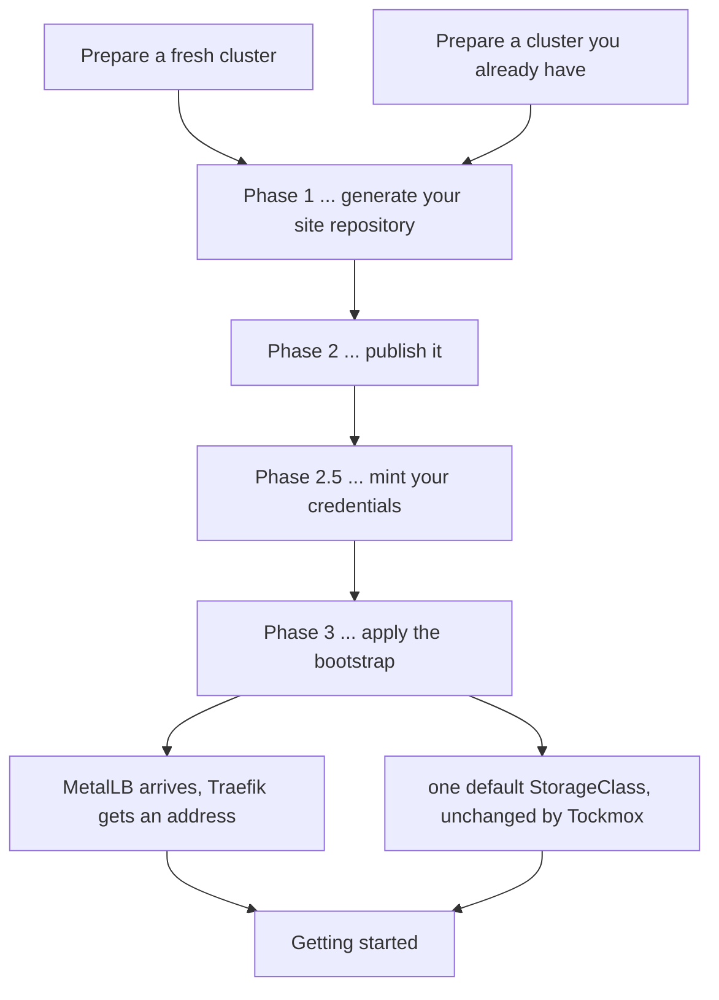

# Install Tockmox

**Both preparation paths end here, and this page does not care which one you
took.** Whether you built a cluster our way with
[prepare a fresh cluster](fresh-install.md) or ran the six checks in
[prepare a cluster you already have](existing-cluster.md), you arrive holding
the same four things, and nothing below re-does work either path already did.

Three phases, in order, with no branch between them: **generate** your site
repository, **publish** it, **apply** it. Everything else on this page hangs off
one of those three.



Text equivalent: the two preparation pages both feed Phase 1. Phases 1, 2, 2.5
and 3 run in that order. Phase 3 is where the last loose end closes ... MetalLB
gives Traefik a real address ... after which the next page is
[getting started](../usage/getting-started.md).

Tockmox does not set your cluster's default StorageClass; `local-path` stays
the default on k3s ([history](#history-the-diagrams-text-equivalent)).

## Before you begin

### What you are assumed to have

Both preparation paths leave you with exactly this. Nothing here is re-checked
step by step below; the one block in the next section confirms all of it at
once.

| Assumed | Which page produced it |
|---|---|
| A Kubernetes cluster with every node `Ready` | [fresh § 4](fresh-install.md#4-install-k3s) or [existing § check 1](existing-cluster.md#check-1-version-and-node-readiness) |
| ArgoCD 2.6 or newer, installed out of band and not managing itself | [fresh § 6](fresh-install.md#6-install-argocd) or [existing § check 5](existing-cluster.md#check-5-argocd) |
| sealed-secrets running, with the controller key backed up off-cluster | [fresh § 7](fresh-install.md#7-install-sealed-secrets-with-your-own-key) or [existing § check 6](existing-cluster.md#check-6-sealed-secrets) |
| An iSCSI initiator and NFS client on every node | [fresh § 2](fresh-install.md#2-install-the-storage-packages-on-every-node) or [existing § check 4](existing-cluster.md#check-4-storage-packages-on-every-node) |
| The four values written down | [fresh § 8](fresh-install.md#8-decide-the-four-values), referenced by [existing § the four values](existing-cluster.md#the-four-values) |
| A read-only token for your site repository, **if it will be private** | [fresh § if your site repository will be private](fresh-install.md#if-your-site-repository-will-be-private) or [existing § check 5](existing-cluster.md#check-5-argocd) |
| **On macOS: Local Network access granted to your terminal, and the terminal restarted since** | Every block on this page is `kubectl` or `helm` against a private address. Without the grant macOS refuses those connections and reports `no route to host`, which reads as a routing fault and is not one. [fresh § 6](fresh-install.md#6-install-argocd) carries the check that tells them apart |

### Set these once

**Required, and it is the first thing you do on this page.** Three values are
used by almost every block below. They are exported once, here, rather than
substituted by hand at each call site, so that every block further down is
pasteable exactly as printed. This is the same pattern
[day 2 operations](../operations/day-2.md#before-you-begin) and
[troubleshooting](../operations/troubleshooting.md) already use, and the
[documentation standard § 5](../documentation-standard.md#5-commands-are-copy-pasteable-and-complete)
is where it is written down.

**YOU SUPPLY:** two of the three. The third is measured and shown to you.

| Variable | Class | Where it comes from |
|---|---|---|
| `KUBE_CONTEXT` | Measured, you confirm | Your current kubectl context. The block below prints the **server address** behind it, not just the name |
| `SITE_REPO_URL` | **You supply** | The git URL of the repository you created on your own forge. Nothing on this page creates it for you |
| `TOCKMOX` | **You supply** | The path to your clone of the Tockmox source tree. Phase 1 and Phase 2.5 both run scripts from it |

**WORKSTATION**

```bash
export KUBE_CONTEXT="$(kubectl config current-context)"
export SITE_REPO_URL=YOUR_SITE_REPO_URL
export TOCKMOX=YOUR_TOCKMOX_CLONE_PATH

kubectl config view --minify --context="$KUBE_CONTEXT" \
  -o jsonpath='{.clusters[0].cluster.server}{"\n"}'
ls "$TOCKMOX/install/tockmox-install.sh" "$TOCKMOX/tools/mint-secrets.sh"
```

**Success condition:** the server address printed is the cluster you prepared,
read rather than recognised by name, and both script paths exist. A context is
a **name you supply**, and a rename can leave that name pointing at a different
server than it used to.

Every block below that reaches the cluster or reads one of these starts with a
guard line:

```
: "${KUBE_CONTEXT:?export KUBE_CONTEXT first, see Set these once}"
```

**A guard, not only the export.** `kubectl --context=` with an empty value does
not error ... it falls back to your current context. So `--context="$KUBE_CONTEXT"`
with no guard fails **open** the moment the variable goes empty, silently, onto
whatever cluster you last touched
([history](#history-the-guard-line)).
[Prepare a fresh cluster](fresh-install.md#name-the-cluster-once-before-anything-writes-to-it)
carries the same guard for the same reason.

A fourth variable, `SITE_REPO`, is exported in
[1c](#1c-generate-the-site-repository) once the directory it names exists.

### Confirm the handoff, in one block

**Required.** Run this before Phase 1. It is five reads and no writes, and it is
the only place this page inspects the cluster you brought.

**WORKSTATION**

```bash
: "${KUBE_CONTEXT:?export KUBE_CONTEXT first, see Set these once}"
kubectl --context="$KUBE_CONTEXT" get nodes
kubectl --context="$KUBE_CONTEXT" -n argocd get deployment argocd-server \
  -o jsonpath='{.spec.template.spec.containers[0].image}{"\n"}'
kubectl --context="$KUBE_CONTEXT" get deployment -A -l app.kubernetes.io/name=sealed-secrets \
  -o jsonpath='{range .items[*]}{.status.readyReplicas}{"\n"}{end}'
kubectl --context="$KUBE_CONTEXT" get storageclass
kubectl --context="$KUBE_CONTEXT" get pods -A \
  | grep -Ei 'metallb|kube-vip|purelb|svclb' \
  || echo "no LoadBalancer controller running"
```

| Line | What it must show |
|---|---|
| `get nodes` | Every node `Ready`. One node, or four, or whatever you built |
| ArgoCD image | A tag of `v2.6` or newer. The tag is the only thing that proves the version floor; the chart number is a different number entirely |
| sealed-secrets | `1`, one line. The controller's Deployment is named `sealed-secrets` on the manual route in fresh-install § 7 and `sealed-secrets-controller` on the `bootstrap-secrets` route, so the check finds it by label rather than by name |
| `get storageclass` | On k3s, `local-path` still listed and still `(default)`. On a cluster you brought, whatever [check 3](existing-cluster.md#check-3-the-default-storageclass) left you with |
| the LoadBalancer grep | **Fresh path:** the `echo` fires, and that is correct. **Existing cluster:** at most one controller, and if you kept it you already set `apps.metallb.enabled: false` in your site values |

**If any line disagrees, go back to your preparation page rather than
continuing.** Every one of these failures gets worse three phases from now, and
none of them names itself when it does.

### What both preparation paths deliberately left undone

Two things are incomplete on purpose when you arrive, and **this page is where
both close**. Neither is a defect to work around on the way past.

| Left open by preparation | Closes at |
|---|---|
| **No LoadBalancer controller.** ServiceLB is off and MetalLB has not been installed yet, so nothing assigns `type: LoadBalancer` addresses | [Phase 3](#phase-3--apply), when the platform layer syncs at wave 2. You confirm it at [point DNS at Traefik's address](#point-dns-at-traefiks-address) |
| **`local-path` is still the default StorageClass.** It stays that way ... Tockmox names the class on every claim it creates and never takes your cluster default | Nothing to close. [Phase 3 § then un-default k3s's StorageClass](#then-un-default-k3ss-storageclass) applies only if you deliberately set `longhorn.persistence.defaultClass: true` |

### Tools this page needs, and preparation did not install

**Required.** Two of these are new here. Discovering `kubeseal` missing at
Phase 2.5, after the site repository is already pushed, is the failure this
table exists to prevent.

| What you need | Why | How to check |
|---|---|---|
| A clone of the Tockmox source tree, at the release you intend to run | Phase 1 runs `install/tockmox-install.sh` from its root and Phase 2.5 runs `tools/mint-secrets.sh` beside it | `ls "$TOCKMOX/install/tockmox-install.sh" "$TOCKMOX/tools/mint-secrets.sh"`, after [set these once](#set-these-once) |
| `kubectl` and `git` | Named on both preparation pages; listed again because every phase uses them | `kubectl version --client && git --version` |
| **`kubeseal`**, matching the controller (both routes need it) | Phase 2.5 seals every credential to your cluster's key. Neither preparation page installs it, and the controller was installed at whatever chart version [fresh cluster § 7](fresh-install.md#7-install-sealed-secrets-with-your-own-key) derived on the day, so a `kubeseal` from an old package install passes "prints a version" and seals with a client the controller may not match | The block below prints both versions side by side |
| **`openssl`** | `mint-secrets.sh` generates every value with it | `openssl version` |
| `docker`, `podman` or `nerdctl` | Only for the ntfy credential: its bcrypt hash and `tk_` token can come only from the ntfy binary. Without a runtime that Secret is skipped, and **until it exists no alert reaches anybody** | `command -v docker podman nerdctl` |
| A git remote **the cluster** can reach, that you can push to | ArgoCD clones your site repository on every sync. Private is correct and expected | Your forge |

**The kubeseal check, because "prints a version" is green at exactly the
moment you are about to fail.** The controller's version is derived by the
cluster preparation page, so it moves on its own; your client was installed
whenever it was. Read both:

**WORKSTATION**

```bash
: "${KUBE_CONTEXT:?export KUBE_CONTEXT first, see Set these once}"
kubeseal --version
kubectl --context="$KUBE_CONTEXT" get deployment -A -l app.kubernetes.io/name=sealed-secrets \
  -o jsonpath='{range .items[*]}{.spec.template.spec.containers[0].image}{"\n"}{end}'
```

**Success condition:** the two version numbers agree on major and minor
(`v0.40.1` beside `...sealed-secrets-controller:0.40.0` is fine; `v0.39.1`
beside `0.40.0` is not; [history](#history-the-kubeseal-check)). What a
mismatch costs, and why it is silent at seal time, is in
[secrets § keep kubeseal at the controller's version](../administration/secrets.md#keep-kubeseal-at-the-controllers-version).
If the `get deployment` line prints nothing, no controller carries the chart's
label ... go back to
[fresh cluster § 7](fresh-install.md#7-install-sealed-secrets-with-your-own-key)
rather than sealing to a controller the flags in Phase 2.5 will not find.

**Installing onto virtual machines?** Read
[virtual machines](virtual-machines.md) first, before Phase 1. Four hypervisor
defaults break Tockmox in ways whose errors name the wrong component, and
neither the installer nor this page can check for them because they are outside
the cluster. It has where each one lives on Harvester, OpenShift
Virtualization, vSphere and Synology VMM. The one that costs the most time: a
cloned VM keeps its template's `machine-id` and disk UUIDs, and Longhorn
identifies disks by UUID.

**Estimate, not a measurement: 45 to 90 minutes**, most of it waiting for sync
waves to report healthy rather than typing.

## Where each command runs

Two hosts are involved and the page switches between them once. **Every command
block carries its host on the line immediately above the block**, in bold, so
that the routing survives a copy button ... a marker inside the block is
stripped by every "copy" control on every docs site, and it is the one piece of
information that decides which machine you are typing on.

| Marked | Runs on |
|---|---|
| **WORKSTATION** | Your own machine, against `$KUBE_CONTEXT` |
| **NODE** | A k3s server node, over SSH or at its console. Exactly one step needs this, in Phase 3 |

**No command block on this page contains a `#` comment line**, because `#`
is not a comment character in the interactive zsh macOS ships, and CI enforces
it. Everything a comment would have said is in the prose beside the block,
where a copy button cannot take it and a screen reader reaches it
([history](#history-why-no-comments-inside-blocks)).

## What you will have at the end

A site repository you own, pushed to a remote your cluster can reach; nine
ArgoCD Applications reporting `Synced` and `Healthy`; Traefik holding a real
address from your pool; exactly one default StorageClass; and every credential
sealed into your repository except one that cannot exist until the cluster does.

**Nothing will be usable yet, and that is expected.** Tockmox ships no accounts.
[Getting started](../usage/getting-started.md) is the path from a green ArgoCD
to a console you can sign in to.

## Phase 1 ... generate your site repository

Tockmox never asks you to fork it: the platform lives in our repository, your
configuration lives in yours, and ArgoCD composes them at sync time, which is
what makes an upgrade unable to overwrite your settings. The full argument is
[architecture § three repositories, not one](../architecture.md#three-repositories-not-one).

The installer writes that second repository and **applies nothing to your
cluster.**

### Precondition: the cluster must be able to read the Tockmox repository

**Every Application the installer generates has two sources**: source 1 is the
Tockmox repository (the charts) at `tockmox.repoURL` and `tockmox.revision`,
source 2 is your site repository (the values). ArgoCD's repo-server has to read
**both**, and the default source 1 in `install/tockmox.yaml.example` is
`https://github.com/tockmox/tockmox.git`, a public repository that needs no
credential. The cluster has to be able to reach it over HTTPS. A cluster that
cannot, behind a proxy it is not configured for or with no internet access at
all, needs a copy it can read: point `tockmox.repoURL` at it, as
[install with no internet access § 5](airgap.md#5-serve-both-git-repositories-inside-the-boundary--required)
describes.

**What it looks like when this precondition is not met.** Nothing fails in
Phase 1 or Phase 2. The 1b preflight prints
`! cannot reach https://github.com/tockmox/tockmox.git ... not confirming 'v0.8.2' exists (fine if you are air-gapped or mirroring)`
and continues, because it cannot tell a repository it cannot reach from one
that is deliberately behind a boundary. Then, three phases later, the nine layer
Applications report the same thing ... nine rather than all of them, because
`root`, `site-apps` and `site-secrets` source your own repository and are
unaffected:

```
ComparisonError: Failed to load target state: failed to generate manifest for
source 1 of 2: rpc error: code = Unknown desc = failed to list refs:
authentication required: Repository not found.
```

**Read `source 1 of 2` before reading anything else in that message.** Source 1
is the Tockmox repository, not your site repository, so the credential step in
[2c](#2c-give-argocd-a-credential--private-repositories-only) does not apply
and will not help; that step is for source 2. The same error, with the same
wording, is what a public repository produces when `tockmox.revision` names a
tag that does not exist, so it means "source 1 is not readable at that
revision", and the fix is the revision or the URL, never a credential.

**Success condition**, from a host on the same network as the cluster:

**WORKSTATION**

```bash
git ls-remote https://github.com/tockmox/tockmox.git refs/tags/v0.8.2
```

Prints a SHA and the tag name. Anything else, including a prompt for a
username, means the cluster will not be able to read source 1 either, and the
install stops in Phase 3 with the error above.

### 1a. Choose interactive or a config file

**Required.** One of the two. They produce the same site repository.

| Route | Choose it when |
|---|---|
| **A config file** (recommended) | You want the run to be repeatable and reviewable, and you want the `--dry-run` preflight in 1b, which needs a file to read |
| **Interactive** | You would rather be asked. It prompts for the same settings and skips 1b |

**Interactive**, if that is you ... run this and skip to
[1c's success condition](#1c-generate-the-site-repository):

**WORKSTATION**, from the root of your Tockmox clone.

```bash
: "${TOCKMOX:?export TOCKMOX first, see Set these once}"
cd "$TOCKMOX" && ./install/tockmox-install.sh
```

**From a config file:**

**WORKSTATION**, from the root of your Tockmox clone. The second line opens
your editor on the copy, not on the shipped example.

```bash
: "${TOCKMOX:?export TOCKMOX first, see Set these once}"
cd "$TOCKMOX"
cp install/tockmox.yaml.example tockmox.yaml
$EDITOR tockmox.yaml
```

**YOU SUPPLY:** four settings in that file. They have no defaults because a
wrong guess is worse than a question, and the installer refuses to run without
them.

| Setting | Where it comes from |
|---|---|
| `site.name` | Only you know what this deployment is called. Lowercase letters, digits and hyphens. Nothing derives from it functionally ... it labels generated files so you can tell deployments apart |
| `global.internalDomain` | The internal DNS zone from your preparation page. Every hostname derives from it |
| `global.lanCIDR` | Your LAN's CIDR. Too narrow silently breaks the admission webhook, too wide opens a hole ... [configuration § why those three are required](../administration/configuration.md#why-those-three-are-required) |
| `addressPool.range` | The free address range you reserved. Must sit inside `lanCIDR` and outside your DHCP scope ... [load balancing § the address pool needs a decision before you start](../administration/load-balancing.md#the-address-pool-needs-a-decision-before-you-start) |

A range of ten is plenty for a single-node install. If you have nowhere to put
one, that is the real prerequisite to go solve before continuing, not a value
to invent.

**A fifth setting has a default, and the default is the wrong one for almost
everybody: `global.certIssuer`.** It is not in the required four because the
installer will run without it. Leave it empty and every console serves plain
HTTP and **SSO does not work** ... the token exchange consoles perform
server-side will not run over `http`. The install still reaches its documented
end state and every layer still reports `Synced` and `Healthy`.

| Value | When |
|---|---|
| **`tockmox-ca`** | **The recommended answer, and what the shipped example now sets.** The platform layer creates this ClusterIssuer on every stock install and it comes up Ready. Nothing else is needed |
| Your own issuer's name | You have a real domain and an ACME account, or an existing private CA. Nothing else changes ... every layer reads only the issuer's *name* |
| `""` | You are deliberately evaluating over plain HTTP and will not test SSO |

**Tockmox's CA is not a public CA**, so browsers reject its certificates until
you trust it once ... which is the deliberate trade that lets this work with no
internet, no DNS delegation and no ACME account.
[TLS and trust](../administration/tls-and-trust.md) is the one-time trust step,
and it is per machine you browse from.

**These four are the installer's four, and they are not the same four you
decided during preparation.** Three overlap: `internalDomain`, `lanCIDR` and
`addressPool.range`. `site.name` is new here and installer-only. Preparation's
fourth ... where the AI plane points ... is not in this file at all; it goes
into generated site values at
[1e](#1e-point-the-ai-plane-or-leave-it-unset), or nowhere if you are
evaluating.

**Success condition:** `tockmox.yaml` exists and those four keys are non-empty.
The real test is 1b, which validates them for you.

### 1b. Preflight before writing anything ... config-file route only

**Required on the config-file route.** `--dry-run` validates every setting,
checks that the Tockmox revision you named actually resolves, reports what it
can and cannot see of your cluster, and writes nothing.

**WORKSTATION**

```bash
: "${TOCKMOX:?export TOCKMOX first, see Set these once}"
cd "$TOCKMOX" && ./install/tockmox-install.sh --config tockmox.yaml --dry-run
```

**Success condition:** it reaches the end and says so. Quoting the strings
`install/tockmox-install.sh` prints at v0.8.0, the lines that matter are:

```
  ✓ revision v0.8.0 resolves in https://github.com/tockmox/tockmox.git
  ✓ settings valid
  ! dry-run: nothing will be written
  ✓ installer finished. Nothing was applied to your cluster.
```

**A failure here is cheap and a failure later is not.** The one worth naming:
a revision that does not exist is accepted by every schema and by ArgoCD's
Application spec, and surfaces three phases later as nine layers that cannot
resolve their source, in an error naming neither this file nor this setting.
The preflight resolves it against the remote instead.

**What `--dry-run` does not check.** It skips the cluster preflight entirely,
along with `--no-cluster`. On a normal run the installer **stops** on a missing
`argocd` namespace and on missing ArgoCD CRDs, and only **warns** on absent
sealed-secrets, on no default StorageClass, and on more than one. Warnings are
not gates: read them.

### 1c. Generate the site repository

**Required.**

**WORKSTATION**

```bash
: "${TOCKMOX:?export TOCKMOX first, see Set these once}"
cd "$TOCKMOX" && ./install/tockmox-install.sh --config tockmox.yaml
export SITE_REPO="$TOCKMOX/tockmox-site"
```

The `export` on the third line names the directory the installer just wrote,
and every block after this one reads it rather than asking you to `cd` by hand.
`SITE_REPO` is the same variable
[day 2 operations](../operations/day-2.md#before-you-begin),
[troubleshooting](../operations/troubleshooting.md) and
[backup and restore](../operations/backup-restore.md) use, so it carries
forward past this page. **If you changed `site.path` in `tockmox.yaml`, export
that path instead.**

You get a directory, `./tockmox-site` unless you changed `site.path`:

```
tockmox-site/
├── README.md
├── .gitignore
├── bootstrap/
│   ├── root.yaml            the only thing you apply by hand
│   └── applications/        one per enabled layer, plus site-apps
├── site/values/
│   ├── global.yaml          settings every layer reads
│   ├── platform.yaml        per-layer overrides
│   └── ... one per layer
├── apps/                    your own Argo Applications
└── secrets/                 your SealedSecrets
```

**Success condition:**

**WORKSTATION**

```bash
: "${SITE_REPO:?export SITE_REPO first, see 1c}"
ls "$SITE_REPO/bootstrap/root.yaml"
ls "$SITE_REPO/site/values/"
```

`root.yaml` exists, and `site/values/` holds `global.yaml` plus one file per
layer you left enabled. The installer's own last three lines are:

```
  ✓ site repository written to ./tockmox-site
  ! The generated site carries PLACEHOLDER_SITE_REPO_URL in 13 files.
  ✓ installer finished. Nothing was applied to your cluster.
```

**That placeholder count is the installer's, not this page's.** It counts the
files it wrote rather than asserting a constant, so it stays right when you
disable a layer. Note the number ... you check it again in
[2b](#2b-replace-the-repository-placeholder).

The installer counts the whole site, not `bootstrap/`: twelve files under
`bootstrap/` plus the generated `README.md`, which carries the placeholder in
the paragraph telling you to replace it.
[2b](#2b-replace-the-repository-placeholder) replaces all of them
([history](#history-the-placeholder-count)).

### 1d. Set the Longhorn replica counts ... three or more nodes only

**Conditional. If** this prints `3` or more, do this step:

**WORKSTATION**

```bash
: "${KUBE_CONTEXT:?export KUBE_CONTEXT first, see Set these once}"
kubectl --context="$KUBE_CONTEXT" get nodes --no-headers | wc -l
```

**If it prints 1 or 2, skip to [1e](#1e-point-the-ai-plane-or-leave-it-unset).**
The shipped defaults are already right for a single node, and two nodes is not a
halfway house ... it tolerates zero control-plane failures, so it is strictly
worse than one.

At three or more, the shipped defaults stop being right in a way nothing
reports. One replica on one node protects against nothing, and
`replicaSoftAntiAffinity: true` lets all three replicas land on the same host,
silently removing the property the extra nodes were bought for. **Raise the
counts to 3 and turn soft anti-affinity off in the same change.**
[Prepare a fresh cluster § 5](fresh-install.md#5-stop-k3s-re-asserting-its-storageclass-default)
tells multi-node readers this happens here; this is here.

Append this to `$SITE_REPO/site/values/platform.yaml`, which the installer has
already written with your address pool:

```yaml
longhorn:
  persistence:
    defaultClassReplicaCount: 3
  defaultSettings:
    defaultReplicaCount: 3
    replicaSoftAntiAffinity: false
```

Both counts, together. They govern different volumes ... one the shipped
StorageClass, one everything created outside it ... and a disagreement between
them is invisible until a volume is built. The reasoning, and why 2 is never
the right answer at any node count, is in
[storage § Longhorn replica count](../administration/storage.md#longhorn-replica-count).

**Success condition now**, before anything is applied:

**WORKSTATION**

```bash
: "${SITE_REPO:?export SITE_REPO first, see 1c}"
grep -A5 '^longhorn:' "$SITE_REPO/site/values/platform.yaml"
```

Prints the block above.

**Success condition after Phase 3**, which is the one that proves it took:

**WORKSTATION**

```bash
: "${KUBE_CONTEXT:?export KUBE_CONTEXT first, see Set these once}"
kubectl --context="$KUBE_CONTEXT" get storageclass longhorn \
  -o jsonpath='{.parameters.numberOfReplicas}{"\n"}'
kubectl --context="$KUBE_CONTEXT" -n tockmox-platform get configmap \
  longhorn-default-setting \
  -o jsonpath='{.data.default-setting\.yaml}{"\n"}' | grep replica
```

The first prints `3`. The second lists `replica-soft-anti-affinity: false`.

> **Unverified against a running cluster.** The two commands read objects the
> Longhorn 1.13.0 chart templates from exactly these values, which is a claim
> about the chart source in this tree, not a recorded run. `defaultSettings` is
> Longhorn's *default* setting mechanism, so on a cluster where Longhorn has
> already started once, changing it may not move the live Setting. Read the
> ConfigMap and then read the live value before believing either.

### 1e. Point the AI plane, or leave it unset

**Optional.** What you get by doing it: a chat console with a model behind it.
What you lose by skipping: the model gateway comes up with an empty model list
and the console shows no models, which is the shipped state and is fine while
you evaluate everything else.

This is the fourth of the four values, and it is a three-way choice: name an
inference host you already run in the gateway's `litellm.proxy_config.model_list`,
let Tockmox run models in-cluster, or leave it unset. It lives in
`site/values/ai.yaml`, not in `tockmox.yaml`. Since 0.8.0 the console goes
through the gateway by default (TM-0460); the values, the trade-offs and the
way to run without the gateway are in [the AI plane](../usage/ai-plane.md).

**Success condition:** whichever you chose, you can say which, and
`site/values/ai.yaml` says the same thing.

### 1f. Name each node's gateway address for the policy layer

**Required whenever the policy layer's platform rules are on**, which they are by
default. Since 0.8.0 the policy layer refuses to render without this list
rather than falling back to admitting the whole pod network to the platform
namespace, which let any pod in the cluster reach every platform pod on every
port (TM-0798).

The list is one `/31` per node: the two addresses a packet from that node's own
host carries when it reaches a pod (its `cni0` and `flannel.1` addresses on
flannel, the k3s default). The installer reads them from the cluster and prints
the block; this appends it to your policy values. Run it once:

**WORKSTATION**

```bash
: "${KUBE_CONTEXT:?export KUBE_CONTEXT first, see Set these once}"
: "${SITE_REPO:?export SITE_REPO first, see 1c}"
cd "$TOCKMOX" && ./install/tockmox-install.sh --print-netpol-node-sources \
  --context "$KUBE_CONTEXT" >> "$SITE_REPO/site/values/policy.yaml"
```

**Success condition:**

**WORKSTATION**

```bash
: "${SITE_REPO:?export SITE_REPO first, see 1c}"
grep -A8 '^platformNetpol:' "$SITE_REPO/site/values/policy.yaml" | grep -c '/31'
```

Prints the number of nodes `kubectl get nodes` lists.

**Re-run it when you add a node**, replacing the block rather than appending a
second one: a node missing from the list has its host traffic to the platform
namespace refused, which shows up as a webhook or a volume attach timing out.

**If a database of your own backs up to the shipped object store**, its
namespace has to be admitted to the object store's S3 port as well, because
this list replaces the old rule that admitted every pod. Name it under
`platformNetpol.extraS3ClientNamespaces` in `site/values/policy.yaml`, the same
namespaces you gave `garage.credentialsNamespaces` (or
`createCredentialsNamespaces`) in `site/values/platform.yaml`. A namespace in
the second list and not the first keeps running and stops archiving, silently.
`./install/tockmox-install.sh --lint "$SITE_REPO"` names any that are missing.

**If the helper prints `no IPv4 podCIDR on node(s)`**, your CNI does not allocate
a pod range per node, and the list cannot be derived. Turn the platform rules
off instead and say so plainly: add `platform_netpol: { enabled: false }` under
`apps:` in `site/values/policy.yaml`. The platform namespace is then unpoliced,
which is a real loss; [external integrations](../administration/external-integrations.md)
says what it costs.

## Phase 2 ... publish it

ArgoCD reads your values over git, so the repository must be reachable **from
the cluster**, not merely from your workstation.

### 2a. Push it

**Required.** `SITE_REPO_URL` is the one you exported in
[set these once](#set-these-once) ... it is not re-typed here, and it is not
re-typed in 2b or 2c either. **The same URL at three call sites was three
chances to spell it differently**, and ArgoCD compares it character for
character.

**The repository must already exist.** Nothing on this page creates it for you.
[fresh-install.md § create your site repository](fresh-install.md#create-your-site-repository)
is where you made it, with the naming and visibility guidance; if you came in by
another route, make an empty one now.

**WORKSTATION**

```bash
: "${SITE_REPO:?export SITE_REPO first, see 1c}"
: "${SITE_REPO_URL:?export SITE_REPO_URL first, see Set these once}"
cd "$SITE_REPO"
git init -b main && git add -A
git commit -m "initial Tockmox site configuration"
git remote add origin "$SITE_REPO_URL"
git push -u origin main
```

**`-b main` is not decoration.** A bare `git init` names the first branch
from `init.defaultBranch`, which a stock git leaves unset, so the branch is
`master` and the push fails with `error: src refspec main does not match any`.
`-b` needs git 2.28 (2020) or newer; `git --version` if in doubt
([history](#history-git-init-and-the-branch-name)).

**Success condition:**

**WORKSTATION**

```bash
: "${SITE_REPO:?export SITE_REPO first, see 1c}"
git -C "$SITE_REPO" status -sb | head -1
git -C "$SITE_REPO" remote -v
```

The first line reads `## main...origin/main` ... the branch is `main` **and**
it tracks the remote, which only happens once the push succeeded. A first line
of `## main` alone, or `## master`, means the push did not land; scroll up for
the error rather than continuing. The generated Applications name
`targetRevision: main`, so the branch name is not yours to vary without also
editing `bootstrap/applications/*.yaml`.

### 2b. Replace the repository placeholder

**Required.** The installer deliberately writes `PLACEHOLDER_SITE_REPO_URL`
rather than asking for a URL and pushing on your behalf. Why it works that way,
and why the command below is shaped the way it is, are in
[ArgoCD § pointing the generated Applications at your site repository](../administration/argocd.md#pointing-the-generated-applications-at-your-site-repository).

`SITE_REPO_URL` must match what ArgoCD will clone **character for character**,
trailing `.git` included ... a mismatch produces the same three unhelpful words
as a missing credential. That is the reason it is exported once rather than
typed here: this is the site that has to agree with 2a and 2c, and a variable
cannot disagree with itself.

**The replacement runs over the whole repository, not over `bootstrap/`**,
because the generated `README.md` carries the placeholder too
([history](#history-the-placeholder-count)).

**WORKSTATION**

```bash
: "${SITE_REPO:?export SITE_REPO first, see 1c}"
: "${SITE_REPO_URL:?export SITE_REPO_URL first, see Set these once}"
cd "$SITE_REPO"
git grep -l PLACEHOLDER_SITE_REPO_URL | while IFS= read -r f; do
  sed "s|PLACEHOLDER_SITE_REPO_URL|$SITE_REPO_URL|g" "$f" > "$f.tmp" \
    && mv "$f.tmp" "$f"
done
git commit -am "point Applications at this repo" && git push
```

The command's shape is deliberate: `git grep`, a read loop, write-and-move.
Each replaces a form that has failed ([history](#history-the-shape-of-the-2b-command)).

**Success condition:**

**WORKSTATION**

```bash
: "${SITE_REPO:?export SITE_REPO first, see 1c}"
: "${SITE_REPO_URL:?export SITE_REPO_URL first, see Set these once}"
git -C "$SITE_REPO" grep -l PLACEHOLDER_SITE_REPO_URL \
  || echo "no file still carries the placeholder"
git -C "$SITE_REPO" grep -l "$SITE_REPO_URL" | wc -l
```

The first prints the `echo`. The second prints **the same number the installer
warned about** in [1c](#1c-generate-the-site-repository) ... thirteen on a stock
install with all nine layers on, fewer if you disabled one. Both commands scan
the whole repository, which is what the installer counted, so the two numbers
are comparable. Scoping either one to `bootstrap/` makes them disagree by one
and the check stops meaning anything.

### 2c. Give ArgoCD a credential ... private repositories only

**Conditional. If** an unauthenticated clone of your site repository fails, do
this step:

**WORKSTATION**

```bash
: "${SITE_REPO_URL:?export SITE_REPO_URL first, see Set these once}"
git ls-remote "$SITE_REPO_URL" >/dev/null 2>&1 \
  && echo "public: skip this step" \
  || echo "private: do this step"
```

**This test can lie in one direction.** If your workstation holds a cached
credential or an SSH agent key for that forge, the clone succeeds from here and
still fails from inside the cluster, which has neither. If you know the
repository is private, do this step regardless of what the line prints.

**YOU SUPPLY:** the read-only token you minted during preparation. The prompt
line reads it rather than taking it as text, so **the token does not land in
your shell history** and does not sit in a scrollback buffer. **Watch the byte
count it prints.** A `0` means the paste did not reach the variable, and the
Secret below is then created with an empty password ... it exists, it carries
the right label, and every layer lands in `ComparisonError` three phases later.

**WORKSTATION**

```bash
: "${KUBE_CONTEXT:?export KUBE_CONTEXT first, see Set these once}"
: "${SITE_REPO_URL:?export SITE_REPO_URL first, see Set these once}"
printf 'read-only token: '; read -rs READ_ONLY_TOKEN; echo
printf 'bytes read: %s\n' "$(printf '%s' "$READ_ONLY_TOKEN" | wc -c | tr -d ' ')"
[ -n "$READ_ONLY_TOKEN" ] || echo "STOP: nothing was read, no Secret will be created"
[ -n "$READ_ONLY_TOKEN" ] && kubectl --context="$KUBE_CONTEXT" -n argocd create secret generic tockmox-site-repo \
  --from-literal=type=git \
  --from-literal=url="$SITE_REPO_URL" \
  --from-literal=username=git \
  --from-literal=password="$READ_ONLY_TOKEN"
kubectl --context="$KUBE_CONTEXT" -n argocd label secret tockmox-site-repo \
  argocd.argoproj.io/secret-type=repository
unset READ_ONLY_TOKEN
```

The prompt is `printf` then `read -rs`, never `read -p`, because zsh has no
`-p` prompt flag ([history](#history-the-token-prompt)).

**Success condition:**

**WORKSTATION**

```bash
: "${KUBE_CONTEXT:?export KUBE_CONTEXT first, see Set these once}"
kubectl --context="$KUBE_CONTEXT" -n argocd get secret tockmox-site-repo \
  -o jsonpath='{.metadata.labels}{"\n"}'
kubectl --context="$KUBE_CONTEXT" -n argocd get secret tockmox-site-repo \
  -o jsonpath='{.data.password}' | base64 -d | wc -c | tr -d ' '
```

Shows `argocd.argoproj.io/secret-type: repository`, then a byte count **above
zero**. **Without that label the Secret exists and ArgoCD never reads it**,
which looks exactly like having no credential at all. **With an empty password
the label is present and the Secret is still useless**, which is why the count
is here ([history](#history-the-token-prompt)).

**This Secret cannot be sealed and committed**, because it is what grants access
to the repository the sealed secrets live in. Apply it by hand, and know that
skipping it sends every Application to `Unknown` with a `ComparisonError` that
cannot tell a missing credential from a wrong URL from a bad revision, on all
nine layers at once ...
[ArgoCD § a missing repository credential names nothing useful](../administration/argocd.md#a-missing-repository-credential-names-nothing-useful).

## Phase 2.5 ... mint your credentials

**Required, and it goes before Phase 3.** Skip it and the install stops halfway
with no error that explains why.

Tockmox generates no credentials. The Secrets are yours to create, four of them
hold a value that must match its pair in another namespace, and **nothing
renders them, so nothing can tell you at sync time that they are missing.** The
workloads come up and wait. What that looks like, and why it is designed rather
than broken, is in
[secrets § ArgoCD reports Synced anyway](../administration/secrets.md#argocd-reports-synced-anyway-and-that-is-designed).

There are two scripts for it, and this is the one step of the install you
should not do by hand. **From 0.7.0 the recommended route is
`install/tockmox-install.sh bootstrap-secrets`**, which also installs or adopts
the sealed-secrets controller, exports its private key encrypted, and then runs
`tools/mint-secrets.sh` for you. Running `mint-secrets.sh` yourself, below it,
still works and is what you use when the controller is already installed the
manual way.

### The bootstrap route: `bootstrap-secrets`

This is the one part of the installer that **writes to a cluster**, so it is a
subcommand you have to name, it shows the kube context and API server and makes
you confirm both, and it refuses an empty `--context`. It needs `kubectl`,
`kubeseal`, `openssl` and (unless it adopts a controller) `helm`. What you
choose is the **mode**, and there is no default, because choosing wrongly is
what strands sealed files:

| `--mode` | Use it when | What it does |
|---|---|---|
| `new` | A fresh cluster with no sealed-secrets controller and no sealing key | Installs the controller (chart 2.20.0, controller 0.40.0), exports its key encrypted to `--backup-out`, seals every credential into `secrets/` |
| `recover` | A rebuilt cluster, and you hold the encrypted key backup from the old one | Restores the key **before** the controller starts, so files already in your site repository still open |
| `reuse` | A controller already runs (installed by hand, or an older cluster's) | Adopts it: prints which controller it found, asks you to confirm that one, installs nothing and **never generates a second key** |

**YOU SUPPLY:** the key-backup destination (`--backup-out`, outside the site
repository) and how to encrypt it (`--age-recipient` with an age public key, or
`--passphrase-file`). There is no way to skip the backup: `--i-have-a-key-backup`
says one already exists elsewhere, and the run reports that it did not write it.
`AGE_PUBLIC_KEY` is yours to set. For an unattended run, `--yes-context` and
`--yes-server` (and `--yes-adopt` for `reuse`) must each equal what the script
shows; a value that does not match is a refusal, not a blanket yes.

**WORKSTATION**

```bash
: "${SITE_REPO:?export SITE_REPO first, see 1c}"
: "${TOCKMOX:?export TOCKMOX first, see Set these once}"
: "${KUBE_CONTEXT:?export KUBE_CONTEXT first, see Set these once}"
: "${AGE_PUBLIC_KEY:?export the age public key the backup is encrypted to}"
"$TOCKMOX/install/tockmox-install.sh" bootstrap-secrets --mode new \
  --site "$SITE_REPO" --context "$KUBE_CONTEXT" \
  --backup-out "$HOME/tockmox-backup/sealed-secrets-key.enc" --age-recipient "$AGE_PUBLIC_KEY" \
  --dry-run
```

`--dry-run` shows the plan and which credentials would be minted, and changes
nothing. Remove it to run for real; the script then asks you to type the
context name and the API server address it printed.

**Running it a second time is safe, and that is checked on the files, not the
exit code.** The second run resumes the controller it installed, keeps the
existing key backup, and leaves every sealed file byte-identical; the summary
lists each one under `ALREADY PRESENT, LEFT ALONE`. A pair with only one half
on disk is refused before anything else happens, because minting the missing
half would produce a value that no longer matches.

**One file besides the sealed ones can appear: `secrets/sealed-secrets-cert.pem`.**
Any run that is not a `--dry-run`, in any mode, saves the controller's **public**
sealing certificate there if the file is not already present, and never
overwrites it. It is a certificate, not a key, and is safe to commit with the
rest of `secrets/`. On a re-run against a site that lacks it (for example one
made with an older version) it is the only new file, and it does not mean
anything was rotated.

**Back up the key, and move the backup off this machine.** The script writes it
encrypted and never in the clear, and it cannot store the passphrase or age
identity for you: lose that and the backup is noise. The controller renews its
key about every 30 days, so re-export with a new `--backup-out` path afterwards
(`--mode reuse`). Where the copy lives, how often to refresh it, how to restore
it and how to drill that restore are on
[escrow the sealed-secrets key](../operations/sealed-secrets-key-escrow.md);
until you have done its drill, treat the file as the only copy of the one thing
a rebuild cannot regenerate
([secrets § back up the controller key](../administration/secrets.md#back-up-the-controller-key-now)).

**What this does not do, and what is not proven.** It does not apply the
SealedSecrets: ArgoCD does, through the `site-secrets` Application, whose
`retry` block covers the window before the policy layer has created the
namespaces. It does not mint the console's LiteLLM virtual key, which needs a
running LiteLLM; a Job in the AI layer mints it after the first sync
([confirm the console's model-gateway key was minted](#mint-the-consoles-model-gateway-key)).
It was tested against shims of `kubectl`, `helm`, `kubeseal`, `age` and
`docker`; it has **not** been run against a live cluster, so nothing here
certifies that the real controller accepts the sealed files or that a
greenfield install needs no manual step. See
[secrets § what is not certified here](../administration/secrets.md#what-is-not-certified-here).

### The manual route: `mint-secrets.sh`

Use this when the controller is already installed as
[fresh cluster § 7](fresh-install.md#7-install-sealed-secrets-with-your-own-key)
describes and you prefer the smaller tool.

**Run it from inside your site repository.** It writes to `./secrets` relative
to where you invoke it, not relative to where it lives, so running it as
`./tools/mint-secrets.sh` from the Tockmox checkout puts your credentials in the
wrong repository and leaves the site repository empty.

**YOU SUPPLY:** an ntfy password you are willing to type into a phone. The
script prompts for it. `TOCKMOX` and `KUBE_CONTEXT` are the ones you exported
in [set these once](#set-these-once) ... the context in particular is not
re-typed here, because a context typed a second time is a context that can be
typed differently, and sealing against the wrong cluster produces a
SealedSecret that is undecryptable in the right one.

**WORKSTATION**, from inside your site repository. The `cd` is the step that
matters: the script writes to `./secrets` relative to where you invoke it.

```bash
: "${SITE_REPO:?export SITE_REPO first, see 1c}"
: "${TOCKMOX:?export TOCKMOX first, see Set these once}"
: "${KUBE_CONTEXT:?export KUBE_CONTEXT first, see Set these once}"
cd "$SITE_REPO"
"$TOCKMOX/tools/mint-secrets.sh" --context "$KUBE_CONTEXT" --dry-run
"$TOCKMOX/tools/mint-secrets.sh" --context "$KUBE_CONTEXT"
```

**Running this without a terminal?** The script confirms the seal target by
reading `/dev/tty`, deliberately, so that a piped stdin cannot answer a question
about which cluster your credentials get encrypted to. That means it cannot run
unattended ... CI, a container, `ssh` without `-t`, `nohup` ... unless you add
**`--yes`** (`-y`) to skip the confirmation. Without a terminal and without the
flag it stops and tells you so.

Two flags are conditional on what you turned on or off:

| Add | If |
|---|---|
| `--without-litellm` | `apps.litellm.enabled` is false in your site values. The model gateway is on by default since 0.8.0 and its master key and database credential are minted by default (`--with-litellm` is still accepted and does nothing new) |
| `--with-apprise` | `notifications.apprise.enabled` is true |

**Naming the context is not optional and there is no default.** Sealing
encrypts to one controller's key, so a SealedSecret sealed against the wrong
cluster is undecryptable in the right one, and the error arrives much later as a
Secret that never appears.

**Success condition:**

**WORKSTATION**

```bash
: "${SITE_REPO:?export SITE_REPO first, see 1c}"
ls "$SITE_REPO/secrets/"
```

Every file the script listed under `MINTED` is present. Read its other two
lists too: `ALREADY PRESENT, LEFT ALONE` is a re-run doing the right thing, and
**`NOT MINTED` is a list of things that will be missing**, each with the reason.
`tockmox-ntfy-auth` lands there if no container runtime was found or you
declined the password, and until it exists no alert reaches anybody.

Do not take a count of Secrets from this page: the script's three lists are the
record, and the per-Secret detail, what consumes each one, and how to mint one
by hand are in
[secrets § secrets the platform expects you to create](../administration/secrets.md#secrets-the-platform-expects-you-to-create).
Rotating one of them later, including the four that come in pairs, is
[secrets § rotation](../administration/secrets.md#rotation).

Then commit them. SealedSecrets are safe to commit; that is the whole point of
them:

**WORKSTATION**

```bash
: "${SITE_REPO:?export SITE_REPO first, see 1c}"
cd "$SITE_REPO"
git add secrets/ && git commit -m "sealed credentials" && git push
```

**Committing them IS applying them.** The installer writes a `site-secrets`
Application that source-paths `secrets/` at **sync wave 1**, ahead of every
layer, so ArgoCD delivers these the same way it delivers everything else. There
is no `kubectl apply` step here and there is no window to miss.

Wave 1 puts the Secrets in before the workloads that mount them, in namespaces
the policy layer creates in that same wave
([history](#history-3b-and-the-secrets-timing)).

[3b](#3b-confirm-your-sealed-secrets-landed) is where you confirm they arrived.

**If your site predates this** ... it has no
`bootstrap/applications/site-secrets.yaml` ... then nothing source-paths
`secrets/` and the credentials sit in git reaching nothing. Generate a site with
the current installer and copy that one file across, or add the Application by
hand; it is a single-source Application pointing at your own repository.

One credential cannot be sealed here, because only a running gateway can issue
it: the console's model-gateway key. You do not mint it. Since 0.8.0 a Job in
the AI layer creates it after the first sync, and
[confirm the console's model-gateway key was minted](#mint-the-consoles-model-gateway-key)
is the check that it did.

## Phase 3 ... apply

### 3a. Apply the root Application

**Required.** This is the only thing you apply by hand.

**WORKSTATION**

```bash
: "${SITE_REPO:?export SITE_REPO first, see 1c}"
: "${KUBE_CONTEXT:?export KUBE_CONTEXT first, see Set these once}"
kubectl --context="$KUBE_CONTEXT" apply -f "$SITE_REPO/bootstrap/root.yaml"
```

**Success condition:**

**WORKSTATION**

```bash
: "${KUBE_CONTEXT:?export KUBE_CONTEXT first, see Set these once}"
kubectl --context="$KUBE_CONTEXT" -n argocd get application tockmox-root
```

It exists. Everything else is created by it.

### 3b. Confirm your sealed secrets landed

**Nothing to do here, and that is the change.** `site-secrets` syncs at wave 1,
so the credentials are delivered before the workloads that mount them. This step
is the check that it happened, not an action.

Which components wait for a missing Secret and which start, read nothing and
never re-read is tabulated in
[Secrets § until they exist](../administration/secrets.md#until-they-exist);
wave 1 closes that window by construction
([history](#history-3b-and-the-secrets-timing)).

**WORKSTATION**

```bash
: "${KUBE_CONTEXT:?export KUBE_CONTEXT first, see Set these once}"
kubectl --context="$KUBE_CONTEXT" -n argocd get application site-secrets \
  -o custom-columns='SYNC:.status.sync.status,HEALTH:.status.health.status'
```

It reports `Synced`. If it reports `Unknown` with a comparison error, ArgoCD
cannot read your site repository ... that is a repository credential problem and
not a secrets problem:
[ArgoCD § a missing repository credential](../administration/argocd.md#a-missing-repository-credential-names-nothing-useful).

**Success condition:**

**WORKSTATION**

```bash
: "${KUBE_CONTEXT:?export KUBE_CONTEXT first, see Set these once}"
kubectl --context="$KUBE_CONTEXT" get sealedsecrets -A
kubectl --context="$KUBE_CONTEXT" -n tockmox-authentik get secret tockmox-authentik
```

Every file you applied is listed as a `SealedSecret` in its namespace, **and**
the controller has produced a real `Secret` from at least one of them. The
second command is the one that matters: a SealedSecret that applied cleanly but
was sealed against a different cluster's key produces no Secret and no error you
will see here.

Workloads that started before their Secret existed sit in
`CreateContainerConfigError` and recover on their own once it appears ...
nothing has to be re-run.

### 3c. Watch the waves

**Required.** Waves come up in order, each waiting for the last to be healthy.

**WORKSTATION**

```bash
: "${KUBE_CONTEXT:?export KUBE_CONTEXT first, see Set these once}"
kubectl --context="$KUBE_CONTEXT" -n argocd get applications -w
```

**When `tockmox-devops` first appears in that watch, capture the Argo Workflows
server's state in the same minute.** The server may crash-loop while the layer
comes up, and the log line that says why is gone within minutes: by the time the
readiness bar below is met the pod can be serving normally, with only a restart
count left and no way to tell which cause it was
([what is expected to look broken](#what-is-expected-to-look-broken-before-you-finish-this-page)).
Run this once when the layer appears and again if the pod changes state; it
appends to a file so you still have it later:

**WORKSTATION**

```bash
: "${KUBE_CONTEXT:?export KUBE_CONTEXT first, see Set these once}"
{ date -u +%FT%TZ
  kubectl --context="$KUBE_CONTEXT" -n tockmox-devops get pods
  echo "--- current container"
  kubectl --context="$KUBE_CONTEXT" -n tockmox-devops \
    logs deploy/tockmox-devops-argo-workflows-server --tail=3
  echo "--- previous container (the crashed one, if there was a crash)"
  kubectl --context="$KUBE_CONTEXT" -n tockmox-devops \
    logs deploy/tockmox-devops-argo-workflows-server --previous --tail=3
} 2>&1 | tee -a tockmox-devops-first-sight.log
```

The block prints both on purpose. The current container's lines show what the
server is doing now; the previous container's lines are the one that crashed,
which is where the cause is. Run late, the current container is healthy and
looks fine, so the previous one is the only place the crash is still readable.
If the server has not restarted, the second command prints an error saying there
is no previous container; that is expected and harmless.

**Success condition:** the nine `tockmox-*` layer Applications reporting
`Synced`, and none `Degraded`, **held across two consecutive reads at least a
reconcile period apart**. One reading cannot tell a settled install from a
cycling one. The wave order and what each layer delivers are in
[architecture § sync waves](../architecture.md#sync-waves).

**`site-apps` is deliberately not in that bar.** It syncs whatever you put in
`apps/`, so on a fresh install with nothing there yet it can legitimately read
`Degraded`. Requiring the extension point to be healthy before you have used it
would make your own empty directory a blocker.

**A layer may pass through `Progressing` without anything being wrong**, which
is why the bar names `Degraded` rather than requiring `Healthy`. If a layer
sits `Degraded` for more than a few minutes, the first question is whether 3b
actually ran: three layers depend on Secrets from it.

A synced policy layer reports resources in roughly this shape on a stock install
with nothing toggled:

```
SYNC=Synced HEALTH=Healthy
--- operation ---
Succeeded: successfully synced (all tasks run)
--- resources ---
     43 NetworkPolicy
      7 Namespace
      4 ValidatingAdmissionPolicy
      4 ValidatingAdmissionPolicyBinding
      3 PriorityClass
      1 PrometheusRule
      1 ServiceAccount
      1 ClusterRole
      1 ClusterRoleBinding
```

**Measured 2026-09-14** on the 0.6.0-rc4 tree, and pinned in
`tools/doc-claims.txt` so it cannot drift silently. The checkable form is to
render the chart yourself and compare, which is true at whatever version you
are on ([history](#history-the-policy-render-table)):

**WORKSTATION**, from your Tockmox clone at the revision you installed. The two
`--set` values are arbitrary ... the chart refuses to render without them, and
nothing here depends on what they are.

```bash
: "${TOCKMOX:?export TOCKMOX first, see Set these once}"
helm template "$TOCKMOX/charts/tockmox-policy" \
  --set global.lanCIDR=10.0.0.0/24 --set global.internalDomain=example.com \
  | grep '^kind:' | sort | uniq -c | sort -rn
```

If yours differ from the block above, the first question is which apps you
toggled.

### Then un-default k3s's StorageClass

**Conditional. If** this prints two or more classes marked `(default)`, do this
step:

**WORKSTATION**

```bash
: "${KUBE_CONTEXT:?export KUBE_CONTEXT first, see Set these once}"
kubectl --context="$KUBE_CONTEXT" get storageclass
```

**On a stock install it will NOT.** Tockmox names the class on every claim it
creates and does not mark a cluster default, so `local-path` stays your one
default and there is nothing to do here ... skip to the next step.

**It WILL if this site sets `longhorn.persistence.defaultClass: true`**, which
marks Longhorn's class default on top of the `local-path` default k3s already
ships. Kubernetes does not reject two; it picks the most recently created one,
which is Longhorn's, which is what you wanted ... **by accident of timestamp
rather than by anything you configured.** That is the moment you actually have
two, which is why the fix lands here rather than during preparation.

**Two commands on two different hosts, in this order.**

**Step 1 ... NODE**, on **every** k3s server node. Skip it only if you already
did this during preparation. Without it the patch in step 2 is undone by the
next k3s restart, because k3s re-applies its packaged addon manifest on every
start.

```bash
sudo touch /var/lib/rancher/k3s/server/manifests/local-storage.yaml.skip
```

**Step 2 ... WORKSTATION**, once, after step 1 has run on every server.

```bash
: "${KUBE_CONTEXT:?export KUBE_CONTEXT first, see Set these once}"
kubectl --context="$KUBE_CONTEXT" patch storageclass local-path -p \
  '{"metadata":{"annotations":{"storageclass.kubernetes.io/is-default-class":"false"}}}'
```

**Un-default it; do not delete it.** The storage policy names `local-path` for
Prometheus and Loki, so the class has to keep existing, which is also why the
`.skip` file goes in *after* `local-path` has deployed rather than before k3s
first started.

**Success condition:**

**WORKSTATION**

```bash
: "${KUBE_CONTEXT:?export KUBE_CONTEXT first, see Set these once}"
kubectl --context="$KUBE_CONTEXT" get storageclass
```

Exactly one class marked `(default)`, and it is `longhorn`. Re-read this after
any k3s restart or node rebuild until you are satisfied the `.skip` file is
doing its job.

The full reasoning ... why deleting the class breaks things, what a restart
actually does, what the `.skip` file costs you, and why the other candidate
fixes lose ... is in
[storage § if you DO want Longhorn as your cluster default](../administration/storage.md#if-you-do-want-longhorn-as-your-cluster-default).
[Troubleshooting § PersistentVolumeClaims stay Pending](../operations/troubleshooting.md#persistentvolumeclaims-stay-pending)
lists a cluster with two defaults, or none, among the first failures a new
install hits.

## After the first sync

<a id="the-readiness-bar"></a>

### The readiness bar

**This is the one definition. Other pages link here rather than restating it**
([history](#history-the-readiness-bar)).

**WORKSTATION**

```bash
: "${KUBE_CONTEXT:?export KUBE_CONTEXT first, see Set these once}"
kubectl --context="$KUBE_CONTEXT" -n argocd get applications \
  -o custom-columns='NAME:.metadata.name,SYNC:.status.sync.status,HEALTH:.status.health.status' \
  --no-headers \
  | grep -v '^site-apps ' \
  | awk '$2 != "Synced" || $3 != "Healthy"'
```

**Success condition: it prints nothing — and it prints nothing again when you
run it a second time, at least three minutes later.**

Three things about that, each of which cost something to learn:

**Read it TWICE.** One reading cannot tell a settled install from a cycling
one, and three minutes clears ArgoCD's default reconcile period.

**`site-apps` is excluded, and that is deliberate.** It syncs *your* workloads
from `apps/` in your site repository. An install with nothing in `apps/` yet, or
with one app whose Secret you have not sealed, is a correct Tockmox install with
an unhealthy `site-apps` — so requiring it here would make the product's own
extension point a blocker to using the product.

**Everything else is in scope, including `site-secrets`.** That one is generated
by the installer and applies your sealed credentials; if it is not Healthy, the
consoles below will fail at login with errors that look like anything but a
missing Secret.

`Progressing` is not `Healthy` and this check treats it as not-ready, which is
correct: a layer still rolling pods has not finished. If it persists past a few
minutes, read the Application's conditions rather than waiting longer.

#### What is EXPECTED to look broken before you finish this page

The devops layer crash-loops twice on the way through, and both times it is the
documented order working rather than a defect. Both present as
`CrashLoopBackOff`, which is exactly what a defect looks like. Measured on
greenfield installs 2026-09-12.

**Capture the log line when you first see the pod, not here.** By the time you
reach this table the messages below have usually rolled off: on a 2026-09-15
install the pod was serving normally at the readiness bar, `get pods` showed 6
restarts the last of which was 22 minutes old, and which of the two states it
had been in could no longer be recovered. The capture block in
[3c](#3c-watch-the-waves) is for that. If you are reading this after the fact
and only the restart count is left, a restart count that has stopped rising on
a pod that is serving is consistent with the expected outcome, though it does
not say which cause it was. A count that keeps rising is the case to
investigate.

| What you will see | Why | Clears when |
|---|---|---|
| `tockmox-devops` Degraded, `argo-workflows-server` in `CrashLoopBackOff`, log ending `Error: secrets "tockmox-sso-argo" not found` | The server reads its SSO Secret at startup and **exits** if it is absent. **On the documented order this should not happen:** Phase 2.5 precedes Phase 3 and `site-secrets` syncs at wave 1, before `tockmox-devops` at wave 5. It can happen if the secrets landed late: a site generated before the installer produced `site-secrets`, or a `site-secrets` Application that is not `Synced` | The sealed secrets land (3b). The pod recovers on its own backoff; no restart needed |
| the same pod, log ending `dial tcp: lookup auth.<internalDomain> ... no such host` | It fetches OIDC discovery from Authentik **by hostname, server-side**, so it needs the DNS you point at Traefik further down this page | DNS resolves inside the cluster. Again self-healing |

**The command that separates expected from broken** is the log's last line, not
the pod state:

**WORKSTATION**

```bash
: "${KUBE_CONTEXT:?export KUBE_CONTEXT first, see Set these once}"
kubectl --context="$KUBE_CONTEXT" -n tockmox-devops \
  logs deploy/tockmox-devops-argo-workflows-server --tail=3
```

Either of the two messages above means wait and carry on. **Anything else means
look properly.** Whether the first message can occur at all on the documented
order is not settled: it was recorded on 2026-09-12, the day the installer began
generating `site-secrets`, so those runs may have had the secrets land late, and
no later run captured the line in time to say. A `tockmox-sso-argo` message on
an install where 3b passed first is therefore worth reporting rather than
waving past. Do not `kubectl rollout restart` to "fix" either one: the
backoff already retries, and restarting hides which of the two you were in.

#### Restarts and ingress errors that are expected in the first hour

**Your first `kubectl get pods -A` will probably show a non-zero `RESTARTS`
column on a handful of pods, and that is normal.** Layers sync in waves, and a
workload that starts before the thing it needs exits and is restarted by
Kubernetes until the dependency is up. Measured on one by-the-book install,
every restart happened during the first sync, the last one within about half an
hour of it, and nothing restarted in the thirteen hours that followed. One
install is one sample, so read the counts as ranges, not promises:

| Workload | Restarts to expect | Why |
|---|---|---|
| `tockmox-devops-argo-workflows-server` | up to about six | It crashes, rather than waiting, when the CA bundle it mounts is not there yet or the identity provider does not answer yet, and recovers by restarting. The table above gives the two log lines to expect |
| `tockmox-ai-litellm` (the gateway) | a few, about four | Its database and its migrations Job come up first; the gateway exits until both are ready |
| `tockmox-ai-litellm-migrations` (the Job's pod) | a few, about four, then `Completed` | It retries until its database accepts connections, then finishes. A Job pod that ends `Completed` is the success state |
| `tockmox-identity-authentik-server` | a few, about four | Most likely it is waiting for its database to come up |
| `longhorn-manager` | about two | Longhorn's manager waits for its own admission webhook to be reachable |
| An application you add under `apps/` with a database | a few | The same ordering applies to your own workloads: the application starts before its database is ready |

**What is not install churn:** `coredns`, `local-path-provisioner` and
`metrics-server` in `kube-system` each showing a restart with exit code 255 is
the node having rebooted before Tockmox existed, not something Tockmox did.

**What to read as broken instead:** a count that keeps rising after the first
hour, or any `OOMKilled`. Capture the log line first
([3c](#3c-watch-the-waves)), then look properly.

**Traefik logs a burst of errors at startup, and clears them on its own.** In
the first seconds the ingress controller tries to write status onto every
Ingress before its own Service exists. Expect around forty lines, one per
Ingress per retry, such as:

```text
ERR Error while updating ingress status error="missing service: tockmox-platform/tockmox-platform-traefik" ingress=grafana namespace=tockmox-monitoring
```

They stop within seconds, when the Service appears and Traefik logs
`Updated ingress status` for each Ingress. Nothing is needed from you. An
`Error while updating ingress status` line that appears again once the install
has settled is worth reading properly.

### Point DNS at Traefik's address

**Required.** Nothing resolves until you do, including the SSO token exchange
that consoles perform server-side.

**WORKSTATION**

```bash
: "${KUBE_CONTEXT:?export KUBE_CONTEXT first, see Set these once}"
kubectl --context="$KUBE_CONTEXT" -n tockmox-platform get svc \
  -l app.kubernetes.io/name=traefik
```

**Success condition:** the Service shows a real `EXTERNAL-IP` from your address
pool rather than `<pending>`. **That address is the proof that the first of the
two open states has closed** ... MetalLB is installed and assigning.

If it stays `<pending>`, MetalLB either has no pool or is not the only
controller answering:
[load balancing § exactly one controller may own LoadBalancer Services](../administration/load-balancing.md#exactly-one-controller-may-own-loadbalancer-services).

**YOU SUPPLY:** the DNS records, and the resolver to check them against. Your
internal domain is **not** something to re-type ... it is in the site values the
installer wrote, and the block below reads it out and shows it to you.

**WORKSTATION**

```bash
: "${SITE_REPO:?export SITE_REPO first, see 1c}"
export INTERNAL_DOMAIN="$(awk '/^[ \t]*internalDomain:/{print $2; exit}' \
  "$SITE_REPO/site/values/global.yaml" | tr -d '"'"'"'')"
export LAN_RESOLVER=YOUR_LAN_RESOLVER_IP
echo "domain: $INTERNAL_DOMAIN   resolver: $LAN_RESOLVER"
```

**Confirm the domain printed is the one you intended** before using it. It is
read from your generated site values rather than from memory, which is the
point, but a value read from the wrong file is still a wrong value.

Point **one wildcard record**, `*.$INTERNAL_DOMAIN`, at Traefik's address, in
the resolver **the cluster uses as well as the one your workstation uses**. That
is the default: every console and every app you add later resolves with no
further DNS change. Per-host records are the alternative;
[external integrations § DNS](../administration/external-integrations.md#dns-reference-unbound-on-the-firewall)
has both, and the Unbound spelling of the wildcard.

**Success condition:** a random label under the zone, which only the wildcard
can answer, resolves to Traefik's address from your workstation and from a pod.

**WORKSTATION**

```bash
: "${INTERNAL_DOMAIN:?run the block above first}"
: "${LAN_RESOLVER:?run the block above first}"
: "${KUBE_CONTEXT:?export KUBE_CONTEXT first, see Set these once}"
PROBE="tockmox-probe-$RANDOM$RANDOM.$INTERNAL_DOMAIN"
echo "probe:       $PROBE"
echo "workstation: $(dig +short "$PROBE" "@$LAN_RESOLVER" | head -1)"
kubectl --context="$KUBE_CONTEXT" -n tockmox-monitoring run tockmox-dnscheck \
  --rm -i --restart=Never --image=docker.io/library/busybox:1.38.0 -- \
  sh -c "sleep 12; echo \"pod:         \$(nslookup $PROBE | awk '/^Name:/ {n=1} n && /^Address/ {print \$NF; exit}')\""
```

Both the `workstation:` and the `pod:` line print Traefik's address. The label
changes every run, so no record you made by hand can be what answered.
`LAN_RESOLVER` must be **the resolver your cluster's nodes use** ... querying
your workstation's resolver instead is the check that passes while SSO still
fails, because the token exchange happens server-side. The pod line is the
cluster's own answer, through CoreDNS. The `sleep 12` is there because a new
pod's traffic can be dropped for its first seconds while the network-policy
controller registers it.

- **`workstation:` is empty:** the resolver has no wildcard for the zone, or you
  chose per-host records. With per-host records this check fails by design;
  run `dig +short "grafana.$INTERNAL_DOMAIN" "@$LAN_RESOLVER"` and the same
  `nslookup` from a pod for each name instead.
- **`workstation:` answers and `pod:` is empty:** the zone is workstation-only.
  SSO will fail after the login screen rather than before it; point the nodes'
  resolver at the same zone
  ([identity § DNS](../administration/identity.md#dns-one-requirement-worth-knowing)).

Grafana, Open WebUI and Authentik then live at `grafana.`, `chat.` and `auth.`
under your domain; the full hostname table is
[configuration § hostnames and TLS](../administration/configuration.md#hostnames-and-tls).

<a id="mint-the-consoles-model-gateway-key"></a>

### Confirm the console's model-gateway key was minted

**Conditional. If** this returns a Service, the model gateway is on (the
shipped default since 0.8.0) and this step applies:

**WORKSTATION**

```bash
: "${KUBE_CONTEXT:?export KUBE_CONTEXT first, see Set these once}"
kubectl --context="$KUBE_CONTEXT" -n tockmox-ai get svc tockmox-ai-litellm
```

**If it returns `NotFound`**, you turned the gateway off, and nothing waits on
this. Skip to [verify what Tockmox authored](#verify-what-tockmox-authored).

Open WebUI authenticates to the gateway with a LiteLLM *virtual key*, and a
virtual key can only be issued by LiteLLM, which has to be running first. So
this one Secret cannot be sealed in Phase 2.5. **Since 0.8.0 a Job in the AI
layer mints it** (TM-0460): it waits for the gateway to answer, asks it for a
key scoped to the console, and creates `tockmox-openwebui-gateway`. Until the
gateway is up, the console alone sits in `CreateContainerConfigError` with:

```
secret "tockmox-openwebui-gateway" not found
```

That is the Job still waiting, not a step you missed. On a cold install the
gateway's database can take ten minutes or more to bootstrap, and the Job
retries across that with the same budget as the schema migration.

**Success condition:**

**WORKSTATION**

```bash
: "${KUBE_CONTEXT:?export KUBE_CONTEXT first, see Set these once}"
kubectl --context="$KUBE_CONTEXT" -n tockmox-ai logs -l app.kubernetes.io/name=tockmox-gateway-key --tail=1
kubectl --context="$KUBE_CONTEXT" -n tockmox-ai get pods | grep open-webui
```

The Job's last line reads `created Secret tockmox-ai/tockmox-openwebui-gateway`
(or `exists and the gateway accepts its key; nothing to mint` on a site that
already had one), and the console
leaves `CreateContainerConfigError` for `Running`. It picks the Secret up on
its own within a minute or so; no restart needed.

**If the Job's log says the gateway returned no key,** or the console is still
waiting an hour after the gateway pod read `Running`, read the Job's whole log
first: it names which call failed. The manual route below is the fallback, and
it is the same request the Job makes.

#### The manual route, if the Job is off or failed

**Only if `modelGateway.consoleKey.enabled` is `false` in your site values, or
the Job above failed.** Wait for the gateway itself first ... run this until
the pod reads `Running`.

**WORKSTATION**

```bash
: "${KUBE_CONTEXT:?export KUBE_CONTEXT first, see Set these once}"
kubectl --context="$KUBE_CONTEXT" -n tockmox-ai get pods | grep litellm
```

Then mint the key. Three things about the block below, each the reason it is
shaped the way it is:

- **`MK` is the master key you minted in Phase 2.5.** It never goes to a
  console ... it is used here only to ask LiteLLM for a scoped key, and the
  last line unsets it.
- **The `sleep 12` is not decoration.** A just-created pod's traffic can be
  dropped for its first few seconds while the network-policy controller
  registers it, because the deny-by-default layer applies to this pod too.
  Fire immediately and `curl` reports `000` or an empty reply; wait about ten
  seconds and it works. Observed both ways on a fresh install, 2026-08-19.
- **With `modelLifecycle.productionKeys.defaultModels` set, this key sees only
  those models.** The request names no model list, so LiteLLM gives the key the
  default list, and the console offers only those models: a hand-written
  `model_list` entry that is not on the list is invisible in Open WebUI (0.8.0
  lab rehearsal). Name the models the console should offer by adding
  `\"models\":[...]` to the request's JSON, or put them on the default list.
  The Job takes the same addition through `modelGateway.consoleKey.generateExtra`.

**WORKSTATION**

```bash
: "${KUBE_CONTEXT:?export KUBE_CONTEXT first, see Set these once}"
MK=$(kubectl --context="$KUBE_CONTEXT" -n tockmox-ai get secret tockmox-litellm \
       -o jsonpath='{.data.masterkey}' | base64 -d)
kubectl --context="$KUBE_CONTEXT" -n tockmox-ai run gwkey --rm -it --restart=Never \
  --image=alpine/k8s:1.31.3 -- sh -c "
    sleep 12
    curl -s -X POST http://tockmox-ai-litellm:4000/key/generate \
      -H 'Authorization: Bearer $MK' -H 'Content-Type: application/json' \
      -d '{\"key_alias\":\"open-webui\"}'"
unset MK
```

**YOU SUPPLY:** the `key` value from that response. The prompt line reads it,
so the key is not left in your shell history. **Watch the byte count**: a `0`
means nothing reached the variable, and the console would then start with an
empty key and fail every request. Same shape as the repository credential in
[2c](#2c-give-argocd-a-credential--private-repositories-only), same
reason the prompt is `printf` then `read -rs` rather than `read -p`.

**WORKSTATION**

```bash
: "${KUBE_CONTEXT:?export KUBE_CONTEXT first, see Set these once}"
printf 'gateway key (sk-...): '; read -rs GW_KEY; echo
printf 'bytes read: %s\n' "$(printf '%s' "$GW_KEY" | wc -c | tr -d ' ')"
[ -n "$GW_KEY" ] || echo "STOP: nothing was read, no Secret will be created"
[ -n "$GW_KEY" ] && kubectl --context="$KUBE_CONTEXT" -n tockmox-ai create secret generic \
  tockmox-openwebui-gateway --from-literal=api-key="$GW_KEY"
unset GW_KEY
```

**Success condition:** the same as above: the console leaves
`CreateContainerConfigError` and reaches `Running`.

Why this is a scoped key rather than the master key, and the three requests that
demonstrate the scoping holding, are in
[secrets § the console's model-gateway key](../administration/secrets.md#the-consoles-model-gateway-key-is-a-post-install-step).

### Let everyone in the console see the models

**Conditional. Do this once the console reads `Running` with the gateway on.**

Open WebUI shows a model to a non-administrator only through an access grant,
and the models it reads from the gateway arrive with none. Until you grant them,
a `tockmox-users` member signs in to an empty model list, while an administrator
sees every model and nothing looks wrong
([identity § the first Open WebUI account is an administrator](../administration/identity.md#the-first-open-webui-account-is-an-administrator)).
The block below runs inside the console's own pod as the bootstrap administrator
that Phase 2.5 minted, and grants read on every gateway model to every signed-in user (not on Open
WebUI's built-in arena model, which it leaves to you).
Run it once the console reads `Running`; a model you add to the gateway later
needs the same grant.

**WORKSTATION**

```bash
: "${KUBE_CONTEXT:?export KUBE_CONTEXT first, see Set these once}"
kubectl --context="$KUBE_CONTEXT" -n tockmox-ai exec -i tockmox-ai-open-webui-0 \
  -c open-webui -- python3 - <<'PY'
import json, os, urllib.error, urllib.request
def call(path, body=None, token=None):
    req = urllib.request.Request("http://127.0.0.1:8080" + path,
        data=None if body is None else json.dumps(body).encode(),
        headers={"Content-Type": "application/json",
                 **({"Authorization": "Bearer " + token} if token else {})})
    return json.load(urllib.request.urlopen(req, timeout=30))
if not os.environ.get("WEBUI_ADMIN_PASSWORD"):
    raise SystemExit("STOP: no bootstrap administrator in this pod")
try:
    token = call("/api/v1/auths/signin", {"email": os.environ["WEBUI_ADMIN_EMAIL"],
                 "password": os.environ["WEBUI_ADMIN_PASSWORD"]})["token"]
except urllib.error.HTTPError as e:
    raise SystemExit("STOP: the bootstrap administrator cannot sign in (HTTP %d): "
                     "this console already had accounts, so it never created one" % e.code)
models = [m["id"] for m in call("/api/models", token=token)["data"] if not m.get("arena")]
for m in models:
    call("/api/v1/models/model/access/update", {"id": m, "access_grants": [
        {"principal_type": "user", "principal_id": "*", "permission": "read"}]}, token)
print("granted read to every user on:", ", ".join(models) or "NOTHING")
PY
```

**Success condition:** the last line names every model in your gateway's
`model_list`, and a `tockmox-users` member who signs in at
`https://chat.<internalDomain>` finds them in the model picker. `NOTHING` means
the console has not reached the gateway yet: check that the console pod is
`Running` and run the block again. Either `STOP` line means there is no
bootstrap administrator to sign in as. `STOP: no bootstrap administrator in this
pod` is a site minted before 0.8.0. `STOP: the bootstrap administrator cannot
sign in (HTTP 400)` is a site **upgraded from 0.7.x with accounts already in the
console**: the upgrade mints the Secret, but Open WebUI creates that
administrator only while it has no accounts, so the sign-in fails (measured on a
0.7.2 to 0.8.0 lab upgrade). Either way, sign in at `https://chat.<internalDomain>`
as a `tockmox-admins` member and make each model public under **Admin Settings
... Models** instead (that route was not measured).

### Subscribe a device, or every alert reaches nobody

**Required, and it is the only step on this page that no automation can do for
you.** Everything the product monitors ends on one ntfy topic. A by-the-book
install leaves that topic with **zero subscribers**, and nothing reports that:
Prometheus is green, the bridge counts a successful delivery, ntfy accepts the
message, and no human is told.

Open `https://ntfy.<your internalDomain>` and log in.

| | |
|---|---|
| **Username** | `you` ... a literal, not a placeholder. `mint-secrets.sh` creates this account and prompts only for the password, so this is the one credential you cannot guess from the prompt |
| **Password** | the ntfy password you chose in [Phase 2.5](#phase-25--mint-your-credentials) |
| **Topic** | `alerts` (`notifications.ntfy.topic`) |

Subscribe to `alerts`. For a phone, install the ntfy app on Android or iOS, add
`https://ntfy.$INTERNAL_DOMAIN` as the server, and subscribe to the same
topic. The app needs to reach that hostname, so it has to be on a network your
DNS and routing serve ... the name you pointed at Traefik two steps ago.

**Success condition ... assert on the message arriving, not on the count.**
Publish a test to the topic and watch it land on the device you just
subscribed:

**WORKSTATION**

```bash
: "${KUBE_CONTEXT:?export KUBE_CONTEXT first, see Set these once}"
NTFY_TOKEN=$(kubectl --context="$KUBE_CONTEXT" -n tockmox-monitoring get secret \
  tockmox-ntfy-auth -o jsonpath='{.data.NTFY_BRIDGE_TOKEN}' | base64 -d)
kubectl --context="$KUBE_CONTEXT" -n tockmox-monitoring exec deploy/tockmox-ntfy -- \
  wget -qO- --post-data='install test, ignore' \
  --header='Title: Tockmox' \
  --header="Authorization: Bearer $NTFY_TOKEN" \
  http://127.0.0.1/alerts
unset NTFY_TOKEN
```

The notification appears on your device. That is the only check that covers the
last hop, because it is the only one a human observes.

**The token is not optional here, and the error says so unhelpfully.**
`auth-default-access` is `deny-all`, so an unauthenticated publish returns
`403 Forbidden` and a publish with a wrong token returns `401 Unauthorized`.
Neither mentions the topic or the account, so both read like the server is
broken rather than like a missing header. The `alertbridge` token this uses
holds `alerts:wo` ... write-only on one topic, which is exactly the privilege a
publish test needs and no more.

A supporting read, useful when nothing arrives:

**WORKSTATION**

```bash
: "${KUBE_CONTEXT:?export KUBE_CONTEXT first, see Set these once}"
kubectl --context="$KUBE_CONTEXT" -n tockmox-monitoring exec deploy/tockmox-ntfy -- \
  wget -qO- http://127.0.0.1:9090/metrics | grep ntfy_subscribers_total
```

**Port 9090, not 80.** Metrics are on a dedicated listener that the Ingress
cannot reach, so the main port answers this with the web app's HTML instead of
an error ... a `grep` against port 80 finds nothing and looks like a broken
command rather than the wrong port.

**`ntfy_subscribers_total` counts live connections, not saved subscriptions.**
It reads `1` while a browser tab is open on the topic and drops back to `0`
when you close it, and a phone using background polling may not hold one at
all. So a `0` here does not by itself mean nobody is subscribed ... which is
exactly why the published-message check above is the success condition and
this one is a hint.

To prove the whole path from Alertmanager forward, see
[monitoring § watching the watcher](../operations/monitoring.md#watching-the-watcher).

### Verify what Tockmox authored

**Required.** Three reads, no writes.

**WORKSTATION**

```bash
: "${KUBE_CONTEXT:?export KUBE_CONTEXT first, see Set these once}"
kubectl --context="$KUBE_CONTEXT" get ns -l app.kubernetes.io/part-of=tockmox
kubectl --context="$KUBE_CONTEXT" get networkpolicy -A \
  -l app.kubernetes.io/part-of=tockmox
kubectl --context="$KUBE_CONTEXT" get validatingadmissionpolicy
```

**Success condition:** namespaces carrying the reserved `tockmox-` prefix,
NetworkPolicies in each of them, and the RBAC admission policies present at
cluster scope.

A label selector alone does not enumerate the whole install: resources rendered
by the upstream charts each layer wraps carry their own chart's labels instead,
and are identifiable by the namespace prefix. See
[architecture § labels, and the reserved namespace prefix](../architecture.md#labels-and-the-reserved-namespace-prefix).

### Publish the product documentation

**Optional, and the last step.** The platform layer serves the product
documentation at `docs.<your internal domain>`, but the cluster holds only a
placeholder page until you publish the docs from your checkout of this
repository: they are not in any image (Tockmox publishes none). Once the
`tockmox-platform` Application is `Synced` and `Healthy`, from the checkout at
the tag your site deploys:

```sh
./install/tockmox-install.sh publish-docs --context YOUR_KUBECONTEXT --config tockmox.yaml --wait 600
```

It builds the site, checks it, and copies it into the docs bucket through a
short-lived pod; nothing secret reaches your workstation. It needs the pinned
documentation generator in a Python virtual environment; without it the command
warns, exits 0 and prints what to run, and nothing else about the install
depends on it. [Publishing the product
documentation](../administration/serving-static-sites.md#publishing-the-product-documentation)
says what it checks and refuses, and how to do this on an air-gapped site.

## If something fails

Most first-install failures are one of these, all covered in
[troubleshooting](../operations/troubleshooting.md), which is an index rather
than a procedure:

| What you see | Go to |
|---|---|
| `namespaces "x" not found` ... a wave ran before the one that creates it | [namespaces not found](../operations/troubleshooting.md#namespaces-tockmox-x-not-found) |
| `ComparisonError` naming `source 1 of 2` with `authentication required: Repository not found`, on every layer | The Tockmox repository is not readable from the cluster at that revision. [Phase 1 precondition](#precondition-the-cluster-must-be-able-to-read-the-tockmox-repository); not a credential problem |
| `ComparisonError` on the site repo ... ArgoCD cannot reach or authenticate to it | [Application stuck OutOfSync](../operations/troubleshooting.md#application-stuck-outofsync) |
| Volumes `Pending` ... no default StorageClass, or two | [PersistentVolumeClaims stay Pending](../operations/troubleshooting.md#persistentvolumeclaims-stay-pending) |
| `cannot list resource "secrets"` ... a ClusterRoleBinding denied by the RBAC guardrail, three layers from its cause | [cannot list resource secrets is forbidden](../operations/troubleshooting.md#cannot-list-resource-secrets-is-forbidden) |
| A greenfield install stalls with Certificates that never issue | [the first platform sync wedges](../operations/troubleshooting.md#the-first-platform-sync-wedges) |
| Every layer says `Synced` and a workload waits in `CreateContainerConfigError` | Phase 2.5. [Secrets § until they exist](../administration/secrets.md#until-they-exist) |

## What is not certified here

**Reading this page cannot establish that the procedure on it works.** Nobody
can certify a documented procedure by reviewing it; it is certified by executing
it. Specifically, and stated rather than left for you to discover:

- **This page was executed start to finish, as written, once**: 2026-09-14,
  every WORKSTATION block pasted into an interactive zsh against a single-node
  throwaway (`tests/executed-docs/INVENTORY.md` row C0). Two boundaries travel
  with that: the product repository was served from inside the cluster rather
  than from GitHub, and the DNS steps could not run. The earlier dated
  observations on this page (2026-08-18, 2026-08-19) remain claims about those
  runs.
- **The resource-count block in [3c](#3c-watch-the-waves) carries no date or
  cluster.** Render the chart and compare rather than trusting it.
- **The Longhorn replica-count success conditions in
  [1d](#1d-set-the-longhorn-replica-counts--three-or-more-nodes-only) are
  derived from the chart source in this tree, not from a run.** In particular,
  whether `defaultSettings` moves a live Longhorn Setting on a cluster where
  Longhorn has already started is untested here.
- **The installer's printed strings are quoted from
  `install/tockmox-install.sh` at v0.6.0.** They are a claim about the source,
  and they will drift if the script's output changes.
- **The two-path handoff is asserted, not measured.** Nobody has run
  [existing-cluster.md](existing-cluster.md) against a cluster this project does
  not control and then run this page against the result.

The [testing standard](../testing-standard.md) records which documented paths
are covered by an executing gate and which are not yet.

## History and corrections

What the steps above used to say, what was measured, and when it changed. Nothing here is needed to finish the install; it is kept because the corrections are the evidence.

<a id="history-the-diagrams-text-equivalent"></a>

### The diagram's text equivalent

Until 2026-09-12 the text equivalent above said `local-path` stops being the
default StorageClass. It does not, and it never did after the change that made
it so; the body of the page said the opposite twice, and the change was
recorded as breaking. The stale sentence survived because a text equivalent
is the part a sighted reviewer skips and a screen-reader user gets as the
*only* description of the diagram ... wrong in the one place least likely to be
proof-read and most likely to be believed. TM-0499.

<a id="history-the-guard-line"></a>

### The guard line

The guard exists because the failure happened: a terminal restart wiped
`KUBE_CONTEXT`, `--context=""` fell back to the current context, and the next
command addressed production. This page gained the guard after
fresh-install.md did, so the two pages match.

<a id="history-the-kubeseal-check"></a>

### The kubeseal check

`v0.39.1` beside a `0.40.0` controller is exactly what the reference lab held
on 2026-09-12, found by this check before anything was sealed; the client was
upgraded first. The check exists because "prints a version" is green at the
moment you are about to fail (TM-0538).

<a id="history-why-no-comments-inside-blocks"></a>

### Why no comments inside blocks

macOS has shipped zsh as the default login shell since 10.15;
`INTERACTIVE_COMMENTS` is off in an interactive zsh, so a pasted
`# WORKSTATION` line returns `zsh: command not found: #`. A trailing comment
is worse: `kubectl get nodes # wait for Ready` passes `#`, `wait` and `for` to
`kubectl` as arguments, and `$EDITOR file.yaml # or another` opens the editor
on four files with no error at all. Measured on a stock macOS zsh 2026-09-11
(TM-0484); `tools/check-pasteable-blocks.sh` refuses the next one.

<a id="history-the-placeholder-count"></a>

### The placeholder count

The thirteenth file is the one that gets missed: a `bootstrap/`-scoped
replacement leaves the site's own README telling you to do a step you already
did. Re-measured on a generated site 2026-09-12, after `site-secrets` was
added ... the count read twelve and eleven for one day, which is why 2b compares
against the installer's printed number rather than a constant on this page.

<a id="history-git-init-and-the-branch-name"></a>

### git init and the branch name

Found 2026-09-14 by pasting this page into zsh on a throwaway with git 2.34
and no global config. The `src refspec` error scrolled past a 26-file commit
listing, the success condition as it was then written (one commit, a remote)
passed anyway, and the failure resurfaced three phases later as every
Application unable to resolve `targetRevision: main`. The success condition now
requires `## main...origin/main`, which only a landed push produces.

<a id="history-the-shape-of-the-2b-command"></a>

### The shape of the 2b command

Three things about that command, each of which is a way it has gone wrong:
`git grep`, not `grep -r`, because a recursive grep from the repository root
descends into `.git/`, where the placeholder sits inside object files; a read
loop, not `xargs`, because `xargs sed` with no matches runs `sed` with no file
arguments, reads standard input and appears to hang; write-and-move, not
`sed -i`, because BSD sed on macOS and GNU sed on Linux disagree about bare
`-i`, and the form that edits in place on one creates a file named `-e` on the
other.

<a id="history-the-token-prompt"></a>

### The token prompt

In zsh, the shell macOS ships, `read -p` means *read from a coprocess*. The
one-line form prints `read: -p: no coprocess` among the other output and
carries on with the variable unset; on 2026-09-12 both repository Secrets on
the reference lab were created with an empty password that way, each passed
the label check, and the failure surfaced three phases later as nine layers in
`ComparisonError` (TM-0537). Hence the byte count, and hence
`tools/check-pasteable-blocks.sh` RULE 5.

<a id="history-3b-and-the-secrets-timing"></a>

### 3b and the secrets timing

Applying the sealed secrets by hand before `root.yaml` existed failed with
`namespaces not found` (observed on a clean install 2026-08-19); until
2026-09-12 this step WAS a manual `kubectl apply -f "$SITE_REPO/secrets/"`, and
this page said no Application source-paths `secrets/`. That stopped being true
when the installer began generating `site-secrets` at sync wave 1, and the page
said it for a while afterwards. A site generated before that date has no
`bootstrap/applications/site-secrets.yaml`; the note at the end of Phase 2.5
says what to do. Why the ordering matters: `tockmox-devops` syncs at wave 5,
Argo Workflows' server exits when `tockmox-sso-argo` is absent, kubelet backs
off to five minutes and the restart count climbs into the dozens before it
recovers on its own ... the alarming number is the harmless case.

<a id="history-the-policy-render-table"></a>

### The policy render table

The NetworkPolicy line read 32 from 2026-09-12 until 2026-09-14, the fourth
page found restating a count the layer's own README had already corrected to
33. Correcting an owner does not correct the pages that repeat it (TM-0533),
which is why the number is now a registered claim rather than prose.

<a id="history-the-readiness-bar"></a>

### The readiness bar

Until 2026-09-12 three surfaces stated this precondition three different
ways and, measured on a correct install, all three were false. A precondition
a reader cannot satisfy teaches them to ignore preconditions, and this one sits
at the highest-stakes moment in the documented path (TM-0496). "Read it twice"
is there because a defect that recreated a Job every five minutes (TM-0495)
passed a release gate: every check happened to land in the half of the cycle
that looked healthy. `site-apps` is excluded because an `apps/` holding only
its README reports `Healthy` with zero resources (measured 2026-09-12), so the
exclusion usually costs nothing and is there for the day it does.

## Next

Everything is `Healthy` and **nothing works yet, which is expected** ... Tockmox
ships no accounts. [Getting started](../usage/getting-started.md) is the path
from a green ArgoCD to a console you can use, beginning with bootstrapping
Authentik, which everything else federates to.

Then: [Upgrading](upgrade.md) · [Configuration](../administration/configuration.md)

Changed your mind, or need to start over? [Uninstalling](../operations/uninstall.md)
is its own procedure rather than the reverse of this one: deleting the ArgoCD
Applications leaves most of the platform running, and enough survives at cluster
scope to break your next install.

<!-- tockmox:footer:begin -->

---

<sub>Tockmox v0.8.2 &middot; &copy; 2026 Tockmox LLC &middot; code Apache-2.0, docs CC BY 4.0 &middot; Tockmox is a trademark</sub>
<!-- tockmox:footer:end -->
