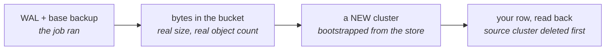

# Prove a backup by restoring it

**A green backup job proves an upload happened. Only a restore proves a
backup.** Every success condition on this page is therefore an assertion about
recovered data or stored bytes, never about a command exiting zero, and the
procedure ends with you reading a row out of a database that did not exist
twenty minutes ago.

The mechanism: **CloudNativePG databases archive to any S3-compatible object
store** via the Barman Cloud plugin, on a schedule you own, and restore is a
one-CR bootstrap.

## Before you begin

| What you need | Why | How to check |
|---|---|---|
| A running CNPG **operator** and the **Barman Cloud plugin**, in the same namespace | The plugin injects a sidecar into each database pod. In a different namespace it injects nothing and says nothing | `kubectl get crd clusters.postgresql.cnpg.io objectstores.barmancloud.cnpg.io` returns both |
| A **database to back up**, already running | Everything below is per database | `kubectl get cluster.postgresql.cnpg.io -A` lists it as `Cluster in healthy state` |
| An **S3 endpoint**, or the shipped object store | Somewhere for the base backup and the WAL to land | Shipped store: `kubectl -n tockmox-platform get svc tockmox-garage`. Your own: `curl -fsS -o /dev/null ENDPOINT_URL && echo reachable` from inside the cluster |
| **Write access to your site repository** | Every CR below is GitOps-managed. Applied by hand it survives until ArgoCD's next reconcile and no longer | `export SITE_REPO=YOUR_SITE_REPO_PATH`, then `git -C "$SITE_REPO" push --dry-run` succeeds |
| **A row you can name in advance** | This is the actual test. "The restore finished" is not a success condition; "the row I wrote at 03:18 is present" is | You can write down a table, a column, and a value that must survive |
| **Spare capacity for a second copy** of the database | The rehearsal restore is a NEW cluster beside the original, not an in-place operation | `kubectl get pvc -A` against your node's free space, at the size in the `Cluster`'s `storage` |

**Estimate, not a measurement: 30 to 60 minutes** for the first time through,
most of it waiting for a base backup and a bootstrap.

## Where each command runs

Two surfaces, and confusing them is the most common way this comes undone:

| Marked | Runs where |
|---|---|
| **SITE REPO** | A file you commit and push. ArgoCD applies it. Every YAML block on this page is one of these |
| **WORKSTATION** | `kubectl` against the cluster, for the assertions. These read; they do not configure |

**Do not `kubectl apply` the YAML on this page directly.** ArgoCD's `selfHeal`
reverts it on the next reconcile, and you get a backup configuration that works
until it silently does not. Commit it.

## What ships, and what you still decide

Shipped since **0.5.0 (2026-08-19)**:

| Piece | State on a fresh install | Your decision |
|---|---|---|
| CNPG operator | ships in the platform layer | none |
| Barman Cloud plugin | `apps.barmanPlugin`, **on** by default | turn it off only if you run CNPG yourself |
| An object store to write to | `apps.garage`, **on** by default | keep it, or bring your own S3 |
| The `ObjectStore` CR for the model gateway | rendered when `modelGateway.database.backup.objectStore.create` is true | which store it points at |
| **Backups themselves** | `modelGateway.database.backup.enabled` is unset, which **follows `capabilities.dataProtection` (on)** from 0.7.1; it was `false` before | leave it, or set `false` to opt out (an alert then fires until you turn it back on or silence it) |
| The weekly restore drill | `modelGateway.database.backup.restoreDrill.enabled` is `true`, and takes effect once backups are on | leave it on |

Values and defaults read from `charts/tockmox-ai/values.yaml` and
`charts/tockmox-platform/values.yaml` at the 0.6.0 tree on 2026-09-01.

**From 0.7.1 the model gateway's database backs up by default**, to the Garage
in the platform layer, because `modelGateway.database.backup.enabled` follows the
`dataProtection` capability. Through 0.7.0 it was `false` and a fresh install had
the whole mechanism present and backed nothing up. The default assumes the
platform layer's Garage and Barman plugin are on and its bootstrap has copied
the credentials into `tockmox-ai`; if you declined the capability or set the
key to `false`, the chart renders the alert `TockmoxModelGatewayDatabaseUnbacked`
for as long as the database has no backup. Still true on any version: a green
backup proves nothing until you have restored one (the drill below).

The shipped object store is one Garage node inside the cluster it protects.
What that covers, what it does not, and why raising `replicationFactor` cannot
help, is
[storage § the shipped object store](../administration/storage.md#the-shipped-object-store-and-what-one-copy-covers).

## The proof chain

Each link asserts on an artifact rather than on the step before it, which is
why there are four of them and not one:



Text equivalent: a backup job running is not evidence; bytes in the bucket are
weak evidence; a cluster that bootstraps from those bytes is strong evidence;
and reading your known row out of that cluster **after deleting the source** is
the only link that cannot pass for the wrong reason.

## 1. Choose a target: any S3 endpoint ... Required

**Decide before you write any CR**, because the next three sections differ by
which branch you took:

| Target | Choose it when | What you do here |
|---|---|---|
| **The shipped store** (recommended to start) | You have nowhere else yet. Bucket, key and credentials already exist | Nothing. Skip to [step 2](#2-turn-on-the-barman-cloud-plugin--conditional) |
| **Your own S3** | You have a NAS, a MinIO, another cluster's Garage, or a cloud bucket | Create a bucket and a scoped key, and seal the credentials. Below |

**A backup that lives on the same storage as the thing it protects is a copy,
not a backup.** The shipped store is shown because it demonstrates the full
mechanism with zero external dependencies. Point at storage that survives the
cluster for anything you care about. The reference site backs its in-cluster
object store onto a separate NAS for exactly this reason.

**For the model gateway's own database, the branch is one key each way, and you
may not set both.** Either leave
`modelGateway.database.backup.objectStore.create` true and let the chart render
an `ObjectStore` against the shipped Garage, or set
`modelGateway.database.backup.objectStoreName` to a CR you wrote yourself and
turn `create` off. A guard in `charts/tockmox-ai/templates/litellm-db.yaml`
refuses the combination where both are supplied, because only one would be used
and nothing would say which. A second guard refuses `backup.enabled: true` with
neither, on the grounds that a backup with no destination is not a backup. Both
fail the render, before anything reaches your cluster.

### If you brought your own S3

**YOU SUPPLY:** the bucket name, the key name, `DB_NAME`, and `DB_NAMESPACE`.
The commands below use a Garage you run yourself; the pod name and namespace are
**yours**, not the shipped store's. On a stock install, backing up the database
that ships, `DB_NAME` is `tockmox-litellm-db` and `DB_NAMESPACE` is
`tockmox-ai`:

**WORKSTATION** ... against YOUR OWN Garage, not the shipped one. The first two
lines are where you substitute, once, and the three commands below them read
what you set rather than asking you to spell your pod name three times.

```bash
export GARAGE_NS=YOUR_GARAGE_NS
export GARAGE_POD=YOUR_GARAGE_POD
kubectl -n "$GARAGE_NS" exec "$GARAGE_POD" -- /garage bucket create cnpg-backups
kubectl -n "$GARAGE_NS" exec "$GARAGE_POD" -- /garage key create cnpg-backup-key
kubectl -n "$GARAGE_NS" exec "$GARAGE_POD" -- \
  /garage bucket allow --read --write cnpg-backups --key cnpg-backup-key
```

Seal the key into the **database's** namespace. A CNPG `ObjectStore` reads its
Secret from its own namespace, so a credential elsewhere is invisible to it:

**WORKSTATION**, and it is the one command here that **writes a file rather than
reading one**. The file lands in your **SITE REPO**, and you then commit it ...
nothing on this page applies it by hand.

**YOU SUPPLY:** the database name and namespace, and the two key values printed
by the command above. The keys arrive through `read -rs` so neither the access
key nor the secret lands in your shell history. **Each prompt prints the byte
count it read; a `0` means the paste did not reach the variable**, and the
sealed file below would then carry an empty credential that seals, commits and
syncs without complaint and fails at the first archive. The prompt is `printf`
then `read -rs` rather than `read -p` because zsh, the shell macOS ships, has
no `-p` prompt flag on `read` ... it prints `read: -p: no coprocess` and
continues with the variable unset.

```bash
: "${SITE_REPO:?export SITE_REPO first, see Before you begin}"
export DB_NAME=YOUR_DB_NAME
export DB_NAMESPACE=YOUR_DB_NAMESPACE
printf 'ACCESS_KEY_ID from the command above: '; read -rs GARAGE_KEY_ID; echo
printf 'bytes read: %s\n' "$(printf '%s' "$GARAGE_KEY_ID" | wc -c | tr -d ' ')"
printf 'ACCESS_SECRET_KEY from the command above: '; read -rs GARAGE_SECRET; echo
printf 'bytes read: %s\n' "$(printf '%s' "$GARAGE_SECRET" | wc -c | tr -d ' ')"
[ -n "$GARAGE_KEY_ID" ] && [ -n "$GARAGE_SECRET" ] || echo "STOP: a key was empty, nothing will be sealed"
[ -n "$GARAGE_KEY_ID" ] && [ -n "$GARAGE_SECRET" ] \
&& kubectl -n "$DB_NAMESPACE" create secret generic "$DB_NAME-garage-backup" \
  --from-literal=ACCESS_KEY_ID="$GARAGE_KEY_ID" \
  --from-literal=ACCESS_SECRET_KEY="$GARAGE_SECRET" \
  --dry-run=client -o yaml \
| kubeseal --format yaml \
    --controller-name sealed-secrets \
    --controller-namespace kube-system \
  > "$SITE_REPO/secrets/$DB_NAME-garage-backup.sealed.yaml"
unset GARAGE_KEY_ID GARAGE_SECRET
```

**The redirect names `$SITE_REPO` explicitly** rather than a bare `secrets/`,
because this block writes a file and a relative path writes it wherever you
happen to be standing ... which is how a sealed credential ends up in the
Tockmox checkout instead of the site repository.

The `--controller-*` flags name the sealed-secrets Service the documented
install creates; kubeseal's own default (`sealed-secrets-controller`) does not
match it, and without them the `>` redirect leaves a **zero-byte file that
looks minted**. See [secrets § sealing one](../administration/secrets.md#sealing-one).
Worth naming twice on a recovery page: a seal that produced nothing is
discovered at the moment you need the restore.

**Success condition:**

**WORKSTATION** ... after committing and letting ArgoCD sync

```bash
kubectl -n DB_NAMESPACE get secret DB_NAME-garage-backup \
  -o jsonpath='{.data.ACCESS_KEY_ID}' | base64 -d | wc -c
```

Prints a non-zero byte count in the **database's** namespace. A sealed secret
that never decrypted is absent here, not empty, and the workload that wants it
sits in `CreateContainerConfigError` rather than failing loudly.

## 2. Turn on the Barman Cloud plugin ... Conditional

**If** `kubectl get crd objectstores.barmancloud.cnpg.io` returns the CRD, the
plugin is already running and you can skip this section. It is on by default
(`apps.barmanPlugin` in the platform layer).

This section is for people who turned it off, or who run CNPG outside Tockmox.
The plugin is the CloudNativePG project's own chart, adopted rather than
authored. Install it as an Argo Application in your site repository's `apps/`,
into the **same namespace as the CNPG operator** (the platform namespace on a
stock install):

```yaml
# SITE REPO: apps/cnpg-barman-plugin.yaml
apiVersion: argoproj.io/v1alpha1
kind: Application
metadata: { name: cnpg-barman-plugin, namespace: argocd }
spec:
  project: default
  source:
    chart: plugin-barman-cloud
    repoURL: https://cloudnative-pg.github.io/charts
    targetRevision: 0.7.0
  destination:
    server: https://kubernetes.default.svc
    namespace: tockmox-platform
  syncPolicy:
    automated: { prune: true, selfHeal: true }
    syncOptions: [ServerSideApply=true]
```

It brings the `ObjectStore` CRD and a sidecar-injecting controller; its mTLS
certificates come from the cert-manager the platform already runs.

> **If that `repoURL` fails to resolve, it is not your cluster.**
> `cloudnative-pg.github.io/charts` answers a 301 to `cloudnative-pg.io`, and
> that apex domain has had outages ... it stopped resolving entirely on
> 2026-09-02. The same charts are published to the project's own registry at
> `ghcr.io/cloudnative-pg/charts`, which is where Tockmox's own dependency on
> them now points. The ArgoCD spelling for an OCI Helm source differs by
> ArgoCD version, so check yours rather than copying a form from here.

**Success condition:**

**WORKSTATION**

```bash
kubectl get crd objectstores.barmancloud.cnpg.io
kubectl -n tockmox-platform get deploy -l app.kubernetes.io/name=plugin-barman-cloud \
  -o jsonpath='{.items[*].status.readyReplicas}'
```

The CRD exists and the controller reports at least one ready replica. **A
plugin in the wrong namespace passes neither of these and produces no error
anywhere else** ... the database comes up healthy and archives nothing.

## 3. Point the database at the store ... Required

Two objects: an `ObjectStore` naming the destination, and changes on the
`Cluster` that enable the plugin as WAL archiver.

**Which database are you backing up?** The rest of this page is written against
**`tockmox-litellm-db` in `tockmox-ai`**, the model gateway's database, because
that is the one a stock install actually has. Everything still applies to a
database you added yourself; only the names change.

| Your database | What you do in this section |
|---|---|
| **`tockmox-litellm-db`** (ships with the AI layer) | Set one values key. The chart renders both objects for you ... jump to [3a](#3a-the-shipped-database-one-values-key) |
| **A database you added** (a site app) | Write both objects yourself ... [3b](#3b-a-database-you-added-write-both-objects) |
| **You declined the AI capability** and added no database | There is nothing to back up yet and nothing here to run. Come back when you add one; §6 still applies, and so does the sealed-secrets controller key, which is the row you cannot regenerate |

### 3a. The shipped database: one values key

`modelGateway.database.backup.enabled` is unset on a fresh install, which means
it follows the `dataProtection` capability and is on. Through 0.7.0 it was
`false`, which is why a cluster from that era archives nothing until you set it
in your site's `site/values/ai.yaml`; setting it explicitly stays valid, and
pins it on whatever the capability says:

```yaml
# SITE REPO
modelGateway:
  database:
    backup:
      enabled: true
```

That renders the `ObjectStore` (`tockmox-litellm-db-store`, writing to
`s3://tockmox-backups/litellm-db` in the shipped Garage), the plugin wiring on
the `Cluster`, and the nightly `ScheduledBackup` ... the same three things 3b
writes by hand. To send it somewhere other than the shipped store, set
`objectStoreName` to an `ObjectStore` you created and leave
`objectStore.create` off. Defaults are in `charts/tockmox-ai/values.yaml` under
`modelGateway.database.backup`.

Then go to the success condition at the end of this section.

### 3b. A database you added: write both objects

`myapp-db` in `myapp` below is a placeholder. **Substitute your own names
throughout** ... the CR names, the namespace, the `destinationPath` prefix and
the Secret. A worked example of a site app with a database is in
[adding an application](../administration/adding-an-application.md).

```yaml
# SITE REPO
apiVersion: barmancloud.cnpg.io/v1
kind: ObjectStore
metadata: { name: myapp-db-store, namespace: myapp }
spec:
  configuration:
    # The bucket the shipped Garage creates (`garage.bucket`, default
    # `tockmox-backups`). Change it here only if you changed it there.
    destinationPath: s3://tockmox-backups/myapp-db
    # The shipped Garage's S3 endpoint. The Service is always `tockmox-garage`;
    # the NAMESPACE is wherever you installed the platform layer, which is
    # `tockmox-platform` on a stock install. Point this at your own S3 endpoint
    # instead if you brought one.
    endpointURL: http://tockmox-garage.tockmox-platform.svc.cluster.local:3900
    s3Credentials:
      # Shipped store: `tockmox-garage-credentials`, copied into this namespace
      # by the Garage bootstrap Job. Your own S3: the sealed Secret from step 1.
      accessKeyId:     { name: myapp-db-garage-backup, key: ACCESS_KEY_ID }
      secretAccessKey: { name: myapp-db-garage-backup, key: ACCESS_SECRET_KEY }
    wal:  { compression: gzip }
    data: { compression: gzip }
  retentionPolicy: "14d"
  instanceSidecarConfiguration:
    env:
      # Garage/MinIO-style endpoints; harmless for AWS
      - { name: AWS_REGION, value: garage }
      - { name: AWS_DEFAULT_REGION, value: garage }
      - { name: AWS_REQUEST_CHECKSUM_CALCULATION, value: when_required }
      - { name: AWS_RESPONSE_CHECKSUM_VALIDATION, value: when_required }
```

**YOU SUPPLY:** `namespace`, the `destinationPath` prefix, and the Secret name.

On the `Cluster`, enable the plugin as WAL archiver and add a schedule:

```yaml
# SITE REPO ... on the existing Cluster
spec:
  plugins:
    - name: barman-cloud.cloudnative-pg.io
      enabled: true
      isWALArchiver: true
      parameters: { barmanObjectName: myapp-db-store }
---
apiVersion: postgresql.cnpg.io/v1
kind: ScheduledBackup
metadata: { name: myapp-db-nightly, namespace: myapp }
spec:
  schedule: "0 0 3 * * *"        # six fields; this is 03:00 daily
  backupOwnerReference: self
  cluster: { name: myapp-db }
  method: plugin
  pluginConfiguration: { name: barman-cloud.cloudnative-pg.io }
```

**The schedule field takes SIX fields, not five.** CNPG includes seconds. A
five-field entry is either rejected or means something other than what you
intended, and the shipped `restoreDrill.schedule` next to it is a Kubernetes
CronJob taking five, which is exactly how the mistake happens.

**Success condition** (either path). Substitute your own names if you took 3b:

**WORKSTATION**

```bash
kubectl -n tockmox-ai get cluster.postgresql.cnpg.io tockmox-litellm-db \
  -o jsonpath='{.status.conditions[?(@.type=="ContinuousArchiving")].status}'
kubectl -n tockmox-ai get cluster.postgresql.cnpg.io tockmox-litellm-db \
  -o jsonpath='{.status.lastSuccessfulBackup}{"\n"}'
```

`ContinuousArchiving` reports `True`. WAL segments start archiving immediately;
base backups follow the schedule, so `lastSuccessfulBackup` is empty until step
4 or 03:00, whichever comes first. **`True` with no archived WAL is the
failure to watch for**, and the next step is what catches it.

## 4. Prove a backup now, not at 03:00 ... Required

```yaml
# SITE REPO
apiVersion: postgresql.cnpg.io/v1
kind: Backup
metadata: { name: tockmox-litellm-db-demo, namespace: tockmox-ai }
spec:
  cluster: { name: tockmox-litellm-db }
  method: plugin
  pluginConfiguration: { name: barman-cloud.cloudnative-pg.io }
```

**Force a WAL switch first.** A row committed seconds ago lives in a WAL
segment that has not been archived yet, so a backup taken without this can
silently miss the very row you are about to look for:

**WORKSTATION**

```bash
kubectl -n tockmox-ai exec tockmox-litellm-db-1 -c postgres -- \
  psql -U postgres -c 'SELECT pg_switch_wal();'
```

**Success condition ... assert on the artifact, not the exit code:**

**WORKSTATION**

```bash
kubectl -n tockmox-ai get backups.postgresql.cnpg.io tockmox-litellm-db-demo \
  -o jsonpath='{.status.phase}{"\t"}{.status.backupId}{"\n"}'
```

**Qualify the kind. `backup` on its own is the wrong CRD on every Tockmox
install.** The platform layer installs Longhorn, which registers
`backups.longhorn.io`, and that is what an unqualified `kubectl get backup`
resolves to. Reproduced 2026-09-10 against a backup that existed and had
completed:

```
Error from server (NotFound): backups.longhorn.io "..." not found
```

**That `NotFound` reads as "the backup was never created"**, which sends you to
debug a backup path that is working. On a page whose central warning is that a
completed phase can hide an empty bucket, this is the one error message most
likely to be believed. `backups.postgresql.cnpg.io` returned the phase and the
`backupId` immediately.

**WORKSTATION** ... then look in the store itself. The block below reads the
**shipped store**. If you brought your own S3, the equivalent is whatever lists
objects on it, run against **your** bucket rather than this one:

```bash
kubectl -n tockmox-platform exec tockmox-garage-0 -- \
  /garage bucket info tockmox-backups
```

`phase: completed` with a `backupId`, **and** the bucket reporting real bytes
and a non-zero object count. On the 2026-08-15 drill that was `Size: 7.4 MiB`
across 6 objects for a small database.

**A completed phase with an empty bucket is the whole reason this page
exists.** It means the sidecar reported success against a destination that
accepted nothing, and nothing else in the cluster will tell you.

## 5. Restore, the part everyone skips until it matters ... Required

Recovery is a **new** cluster bootstrapped from the store, never an in-place
operation. Rehearse it beside the original; the same procedure moves a database
between clusters.

```yaml
# SITE REPO
apiVersion: postgresql.cnpg.io/v1
kind: Cluster
metadata: { name: tockmox-litellm-db-restore, namespace: tockmox-ai }
spec:
  instances: 1
  storage: { size: 2Gi }
  bootstrap:
    recovery: { source: origin }
  externalClusters:
    - name: origin
      plugin:
        name: barman-cloud.cloudnative-pg.io
        parameters:
          # The ObjectStore the AI layer renders when backups are on. If you
          # took 3b, this is the ObjectStore you wrote.
          barmanObjectName: tockmox-litellm-db-store
          serverName: tockmox-litellm-db   # the ORIGINAL cluster's name
```

**`serverName` is the original cluster's name, not the new one.** It is the
prefix the backup was written under. Get it wrong and the bootstrap looks for a
backup that does not exist and reports a missing base backup rather than a
naming error.

**Success condition ... read the data, not the status:**

**WORKSTATION** ... the row you named in "before you begin"

```bash
kubectl -n tockmox-ai exec tockmox-litellm-db-restore-1 -c postgres -- \
  psql -U postgres -d litellm -c 'SELECT ...your table, your column...;'
```

The row you wrote down before you started is present, with its original values.
**`phase: Cluster in healthy state` on the restored cluster is not the success
condition** ... an empty database that bootstrapped cleanly reports exactly
that.

**If the database is the shipped one you have no row of your own in it**, and
writing into the model gateway's schema to make one is a bad trade. Assert that
the schema came back with substance instead ... the same check the weekly drill
makes, and it fails on exactly the empty-but-healthy cluster the paragraph above
warns about:

**WORKSTATION**

```bash
kubectl -n tockmox-ai exec tockmox-litellm-db-restore-1 -c postgres -- \
  psql -U postgres -d litellm -tAc \
  "SELECT count(*) FROM information_schema.tables WHERE table_schema='public';"
```

A count in the dozens, not `0`. On the 2026-09-10 greenfield the drill recorded
`in_recovery=f public_tables=77`. **This is weaker evidence than your own named
row** ... a table count proves the schema restored, not that your data did ...
so use it for the shipped database and use the row for anything you own.

**Optional: point-in-time recovery.** Add
`recoveryTarget: { targetTime: "..." }` under `bootstrap.recovery`. What you
get is the ability to land before a bad migration rather than after the last
base backup; what you lose by skipping it is nothing until the day you need it.

**Optional: fail over to the restored cluster.** Repoint the app's
`DATABASE_URL` secret ref at `tockmox-litellm-db-restore-app`. Before a *planned*
migration, run the same `pg_switch_wal()` from
[step 4](#4-prove-a-backup-now-not-at-0300--required) against the source first:
WAL archived after the last switch may be minutes behind, and those minutes are
the difference between a clean cutover and a support ticket.

### A drill that actually destroyed something

Restoring beside a healthy original proves the mechanism but leaves one
question open: was the data read from the object store, or from something still
on the cluster? Run on 2026-08-15 in `tockmox-ai`, with the source cluster
**deleted** in between:

| Time (UTC) | What happened |
|---|---|
| 03:18:21 | a known row written to a drill database, then `pg_switch_wal()` |
| 03:18:47 | `Backup` reached `phase: completed`, `backupId 20260815T031836` |
| 03:19:03 | the entire source `Cluster` deleted, not just its data |
| 03:19:37 | a new `Cluster` bootstrapped from the store: `restore command execution completed without errors` |
| 03:19:5x | the row present in the restored cluster, original timestamp intact |

Garage held 7.0 MB across 7 objects at the end.

Two things that drill is worth repeating for. `pg_switch_wal()` before the
backup is not decoration ... a row committed seconds earlier lives in a WAL
segment that has not been archived yet, and a restore that silently misses it
is the failure mode you least want to discover during an incident. And deleting
the source is the only version of this test that cannot pass for the wrong
reason.

**Scope of that claim:** one drill database in one namespace on 2026-08-15. It
was **not** run against the model gateway's own data, and it is not a claim
about your database. Run it yourself once.

### The scheduled drill repeats this weekly

Since 0.5.0 (2026-08-19) a weekly CronJob automates exactly the sequence above:
it bootstraps a fresh cluster from the store, asserts recovery finished and
that the schema has substance, writes a dated PASS or FAIL row into the
`tockmox-restore-drill-register` ConfigMap, and tears itself down. It never
touches the live database. On by default once backups are on
(`modelGateway.database.backup.restoreDrill`).

**WORKSTATION**

```bash
kubectl -n tockmox-ai get configmap tockmox-restore-drill-register \
  -o jsonpath='{.data}{"\n"}'
```

The register's first three rows on the reference install read **FAIL, PASS,
PASS**. The FAIL is the point: the drill's very first run caught a backup
destination that had been silently broken since a reinstall. That is the entire
argument for drills that run on a schedule and complain.

**Reading a row.** A row is `<UTC time> <PASS|FAIL> <detail> backup=<backupId>`.
Read the first field as the time and the second as the verdict, then pick the
rest out by key: on a PASS the detail is `in_recovery=f public_tables=<n>`, on a
FAIL it is a short sentence, so never match on position. `backup=` names the
base backup the drill restored: it pins the newest completed `Backup` of the
live cluster, so the row says exactly what was proved. `backup=none` means no
completed `Backup` was visible to the drill and the recovery took the newest
base backup in the store. Rows written before 0.7.1 have no `backup=` field.

**A PASS leaves error-level lines behind, and they are expected.** Three come
from the drill cluster being created and deleted inside a minute, and none
means a failed backup or restore (TM-0673, TM-0672):

- At create, the barman-cloud plugin logs `Error while handling GRPC request`
  for `ReconcilerHooks/Pre` with `Role.rbac.authorization.k8s.io
  "<cluster>-drillcheck-barman-cloud" not found`, and the operator logs
  `Pre-reconcile hook stopped the reconciliation loop`. The plugin asks for its
  per-cluster Role before anything has created it, and the next reconcile finds
  it.
- At teardown, the CloudNativePG operator logs `Reconciler error` with
  `cannot update the resource status: clusters.postgresql.cnpg.io
  "<cluster>-drillcheck" not found`. The drill deletes the Cluster while the
  operator is mid-reconcile on it.
- While the drill Cluster has no `status` yet, kube-state-metrics logs
  `got nil while resolving path` for `tockmox_cnpg_cluster_ready_instances` and
  `tockmox_cnpg_cluster_condition`, once per scrape, until the status appears.
  Any new CloudNativePG Cluster does the same in its first seconds.

A real failure shows up in the register as a FAIL row and in
`TockmoxRestoreDrillFailed`, not only in these lines.

Three alerts watch the drill itself, so a drill that stops running, never ran,
or ran and failed is a paged event rather than a quiet one:
[monitoring § why the restore drill is itself alerted on](monitoring.md#why-the-restore-drill-is-itself-alerted-on).

A fourth, `TockmoxWalArchiveBacklog`, watches the archive rather than the
drill: WAL segments waiting in `pg_wal/archive_status` for more than 15
minutes mean the archiver has stalled, which is the failure that shows no
symptom until a restore needs WAL that never left the node. It reads
`cnpg_collector_pg_wal_archive_status{value="ready"}` and not the last-backup
timestamp, because that metric is deprecated in CloudNativePG since 1.26 and
reports 0 under the barman-cloud plugin path this platform uses, backup or no
backup.

**This page remains the manual procedure the drill automates. Run it yourself
once anyway**, because the day you need it is not the day to learn it.

## 6. What else wants backing up

Everything above covers CNPG databases. Four other things hold state, and they
are covered by four different mechanisms:

| Data | Mechanism | Status |
|---|---|---|
| CNPG databases | this page | **drilled** 2026-08-15, source cluster destroyed and restored from the store |
| Volume snapshots (CSI) | `VolumeSnapshot` with class `longhorn-snapshot` (in-cluster) or `longhorn-backup` (off-volume) | **ships.** The snapshot-controller and its CRDs arrive with `dataProtection`, and the platform layer provides two classes, neither marked default. `longhorn-snapshot` (type `snap`) is seconds, local to the volume's replicas, and gone with the volume: not a backup. `longhorn-backup` (type `bak`, deletion policy `Retain`) is minutes, is uploaded to Longhorn's BackupTarget, and survives losing the volume. For a volume with no application-level backup it is the only protection the chart offers; databases keep using this page's barman path. Longhorn's own `snapshots.longhorn.io` remains a different, storage-internal interface |
| Longhorn volumes | Longhorn's default BackupTarget: the shipped store (`s3://tockmox-backups@garage/longhorn`) unless the site names another | **ships** (0.5.0, 2026-08-19); **restored once in production** (2026-10-01, every volume of one cluster through the shipped `longhorn-backup` class from an off-cluster target) and **drilled** 2026-10-10 (one volume backed up through `longhorn-backup` to the shipped store, its claim, PV and Longhorn volume deleted, a new claim restored from the VolumeSnapshot and read back byte for byte; see [what is not certified here](#what-is-not-certified-here)): the Garage bootstrap Job mints a Longhorn-format credential and wires the default BackupTarget to the shipped store, unless the site set `longhorn.defaultBackupStore.backupTarget` or an operator already pointed it somewhere, both of which are respected. The shipped store is circular, see [the warning below](#longhorn-backups-into-the-shipped-garage-are-circular) |
| Authentik's bundled (Bitnami) Postgres | nightly `pg_dump` CronJob to the shipped store, seven-weekday rotation (`authentik-db/authentik-<dow>.sql.gz`), upload byte-verified, freshness-alerted | **ships** (0.5.0, 2026-08-19) as the bridge until the CNPG migration; **drilled** 2026-10-10 (that night's dump restored with the command below into a fresh database, a second Authentik started on it, and a user created before the dump signed in; see [what is not certified here](#what-is-not-certified-here)). Restore: `gunzip < dump \| psql -U authentik -d authentik` against a fresh database, then start Authentik. Seven-day window, stated plainly |
| Your site repo and the sealed-secrets controller key | git remote plus the key backup in [secrets](../administration/secrets.md#back-up-the-controller-key-now) | do this **today** ... the controller key is the one item that cannot be regenerated |

**Success condition for the last row, and it is the only one you can check
right now:**

**WORKSTATION.** **YOU SUPPLY:** the path to the key backup, on the first line.

```bash
export KEY_BACKUP=YOUR_KEY_BACKUP_PATH
grep -c 'tls.key' "$KEY_BACKUP"
```

At least 1, on a copy that is not on the machine that built the cluster.

## 7. The whole-cluster story, in one place

Everything above protects data inside a cluster that still exists. Losing the
cluster itself ... the node dies, the disk dies, the VM host eats it ... is a
different failure, and Tockmox's answer is assembled from five planes:

| Plane | Protected by | Where it must live |
|---|---|---|
| Cluster configuration | **your site repo.** GitOps is the manifest backup: every Tockmox resource is reconstructed by pointing ArgoCD back at it. There is nothing to export | your git remote, off this machine |
| Secrets | the SealedSecrets in that repo plus **the controller key backup** | key backup off this machine, per [secrets](../administration/secrets.md#back-up-the-controller-key-now); the procedure and its restore drill are [escrow the sealed-secrets key](sealed-secrets-key-escrow.md) |
| Databases | CNPG plus Barman to S3 (this page) | an S3 endpoint ... off this machine the moment you have one |
| Volumes | Longhorn backups to a BackupTarget | same |
| The substrate | **your Kubernetes distribution's own state backup**, which is outside Tockmox. On k3s that is etcd snapshots: `etcd-snapshot-schedule-cron` plus `etcd-s3` to an endpoint | **off this cluster, without exception** |

**The circular dependency to refuse.** The shipped Garage runs IN the cluster,
so pointing the substrate row at it means the backup of the cluster dies with
the cluster. A NAS, another machine's MinIO or Garage, or a directory an
off-cluster cron rsyncs are all fine answers; the shipped Garage is not. The
full reasoning is
[storage § the shipped object store](../administration/storage.md#the-shipped-object-store-and-what-one-copy-covers).

### Longhorn backups into the shipped Garage are circular

The chart's own Garage stores its data on a Longhorn volume, in the same
cluster. Backing Longhorn up into it therefore does not survive losing the
cluster, or losing Longhorn itself: the backups go down with the thing they
protect. That is fine for an evaluation install and it is not fine for data you
care about. Point Longhorn at an off-cluster target.

NFS is the recommended choice, because it needs no credentials and a NAS is the
usual thing a site already has. In your site values:

```yaml
longhorn:
  defaultBackupStore:
    backupTarget: nfs://nas.int.example.com:/volume1/longhorn-backup
```

An external S3 works too: set `backupTarget: s3://BUCKET@REGION/longhorn` and
`backupTargetCredentialSecret` to a Secret you create in the Longhorn namespace
holding `AWS_ACCESS_KEY_ID`, `AWS_SECRET_ACCESS_KEY` and, for a non-AWS endpoint,
`AWS_ENDPOINTS`. When `backupTarget` is set the Garage bootstrap Job does not
render its Longhorn step at all, so it cannot contest your choice.
`garage.bootstrap.wireLonghornBackupTarget: false` skips that step without
naming a target.

Two things this page does not prove. Longhorn reads `defaultBackupStore` when it
creates the default BackupTarget, so treat it as a fresh-install setting: on a
cluster that already has a target, change it in the Longhorn UI or by patching
the `default` BackupTarget. And the NFS and external-S3 routes have been
rendered, not restored from; only the render of the wiring is checked.

**Restore order, when the worst happens.** Each step depends on the one before
it, which is why this is a list and not a table:

1. Rebuild the node and the Kubernetes distribution, or restore its etcd
   snapshot if you kept one and want the cluster's exact prior state.
2. Install ArgoCD and the sealed-secrets controller. **Restore the controller
   key before the controller first starts** ... a controller that generates its
   own key first makes every sealed secret in your repository unreadable.
3. Give ArgoCD its repository credentials, apply your site repo's
   `bootstrap/root.yaml`, and apply your sealed secrets once the policy wave
   has created the namespaces. This is the
   [install](../deployment/install.md) path, second time through.
4. Databases: bootstrap each CNPG cluster from its object store
   ([step 5](#5-restore-the-part-everyone-skips-until-it-matters--required)).
5. Volumes: restore from the Longhorn BackupTarget where one was configured.

**Rehearse step 4 before you need step 1.**

### Adopting an existing Garage

If you point the platform layer at a Garage metadata volume that another install wrote, check which metadata
engine wrote it first. Garage does not record its engine in the data. This chart runs `db_engine = "sqlite"`
by default (`garage.dbEngine`), while upstream Garage defaulted to LMDB for a long time, so most existing stores
are LMDB. Started on an LMDB directory, a sqlite Garage opens an empty database beside the real one: the
bootstrap then creates fresh buckets and keys, every check reports success, and your objects are unreachable.

The Garage pod runs an engine guard before Garage starts and refuses that combination with a message naming
both ways out:

- keep LMDB: set `garage.dbEngine: lmdb` in your platform values, or
- convert once, with Garage stopped, from a pod that mounts the metadata volume:
  `garage convert-db -a lmdb -i <meta>/db.lmdb -b sqlite -o <meta>/db.sqlite`
  (Garage v2 takes only these short flags). Keep `db.lmdb` until the converted store has served a backup.

Changing `garage.dbEngine` on a store that already holds data is that same conversion, not a setting.

Upgrading to a release with the guard restarts the Garage pod once, because the pod gains the init container; the config checksum is unchanged at the default engine.

## What is not certified here

The dated results on this page are measurements of specific runs, not of this
page:

- **2026-08-15**, `tockmox-ai`: the destroy-and-restore drill in
  [§ 5](#a-drill-that-actually-destroyed-something), against a purpose-made
  drill database.
- **2026-08-15**: the shipped object store's own end-to-end verification
  (layout, bucket, key, S3 PUT and GET), recorded in
  [storage](../administration/storage.md#the-shipped-object-store-and-what-one-copy-covers).
- **2026-08-19**: the clean-install path, executed end to end.
- **2026-08-19**, the overnight rehearsal on the maintainer's lab: a base
  backup taken and the store's objects copied aside; the nine Tockmox layers
  torn down to bare k3s, ArgoCD and sealed-secrets; reinstalled from
  `bootstrap/root.yaml` with the operator Secrets re-applied; the LiteLLM
  database bootstrapped from the preserved store into a **second** CNPG
  cluster beside the live one and checked against anchors recorded before
  the teardown (row counts, newest key alias, 77 tables); then the shipped
  drill passing on the rebuilt system. That is steps 3 and 4 of the restore
  order, back to back, for one database.
- **2026-10-01**, the maintainer's production homelab, during its migration
  onto the `v0.7.0` chart (rehearsed beforehand on throwaway clusters): every
  Longhorn volume backed up to an off-cluster NFS BackupTarget, the Tockmox
  layers installed from the site repository, and **all 19 volumes restored
  from those backups** under their original claim names through the shipped
  `longhorn-backup` VolumeSnapshotClass, at three replicas, in about 34
  minutes. Every volume in the hash scope (nine of them, chosen before the
  window) read back with an identical whole-tree hash before any workload
  started. Restore drills then passed on the new install for the model
  gateway's database, the chat console's volume and the object store's
  metadata volume. That is step 5 of the restore order, for every volume, on
  a six-node cluster in daily use.
- **2026-10-10**, the maintainer's single-node lab, two drills (TM-0598):
  - **Authentik's `pg_dump`.** The shipped backup CronJob was run once by
    hand (`authentik-db/authentik-sat.sql.gz`, 4,765,419 bytes, local and
    remote byte counts equal). The dump was fetched into a fresh PostgreSQL 17
    with an empty `authentik` database and restored with the command in
    [§ 6](#6-what-else-wants-backing-up) exactly as printed: 2,300 lines of
    `psql` output, no `ERROR`, 230 tables, the six users the live instance
    held. A second Authentik server of the same image and secret key, pointed
    at that database, came up ready; a user created on the live instance
    before the dump then signed in through the default authentication flow's
    API (identification, then password) and `GET /api/v3/core/users/me/`
    answered with that user. The same sign-in with a wrong password was
    refused. The live instance was not touched beyond that one user, deleted
    afterwards.
  - **A Longhorn volume from a VolumeSnapshot.** 64 MiB of random data plus
    200 small files written to a `longhorn` claim; a VolumeSnapshot through
    the shipped `longhorn-backup` class (Longhorn backup `Completed`, in the
    shipped store); the claim, its PV and the Longhorn volume deleted; a new
    claim with the VolumeSnapshot as its `dataSource`. The restored volume
    read back 201 files whose combined `sha256sum` matched the original's.
    The shipped store is the circular one
    ([below](#longhorn-backups-into-the-shipped-garage-are-circular)), so this
    proves the restore path, not survival of the cluster.

**The full sequence 1-through-5 in [§ 7](#7-the-whole-cluster-story-in-one-place)
has never been rehearsed as one exercise.** The 2026-08-19 run did not rebuild
the node or the Kubernetes distribution (step 1), did not reinstall
sealed-secrets or restore its key into a fresh controller (step 2 ... the
controller never left), restored one database rather than every CNPG cluster
(step 4), and touched no volume (step 5). The 2026-10-01 production
migration has since run step 5 for every volume, but it did not rebuild a node
or restore the sealed-secrets key into a fresh controller either, so steps 1
and 2 have still never run. The 0.5.0 release notes describe
that run as "total cluster loss, reinstall, restore"; the loss was the Tockmox
layers, not the cluster, and the correction is in the changelog. The sequence
is assembled from parts that were each run separately, which is a weaker
claim, and this page will say otherwise only when it has been run rather than
described.

The Authentik `pg_dump` restore in [§ 6](#6-what-else-wants-backing-up) has
one drill behind it, the 2026-10-10 run above, on a lab whose Authentik held
six users; the production homelab still does not exercise it, because that
site runs Authentik's database on its own CloudNativePG cluster rather than
the bundled Postgres. The Longhorn BackupTarget restore path is the 2026-10-01
and 2026-10-10 measurements above, both through the snapshot-class route rather
than Longhorn's own `fromBackup` field.

Documented procedures are verified by running them, not by reviewing them. The
[testing standard](../testing-standard.md) says which paths are covered.

## Next

- [Storage](../administration/storage.md#the-shipped-object-store-and-what-one-copy-covers)
  ... what one copy covers, and the circular dependency to refuse
- [Monitoring](monitoring.md#why-the-restore-drill-is-itself-alerted-on)
  ... the alerts that watch the drill
- [Secrets](../administration/secrets.md#back-up-the-controller-key-now)
  ... the one backup that cannot be regenerated
- [Uninstalling](uninstall.md) ... what to take with you before you tear
  anything down

<!-- tockmox:footer:begin -->

---

<sub>Tockmox v0.8.0 &middot; &copy; 2026 Tockmox LLC &middot; code Apache-2.0, docs CC BY 4.0 &middot; Tockmox is a trademark</sub>
<!-- tockmox:footer:end -->
