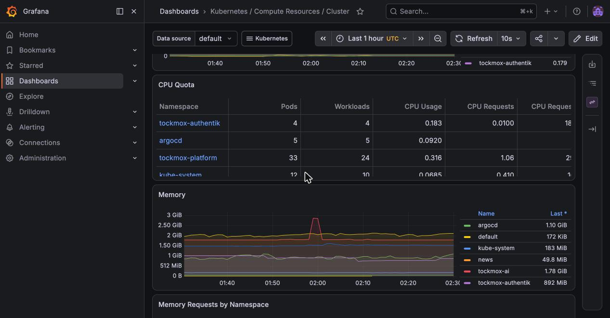

# Monitoring

## Intended stack

Prometheus for metrics, Loki for logs, Grafana to look at both, Alertmanager to
tell you when to care.

## The principle: a status must not be able to lie

Two health axes, always both:

**Is the subject healthy?** The obvious one.

**Is the checker alive?** The one people forget.

If a check stops running, its subject renders **not-green**, never green.
Absence and staleness are failures, not the absence of a failure. A dashboard
that goes green because monitoring broke is worse than no dashboard, because it
actively misleads you.

## Deterministic first, AI on exception

Routine monitoring never invokes a model. Checks run on a schedule, fan in to a
deterministic healthy-or-not decision, and only an exception escalates to
anything intelligent.

A platform whose health monitoring depends on an AI being up has a circular
dependency at precisely the worst moment. Determinism at the base means the
platform can tell you it is broken even when the clever parts are the broken
part.

## Dashboards: what ships, honestly

Two sets. **Upstream's kubernetes-mixin boards** ... Alertmanager, CoreDNS,
etcd, the Kubernetes compute/network/storage boards, Grafana's own overview
... substantial and generic. And **ten Tockmox-authored boards** ship under
`apps.dashboards`, with an eleventh behind a switch. One is the overview (next
paragraph but two). Five are component boards
(2026-08-19): Traefik, cert-manager, MetalLB, Authentik, and Admission &
Policy, each hand-scoped to metrics the component actually emits. Argo
Workflows joined them, and three know Tockmox's own shapes ... both sets are
below. All are grouped in the UI under a `Tockmox /` prefix and linked through
a shared `tockmox` tag dropdown. The eleventh is ArgoCD's, and the switch is the
next paragraph.

Which boards ship was decided on evidence, not inventory: each ported board
queries metric families verified present on a fresh install. **Argo
Workflows** joined the shipped set (2026-08-19) together with the scrape
that feeds it (the devops layer now enables the workflow controller's
metrics and its ServiceMonitor). **ArgoCD** ships as of 0.6.0, but behind a switch, and the reason is worth
reading before you go looking for it. The prerequisite ArgoCD exposes no
metrics services at all on a stock install ... the argo-cd Helm chart ships
them disabled, verified on a clean cluster 2026-08-30. Tockmox never touches
your ArgoCD, so it cannot fix that for you.

So `apps.argocdMonitoring.enabled` gates the three ServiceMonitors, the board
**and** the sync-state alert rules together. It follows the observability
capability, so it is on by default (TM-0739; it was off until 0.7.1). An ArgoCD
installed per [fresh-install § 6](../deployment/fresh-install.md#6-install-argocd)
has its metrics on already. One you installed without them
([ArgoCD § its metrics are off until you turn them on](../administration/argocd.md#its-metrics-are-off-until-you-turn-them-on)
has the values) renders the board as "No data" until you turn them on, or set the
key false to drop the pair.

**Trivy** remains unported, because Tockmox does not ship it.

The boards that know Tockmox's OWN shapes ship too (2026-08-19), and they
are the three this page has been promising: **Backup & Restore Proof**
(WAL segments waiting to archive ... the one CNPG backup metric that still
reports under the barman-cloud plugin path, since the last-backup and
recoverability timestamps are deprecated and read 0 there ... days since the
last drill PASS, the identity dump, and timestamp lines that go flat when
something stalls), **Storage Contract** (every PVC and the class it
landed on, Pending binds, and the two Longhorn duty-cycle fault signals as
graphs), and **Alert Delivery** (the sink, the last delivered notification,
and the whole Alertmanager-to-phone path as rates). Every panel queries
metric families verified present on a fresh install; the drill and
identity-dump panels read their CronJobs' own kube-state series, so they go
yellow-then-red on exactly the schedule the freshness alerts use.

**Tockmox / Overview** (`/d/tockmox-overview`) is the one to open first, or to
put on a wall screen with `?kiosk`. Four rows, each tile a link down to the board
that explains it. **Is it working?** gives a platform verdict, firing alerts,
GitOps applications not Synced and Healthy, scrape targets down, endpoints
answering, nodes not Ready and days since a restore drill passed. **Capacity**
gives the busiest node's memory and CPU, the fullest volume, Longhorn use and
the next certificate expiry. **AI** gives the share of gated requests served
locally, requests by tier, frontier spend (24 hours, 30 days, by model), gateway
errors and latency, the least budget left on a key, and restricted traffic
served off-site (the policy says zero, so anything else is a failed control).
Then the active alerts. The verdict reads OK only when no critical alert fires
**and** Alertmanager's Watchdog is present; with the alert pipeline down it
reads Unknown, never a green zero. A tile whose metric is absent is grey with a
word, not 0. On an install with no AI traffic yet the AI row is grey, and that is
correct. The board is generated by `tools/gen-dashboard-overview.py`; edit the
generator, not the JSON (`tools/check-all.sh` runs its `--check` and fails on a
stale file).

**Folders.** Grafana files the boards in three folders from the sidecar's
`grafana_folder` annotation: **Tockmox** (the boards above), **Kubernetes**
(upstream's), and **General** for anything with no annotation. Upgrading from
0.8.1 moves the boards out of General with their UIDs unchanged, so links and
stars survive. One thing does not: a `default_home_dashboard_path` in
`grafana.ini` names a file, and an annotated board's file moves into its
folder's subdirectory. To make the overview your home page, set it to
`/tmp/dashboards/Tockmox/tockmox-overview.json`.




**Adding your own** ships today via the extension point: any ConfigMap
labelled `grafana_dashboard: "1"` is discovered. Add the annotation
`grafana_folder: <Name>` to file it in a folder of your own (`Site`, say);
without it the board lands in General. Match a UID to replace an upstream
board. See [customising.md](../administration/customising.md).

## What Tockmox itself alerts on

Beyond the kube-prometheus-stack defaults, the layers ship their own rules
where the defaults cannot see. Pointers, not restatements ... each rule's
reasoning lives as comments beside its expression:

| Group | Watches | Lives in |
|---|---|---|
| Platform storage | Longhorn capacity past the scheduling cliff; a volume faulted (duty-cycle, because a wedged volume flaps); a volume stuck attaching (the shape faulted alone cannot see) | `tockmox-platform` |
| Certificates | expiry with renewal margin | `tockmox-platform` |
| Restore drill | no PASS in 15 days; drill never ran at all; the most recent drill failed | `tockmox-ai`, beside the drill |
| Console key | `TockmoxConsoleKeyRejected`: the newest run of the console-key check was answered 401 or 403 by the model gateway and no later run passed. The uptime probe carries no key and cannot see this; the restore drill's newest-failure-against-newest-success shape, so one passing run clears it. A gateway that does not answer is left out by the Job's failure reason. What to do: [ai-plane](../usage/ai-plane.md#when-the-gateway-rejects-the-consoles-key) | `tockmox-ai`, beside the check |
| Failed Jobs | `KubeJobFailed` is upstream's rule (warning, a failed Job that still exists after 15 minutes), re-shipped with the console-key check's Jobs left out: that check keeps 24 failed Jobs on purpose, so the owning alert can read the newest rejection, and the upstream rule fired one copy per kept Job beside it (five at once on the lab). Every other Job's failure fires it as before. `defaultRules.disabled.KubeJobFailed` is the switch; false brings the upstream copy back, never both | `tockmox-observability` (`templates/kube-job-failed.yaml`) |
| WAL archiving | `TockmoxWalArchiveBacklog`: WAL segments waiting to be archived, more than 3 for 15 minutes. The one CNPG backup metric that still reports under the barman-cloud plugin; the last-backup-age metrics read 0 there and would fire forever | `tockmox-ai`, beside the database |
| CNPG instances and scrape targets | `TockmoxCNPGInstancesNotReady`: fewer ready instances than the Cluster asks for, 15 minutes, including the case where no instance is ready and the ready count is absent. Kubernetes' replica-mismatch alerts cannot see a CloudNativePG cluster, because the operator manages the instance Pods itself. `TockmoxCNPGScrapeTargetAbsent`: a Cluster exists and no `up` series exists for job `<namespace>/<cluster name>`, 30 minutes. The cluster reads healthy throughout, so only the missing target says its metrics are not collected. A hibernated cluster fires the first; a PodMonitor not named after its Cluster fires the second | `tockmox-observability` (`templates/cnpg-rules.yaml`), reading kube-state-metrics' view of the Cluster |
| Notification path | the bridge's own delivery health, alerting on its own failure | `tockmox-observability` |
| Self-check | the heartbeat that proves the whole alerting chain, end to end | `tockmox-selfcheck` |

### Why the restore drill is itself alerted on

A green backup job proves an upload happened. Only a restore proves a backup,
and only a *scheduled* restore proves it still works next month. So the weekly
drill writes a dated PASS or FAIL row into the
`tockmox-restore-drill-register` ConfigMap, and three rules watch the drill's
Jobs rather than the databases:

| Alert | Fires when | Why it exists separately |
|---|---|---|
| `TockmoxRestoreDrillStale` | no PASS in 15 days | Two missed weekly cycles. One slot lost to a maintenance window stays silent; two never does |
| `TockmoxRestoreDrillNeverRan` | no drill Job has ever completed, and the CronJob has passed a slot: scheduled over 26h ago, or its next scheduled time more than an hour gone | A freshness rule alone cannot see a drill that was never scheduled ... absence and health look identical from the metrics side. Keyed on the CronJob's own schedule, so a fresh install is silent until its first slot has come and gone (TM-0851; until 0.8.0 it fired for up to six days on every new install) |
| `TockmoxRestoreDrillFailed` | the most recent drill ran and did not PASS | The other two see a drill that stopped or never started; neither sees one that ran and failed, and a failed drill that pages nobody is worse than no drill. Clears on the next PASS rather than when the failed Job is garbage-collected |

All three are stated in `charts/tockmox-ai/values.yaml` beside the
`restoreDrill` block; the rules render from
`charts/tockmox-ai/templates/restore-drill.yaml`. The argument for drilling on
a schedule at all, and the register's first three rows on the reference
install, are in
[backup and restore](backup-restore.md#5-restore-the-part-everyone-skips-until-it-matters--required).

## How an alert reaches you

Alertmanager decides *when* to tell you. Getting the message to a human is a
separate hop, and it is the one that is usually missing:

```
Prometheus ──▶ Alertmanager ──▶ alert bridge ──▶ ntfy ──▶ your phone
                                      └────────▶ Apprise ──▶ email, Slack, …
```

![The alert path. Workloads expose metrics that Prometheus scrapes, and pod logs go through Alloy to Loki; Grafana shows both. Prometheus sends firing alerts to Alertmanager, which posts them to the alert bridge, which publishes them to ntfy, where a subscribed phone receives them. Apprise, off by default, fans out to email or chat. On iOS an optional relay through ntfy.sh, off by default, lets a wakeup and the topic name leave your network. Every 15 minutes the self-check heartbeat posts an alert to Alertmanager that travels the same path, and TockmoxSelfCheckStale fires if it stops succeeding. The bridge publishes its own delivery health as metrics, and Alertmanager's Watchdog goes to a null receiver rather than the phone.](../diagrams/rendered/alert-path.svg)

**Text equivalent.** The block above is the delivery path. The heartbeat is the
`tockmox-heartbeat` CronJob in the selfcheck layer, every 15 minutes by
default; it posts to Alertmanager's API, so it proves the path from
Alertmanager onwards, and `TockmoxSelfCheckStale` fires when its last success
goes stale. [Watching the watcher](#watching-the-watcher) covers the bridge's own
metrics; the iOS relay and Apprise are below.

The bridge exists because neither sink speaks Alertmanager's webhook envelope.
Alertmanager posts `{"alerts":[…],"status":…}`; ntfy wants the text in the body
with `Title`/`Priority`/`Tags` as headers, and Apprise rejects any payload
without a `body` field. A standard-library bridge translates between them, with
no dependencies to install at container start, so a mirrored image works
unchanged in an air-gapped cluster.

**ntfy ships on by default.** It is the only push path that reaches a phone
without a third party holding your messages. Subscribe at
`ntfy.<yourdomain>`, or with the ntfy app on Android or iOS.

**ntfy runs as one replica, deliberately.** It keeps its message cache and auth
database in SQLite on a ReadWriteOnce volume, which two pods cannot share, so
the Deployment uses the `Recreate` strategy and there is no replicas value. The
alert bridge in front of it runs two replicas; ntfy itself is unavailable while
its pod restarts or its node drains. `TockmoxNtfyDown` fires after ten minutes
of that, and `TockmoxNotificationSinkDown` fires from the bridge's side.

**iOS needs one extra decision.** Apple requires APNs and a self-hosted server
cannot talk to APNs, so lock-screen notifications need
`notifications.ntfy.upstreamBaseURL: "https://ntfy.sh"`. Only a wakeup and the
topic *name* transit that relay; the message body is fetched from your server.
It is off by default, because it is the one setting in the observability layer
that causes any traffic to leave your network.

**Apprise is off by default** and fans out to every service Apprise supports
once you give it URLs. It stays off until you do: an Apprise with no
destinations accepts every alert, delivers none of them, and reports healthy
while it does.

**Until 0.8.0-rc2 the Apprise path never delivered** (TM-1020). The config was
mounted as `tockmox.txt`, and Apprise's simple mode reads only `.cfg` or `.yml`,
so Apprise 1.5.4 answered every alert `204` and sent nothing while the bridge
counted it delivered. The chart now mounts `tockmox.cfg` read-only, locks the
config (no reading the URLs back, no adding to them), binds IPv4 only, and runs
Apprise 2.0.1 on a read-only root with `/tmp` as its only writable path. Each
line of the Secret is `tockmox=<url>`, and the bridge notifies that tag. Proven
with Apprise 2.0.1 run as the chart runs it (uid 1000, read-only root and
config): `/status` 200, a tagged notify delivered to a local listener, `/get`
and `/add` refused 403. Not yet run on a cluster.

### The one thing you must do

ntfy defaults to `deny-all`, so until you create the `tockmox-ntfy-auth` Secret
nothing can publish or subscribe. That is deliberate ... an alert stream anyone
who can reach the Service can read and forge is not a default worth having.
See [secrets.md](../administration/secrets.md) for the exact commands.

### Watching the watcher

You cannot page somebody to tell them that paging is broken. So the bridge
publishes its own delivery health as metrics that Prometheus scrapes, and three
rules render the failure on a dashboard ... a surface that survives the
notification path being dead:

| Alert | Fires when | Usually means |
|---|---|---|
| `TockmoxNotificationSinkDown` | the sink has not answered for 10 minutes | ntfy is down, does not resolve, or is refused by a NetworkPolicy |
| `TockmoxNotificationDeliveryFailing` | the sink is answering but refusing messages | the publish token is missing, or lacks write access on the topic |
| `TockmoxNotificationBridgeAbsent` | no `tockmox_notify_*` series exist at all | the bridge is gone, or Prometheus stopped scraping it |

The third one matters most and is the easiest to leave out. A deleted
Deployment and a healthy quiet system look identical from the metrics side, so
absence is alerted explicitly rather than inferred.

**Reachable is not authorised, and the first row is not the one you want.**
ntfy answers `/v1/health` without credentials, so `tockmox_notify_sink_up`
reads `1` on a bridge holding no token and publishing nothing ... which is
exactly what it did throughout a 37-failure window on 2026-09-10.
`TockmoxNotificationSinkDown` stays quiet in that case and
`TockmoxNotificationDeliveryFailing` is the one that fires. Check
`tockmox_notify_token_present` first when deliveries are being refused: `0`
means the bridge has no bearer token, and on the shipped `deny-all` posture
that alone is enough to deliver nothing.

The token is read from a mounted Secret on every send rather than from the
environment at startup, so it is picked up without a restart when
`tockmox-ntfy-auth` is created and again when it is rotated. Expect the gauge
to flip within about a minute of either, not instantly.

### Renaming the monitoring namespace

Alertmanager's configuration is a static values block ... Helm cannot template a
values file ... so the bridge's address is written out literally under
`kube-prometheus-stack.alertmanager.config`. Change `namespaces.monitoring` and
that string goes stale, and Alertmanager then posts into a name that does not
resolve, silently, forever.

The chart therefore compares that literal against the Service it actually
creates and **refuses to render** when they disagree, printing the corrected
block. A deliberately invalid render beats a deliberately silent one.

## Two Prometheus replicas and `ALERTS` (TM-0781)

Tockmox sets no `prometheusSpec.replicas`, so a default install runs **one**
Prometheus (upstream's default) and nothing here applies. A site that raises it
to two has a problem that is easy to miss, because round-robin across replicas
is harmless for scraped series and wrong for alerts. Both replicas scrape the
same targets, so a metric query returns the same data from either. `ALERTS` is
not scraped data. Each replica evaluates the rules itself and keeps its own
`for:` clock, which starts when that replica started. Two replicas restarted
minutes or hours apart (a node reboot wave does exactly that) can answer the
same instant query with `firing` from one and `pending` from the other.

The Prometheus Service (`tockmox-observability-kube-prometheus`) selects
both pods and, by upstream default, has `sessionAffinity: None`, so each request
lands on whichever replica kube-proxy picks. Everything in the cluster that
reads `ALERTS` through it gets a coin flip: kured's reboot gate
(`prometheusUrl`), a script, a Grafana panel. A gate that polls repeatedly
against two backends that disagree proceeds as soon as either says clear.

Tockmox offers two mechanisms, both pass-throughs to values that already exist,
and neither is on by default. Pick by what you need the guarantee to be.

**Session affinity on the Service.** Set it in your values:

```yaml
kube-prometheus-stack:
  prometheus:
    prometheusSpec:
      replicas: 2
    service:
      sessionAffinity: ClientIP
      sessionAffinityConfig:
        clientIP:
          timeoutSeconds: 10800
```

Each client IP is then sent to the same replica for as long as that replica is
an endpoint, and for `timeoutSeconds` after its last connection. What that
guarantees: one consumer (one kured pod, one script run from one pod) stops
flip-flopping, and when its replica goes away it fails over to the other instead
of getting errors. What it does not: two different consumers can be pinned to
different replicas and still disagree with each other; the pin moves when the
replica restarts, and the new replica's `for:` clocks may differ; and a client
behind NAT, a node or an ingress controller shares one source IP with everything
else behind it. It also does nothing at one replica.

**Point the consumer at one pod.** The operator creates a headless Service,
`prometheus-operated`, and each pod resolves under it, so a consumer can use
`http://prometheus-tockmox-observability-kube-prometheus-0.prometheus-operated.<monitoring-namespace>.svc:9090`
(the pod name is `prometheus-` plus the Prometheus object's name, which takes
the Argo Application's name, `tockmox-observability`; read the real one from
`kubectl get pods`). Every consumer given this URL gets the same
replica's answer, which is the strongest guarantee of the three. The cost is
availability: while that pod is down the consumer gets errors, and kured treats
an error as "do not reboot". Use it for a reader whose failure is harmless, not
for the reboot gate.

A Thanos or VictoriaMetrics layer in front of the pair is outside this chart.
Note that deduplicating layers choose one series per label set. `alertstate` is
part of that set, so a `pending` and a `firing` series from two replicas can
both survive, and "deterministic" is not the same as "safe" for a gate.

To check a live install, query the Service from one pod several times and
compare, as in `tools/check-platform-seams.sh` S10 for the render and the lab
steps in TM-0781 for the behaviour.

## The reboot gate: which alerts hold a kured reboot (TM-0225)

kured can hold a node reboot while chosen alerts are firing. Tockmox ships
`kured.configuration.prometheusUrl` and `alertFilterRegexp` empty, so the gate
is off until a site sets both. This section is what to set, and how the list
stays honest.

```yaml
kured:
  configuration:
    prometheusUrl: http://tockmox-observability-kube-prometheus.<monitoring-namespace>.svc:9090
    alertFilterRegexp: "^(KubeDaemonSetNotScheduled|KubeDeploymentReplicasMismatch|KubeNodeNotReady|KubeNodeReadinessFlapping|KubeNodeUnreachable|KubePdbNotEnoughHealthyPods|KubeStatefulSetReplicasMismatch|KubeletDown|TockmoxCNPGClusterNotHealthy|TockmoxCNPGInstancesNotReady|TockmoxLonghornStorageFull|TockmoxLonghornVolumeDegraded|TockmoxLonghornVolumeFaulted|TockmoxLonghornVolumeStuckAttaching|etcdInsufficientMembers|etcdMembersDown|etcdNoLeader)$"
    alertFilterMatchOnly: true
    alertFiringOnly: true
```

Set `alertFilterMatchOnly: true`. Without it kured reads the expression as a
list of alerts to **ignore**, which inverts the gate. The Service name is the
Prometheus Service from [two Prometheus replicas](#two-prometheus-replicas-and-alerts-tm-0781)
above; read the real one with `kubectl get svc -n <monitoring-namespace>`.

**What the regexp is built from.** One decision per alert Tockmox authors,
`block` or `pass`, in `tools/kured-gate.txt`, plus the upstream
kube-prometheus-stack alerts the gate names (node readiness, PodDisruptionBudgets,
replica shortfalls, etcd quorum). `./tools/check-kured-gate.sh --print-regexp`
prints the regexp those decisions imply; the line above is that output. A
`block` means a firing alert says the cluster has lost redundancy, quorum or
capacity that a drain would spend. The decisions are the project's, not facts:
a site that disagrees overrides `alertFilterRegexp` in its own values, and
should keep any alert of its own that matters in the list.

**Why a list file and a check.** The gate is an inclusion list, so an alert
that is not on it never holds a reboot and nothing reports that. The check,
`tools/check-kured-gate.sh`, fails the build when a Tockmox alert has no
decision, when a decision names an alert that no longer renders, when an
upstream alert on the list has been renamed, and when the regexp above is not
the one the decisions imply. A rule can carry its decision itself instead, as
the annotation `kured_gate: block` or `kured_gate: pass` (an annotation name
cannot contain a dot or a slash). The check does not see a site's own rules:
a site that wants the same guarantee needs the same check over its own rules.

**What kured does with the answer.** Read from the kured 1.23.0 source, not run
here: it asks the Prometheus URL for the instant query `ALERTS` on every poll,
keeps the series whose `alertname` matches (and, with `alertFiringOnly`, whose
`alertstate` is `firing`), and holds the reboot if any remain. A query error
also holds the reboot. Two things follow. With `alertFiringOnly: true` an alert
that is still `pending` holds nothing, which is exactly what two Prometheus
replicas with different `for:` clocks disagree about; `alertFiringOnly: false`
makes a pending alert hold the reboot too, at the cost of holding for every
alert that is merely pending (a Longhorn volume rebuilding after the previous
node's reboot is the usual one). And because Alertmanager does not serve
`/api/v1/query`, the URL has to be a Prometheus, not Alertmanager.

## Grafana on CloudNativePG, and more than one Grafana (TM-0786)

**Optional, off by default, new in 0.8.0.** What you get: Grafana's own state
(users, org membership, preferences, annotations, UI-made alert rules) in a
replicated Postgres instead of one SQLite file on one volume, and with it the
option of a second Grafana replica. What it costs: a small CNPG cluster in the
monitoring namespace, and, if you are moving an existing Grafana, the state
listed below.

**Turn it on** in your observability values. CNPG creates the database, the
owner and the credential (the Secret `tockmox-grafana-db-app`), so there is
nothing to mint:

```yaml
# site/values/observability.yaml
grafanaDatabase:
  enabled: true
```

Then roll Grafana once, after the sync lands: `kubectl -n tockmox-monitoring
rollout restart deployment/tockmox-observability-grafana`. Grafana reads its
database settings through `envFrom`, which is not a restart trigger, so until
it restarts it keeps SQLite.

**Then, if you want two:**

```yaml
# site/values/observability.yaml
kube-prometheus-stack:
  grafana:
    replicas: 2
    persistence:
      enabled: false
```

The render refuses `replicas` above one while `grafanaDatabase` is off and
`grafana.ini` names no shared database (every replica would have its own SQLite
file), and while `persistence` is still on (the volume is ReadWriteOnce, so the
second replica could never mount it). A site that already runs Grafana on a
postgres or mysql of its own, set in `grafana.ini`'s `database` section, may run
two replicas without `grafanaDatabase`. Grafana
itself sends no alerts in Tockmox, which is Alertmanager's job, so two replicas
need no alerting high-availability settings.

**Moving an existing Grafana is a clean slate.** The new database starts empty.
What comes back by itself: every dashboard (they are ConfigMaps), every SSO user
on their next sign-in, the local admin (`tockmox-grafana-admin`). What does not:
preferences, annotations, local accounts other than the admin, and anything
built in the UI rather than in git. The reference site moved the same way on
2026-06-08. There is no SQLite-to-Postgres migration here, on purpose: a copy of
state that regenerates is not worth a migration path to maintain.

**Backups are optional** for the same reason. Name an existing barman-cloud
ObjectStore in `grafanaDatabase.backup.objectStoreName` and the cluster archives
WAL to it and takes a scheduled base backup.

> **The move from SQLite and two replicas: measured on a 0.8.0 lab install
> (household-sso, 2026-10-06).** With `grafanaDatabase.enabled: true` the CNPG
> Cluster reported healthy within a minute; after the rollout restart Grafana
> logged `Connecting to DB dbtype=postgres` and ran its migrations; with
> `replicas: 2` and persistence off both pods ran, an annotation written through
> one pod was read back through the other, and both reported database `ok`.
> **Not yet run: a fresh install with the database on from the first sync.**

## Loki is one replica by default, and the way to more than one (TM-0778)

Loki ships as a single pod with its chunks and index on a local volume. That is
deliberate, not an oversight: a week of logs on one disk is cheap to lose and
cheap to run, and the storage policy treats it that way (see
[storage](../administration/storage.md)). The cost is that a node reboot or a
node loss stops log ingest until the pod is back, and the logs on that node's
disk go with the node.

Raising `loki.singleBinary.replicas` on its own does not help. With filesystem
storage the Loki chart refuses to render more than one replica and says it needs
an object storage backend, so there is no quiet way to end up with two pods that
each hold half the logs. The way to more than one replica is an object store:

- `ci/values-loki-ha.yaml` is the documented shape. Three replicas,
  `replication_factor: 3`, and the object store named in all three places Loki
  reads it from: the schema, the storage block and the compactor's
  `delete_request_store`. Leave one on `filesystem` and the retention or the
  chunks quietly stay on a local disk.
- The endpoint in that file is the Garage the platform layer ships with
  `dataProtection`. Create the three buckets in it, and a Secret named
  `loki-s3` in the monitoring namespace with `ACCESS_KEY` and `SECRET_KEY`.
  The values read them from the environment; no credential is in the file.
- Switching a running install from filesystem to an object store starts a new
  schema period. Add a second entry to `schemaConfig.configs` with a `from` date
  in the future instead of editing the first, or Loki cannot read what it has.

`tools/check-loki-ha.sh` renders the default, renders filesystem with two
replicas and asserts it is refused, and renders the HA values and asserts three
replicas against the object store. What it does not prove is that three
replicas keep ingesting while a node goes away. That needs a lab run, and until
one has been done this is a shape the chart will render, not a measured
guarantee.

## Scraping a host outside the cluster

A Mac, a firewall or any other machine that is not a pod is scraped with a
Prometheus Operator **`ScrapeConfig` that lists the targets statically**. Do not
build it as a Service with no selector plus a hand-written `Endpoints` object.

The reason is GitOps, not Prometheus. ArgoCD's default resource exclusions
include `Endpoints` and `EndpointSlice`, so it never applies or diffs them. The
Application reads `Synced` and `Healthy` while the one object that makes the
target exist is missing, and the target silently disappears from `up` (no series
at all, not `up == 0`). On the lab this was observed on, the hand-applied
Endpoints survived for as long as nothing moved, and were garbage-collected the
first time their Service was recreated in another namespace.

```yaml
apiVersion: monitoring.coreos.com/v1alpha1
kind: ScrapeConfig
metadata:
  name: mac-node-exporter
spec:
  staticConfigs:
    - targets: ["192.0.2.20:9100"]
      labels:
        host_type: mac
```

The chart's Prometheus selects ScrapeConfigs without requiring a Helm release
label (`scrapeConfigSelectorNilUsesHelmValues: false`), so one in your site
repository is picked up the same way a ServiceMonitor is. A `ScrapeConfig` is an
ordinary custom resource, which ArgoCD manages like any other.
**Success condition:** `up{job="mac-node-exporter"}` returns one series per
target, with value `1`. The `job` label defaults to the ScrapeConfig's name
unless you set one. Not verified here: which namespaces Prometheus watches for
ScrapeConfigs on your install; if yours is ignored, check that first.

## Alert philosophy

An alert that fires when nothing is wrong trains you to ignore alerts. An alert
that cannot fire is worse, because it looks like coverage.

Two failure modes we watch for specifically, both learned the hard way:

**Series churn.** If an alert's `for:` clock resets because a label like
`instance` changes on every pod restart, the alert never fires. Looks
configured; is decorative.

**Statistically invalid thresholds.** A p95 latency alert on four requests a
fortnight is noise. Check the sample count before trusting a percentile.

**Faults that flap their own condition.** A wedged volume puts its workload
into a restart loop, each cycle re-attempts the operation, and the failure
condition oscillates ... so a `== 1` with a `for:` duration stays INACTIVE
through the entire incident, because the clock resets on every flip. Measured
live 2026-08-18: true ~10% of the time, 26 flips an hour, alert silent for
over an hour of real fault. The answer is a duty cycle
(`avg_over_time(...) > threshold`), which scores a steady fault at 1.0, the
flapping fault at 0.1, and an ordinary transient at ~0.02. Both Longhorn
volume rules use this form.

<!-- tockmox:footer:begin -->

---

<sub>Tockmox v0.8.0 &middot; &copy; 2026 Tockmox LLC &middot; code Apache-2.0, docs CC BY 4.0 &middot; Tockmox is a trademark</sub>
<!-- tockmox:footer:end -->
