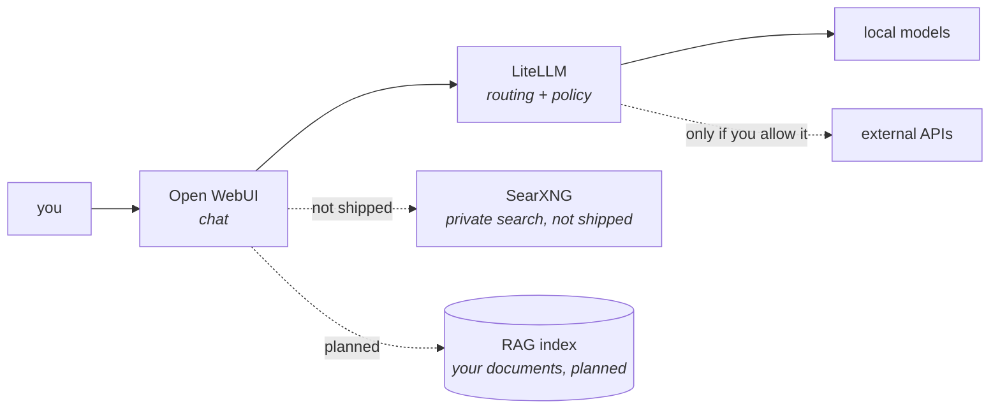

# The AI plane

Running language models on hardware you own, with a normal chat interface, so
that using AI does not have to mean sending your data somewhere else.

| I want to | Go to |
|---|---|
| See what ships and what is on by default | [What ships today](#what-ships-today) |
| Understand how the console reaches the gateway, or run without it | [The console goes through the gateway](#point-the-console-at-the-gateway) |
| Load my own policy or logging hooks into the gateway | [Load your own gateway hooks](#load-your-own-gateway-hooks) |
| Understand the egress containment around the console | [Containing the console](#containing-the-console) |
| Add a hosted provider without opening the console up | [The egress question](#the-egress-question-if-you-add-a-hosted-provider) |
| Know what has been proven and what has not | [Verification status](#verification-status) |
| Understand where local models stop being enough | [The honest boundary](#the-honest-boundary) |

## What it is for

**"Does not have to" rather than "does not".** Tockmox ships pointed at nothing,
and CI proves no shipped default names one of three named hosted providers ...
but that is a promise about what this project ships, not a limit on what an
operator configures. Frontier models work here, through the same gateway as
local ones.

The design that makes local AI practical ... one endpoint, one place to set
policy, one audit trail ... is the same design that makes a mixed deployment
practical: local for the work that fits, frontier for the work that earns it,
and the decision recorded in one place rather than scattered across consoles.

Configuring a hosted provider is a deliberate act with a visible cost, which is
the point. See
[the egress question](#the-egress-question-if-you-add-a-hosted-provider) before
you do it.

**What the CI gate actually asserts**, so nobody reads it as broader than it is:
it renders every layer chart against `ci/values.yaml` and fails if any rendered
environment value is an `http` or `https` URL beginning `api.openai`,
`api.anthropic` or `generativelanguage`. That is three named providers matched
in rendered env values, not a proof that nothing anywhere can reach the
internet. The containment claim is the NetworkPolicy below, not this grep.

## What ships today

| Component | Where | Default | Switch |
|---|---|---|---|
| **Open WebUI**, the chat console | `chat.<internalDomain>` | On | `apps.openWebui`, unset follows `capabilities.aiPlane` |
| **LiteLLM**, the model gateway | `llm.<internalDomain>` | **On** (since 0.8.0) | `apps.litellm`, unset follows `capabilities.aiPlane` |
| The gateway's database | In-cluster CloudNativePG `Cluster` | With the gateway | `modelGateway.database` |
| The console's gateway key, minted by a Job | `tockmox-openwebui-gateway` in the AI namespace | With the console and the gateway | `modelGateway.consoleKey`, unset follows both |
| The console-key check and its alert (since 0.8.0) | A CronJob in the AI namespace, every 15 minutes; `TockmoxConsoleKeyRejected` | With the Job | `modelGateway.consoleKey.check.enabled` |
| Egress containment for the console | Policy layer | On | `apps.ai_openwebui_egress`, unset follows `capabilities.networkPolicy` |
| Egress default-deny for the whole AI namespace (after 0.6.2) | Policy layer | On | `apps.ai_namespace`, unset follows `capabilities.networkPolicy`; rollback lever `aiEgress.namespaceDefaultDeny` |

Open WebUI points at the model gateway, and the gateway points at the model
hosts you name: Ollama on the cluster if you enable it, or any
OpenAI-compatible endpoint on your network, or beyond it if you choose. Until
you name one, the console starts with an empty model list and nothing to talk
to, which is the shipped state and is fine while you evaluate everything else.

### Why the gateway shipped off until 0.8.0, and what changed

Two things it needs could not come from this repo: a **master key**, which is
a Secret you create, and a **model list**, which is addresses on your network.
Shipped on, a first install produced a pod waiting in
`CreateContainerConfigError` and a gateway routing to nothing, so through 0.7.x
the chart shipped `apps.litellm: { enabled: false }` and this page called
pointing the console at it "optional, and recommended". That default was the
contradiction REQ-0004 AC-4.1 names: all AI traffic fronted by a local gateway
is the mechanism the control claim rests on, and a shipped default that
bypasses it makes the claim decorative. Ruled 2026-10-08 (TM-0460): the
gateway is required, in the sense this page now states under
[the console goes through the gateway](#point-the-console-at-the-gateway).

What changed to make that honest: `mint-secrets.sh` mints the master key and
the database credential by default, so the Secret exists before the first
sync; the console's own key is minted by a Job in the chart once the gateway
answers, so no post-install step stands between the sync and a working
console; and the model list still ships empty, because there is no example
address in the defaults, only the shape of one in a comment.

<a id="point-the-console-at-the-gateway"></a>

## The console goes through the gateway

**The shipped default, since 0.8.0.** What you get: a credential you can revoke
without touching anything else, a per-console record of what was asked, and a
list of models the console cannot exceed. The AI layer ships these values, and
a site that never mentions them gets them:

```yaml
# charts/tockmox-ai/values.yaml, the shipped default; nothing to copy
open-webui:
  enableOpenaiApi: true
  openaiBaseApiUrl: "http://{{ .Release.Name }}-litellm:4000/v1"
  openaiApiKeyExistingSecret: tockmox-openwebui-gateway
  openaiApiKeyExistingSecretKey: api-key
```

The URL is rendered by the subchart, so `{{ .Release.Name }}` becomes your AI
layer's release name, `tockmox-ai` on a stock install, and the Service it
names is the one this command prints:

```bash
kubectl -n tockmox-ai get svc -l app.kubernetes.io/name=litellm \
  -o jsonpath='{.items[0].metadata.name}{"\n"}'
```

**The Secret holds a LiteLLM virtual key, not the master key, and a Job mints
it.** A virtual key can only be issued by a running LiteLLM, so the Secret
cannot exist before the first sync. The AI layer renders a Job
(`<release>-gateway-key-<hash>`, `modelGateway.consoleKey`) that waits for the
gateway's readiness endpoint, calls `POST /key/generate` with the master key,
and creates `tockmox-openwebui-gateway`. When the Secret already exists it
sends that key to the gateway first (`GET /v1/models`): a key the gateway
accepts is left alone, so a re-sync or an upgrade never rotates a working
key; a key it rejects with 401 (a gateway turned off and on again comes back
with a fresh database and no keys in it) is replaced in place and the console's
pods are deleted so they restart on the new one. Its Role is `get` and
`update` on that one Secret name, `create` on Secrets, which is the narrowest
shape Kubernetes RBAC can express for a create, and `delete` on the console's
pod names. Putting the
master key in the console instead would make the gateway a pass-through with
extra steps; the scoping measurement is in
[secrets](../administration/secrets.md#the-consoles-model-gateway-key-is-a-post-install-step),
and so is the manual fallback if you turn the Job off.

**Success condition:** the console pod reaches `Running` and the model selector
lists your models.

```bash
kubectl -n tockmox-ai get pods -l app.kubernetes.io/name=open-webui
kubectl -n tockmox-ai logs -l app.kubernetes.io/name=tockmox-gateway-key
```

The Job's last line is `created Secret tockmox-ai/tockmox-openwebui-gateway`,
`Secret ... exists and the gateway accepts its key; nothing to mint`, or, after
a gateway that was off and is on again, `restarted the console ... so it reads
the new key`. While the gateway is still coming up
the Job's pod is retrying, which is a `Progressing` AI layer rather than a
failed one.

**If the model list is empty** and the pod is Running, the gateway is reachable
but has no models configured. That is **`litellm.proxy_config.model_list`** in
your site's `ai.yaml`, not a console problem.

### When the gateway rejects the console's key

The Job repairs a rejected key when it runs, and it runs at a sync. Between
syncs, nothing in the platform used to notice a dead key: the `llm` uptime
probe sends no key, so it stayed green through the whole of the 0.8.0 upgrade
lab's off-then-on cycle while the console could not list a model and every
layer read Healthy. So the AI layer also renders a check (`tockmox-console-key-check`,
a CronJob, `modelGateway.consoleKey.check`) that does what the console does
and nothing more: every 15 minutes it sends `GET /v1/models` to the gateway
with the key from `tockmox-openwebui-gateway`. A `200` is a passing run. A
`401` or `403` is a failed run with one line in its log, and the rule
`TockmoxConsoleKeyRejected` (warning) fires when the newest run was a
rejection and no later run has passed. A gateway that does not answer is
neither: the run ends with a different exit code and a log line that says
what happened (refused, timed out, or the name did not resolve), the rule
leaves it out, and the gateway's own alerts cover it. A request that got no
answer at all is tried again, two seconds apart for up to ten attempts, because
on k3s [a new pod's egress is refused for about its first second](what-you-get.md#network-containment)
and the lab's single-shot check lost most of its slots to that window; the
first HTTP answer decides, so a rejection is never retried into a pass.

The check holds the console's key, never the master key. It has no
ServiceAccount token and no Role: the key reaches it as an environment
reference, a fresh pod every run, so the key the Job last wrote is the key the
next run tests. Its pod is `tockmox.com/isolated`, and the policy layer's
`allow-egress-console-key-check` is the only path it has besides DNS: the
gateway's pods, port 4000.

The check keeps 24 failed Jobs in its history on purpose: the rule reads the
newest rejection off the failed Job that records it, and that Job has to
outlive the outage failures that can follow it (a history of 3 let the alert
clear by garbage collection on the lab, with the key still dead). Upstream's
`KubeJobFailed` would fire once per kept Job, so the observability layer
re-ships that rule with this check's Jobs left out and nothing else changed
([monitoring](../operations/monitoring.md#what-tockmox-itself-alerts-on)).
A failed check therefore raises one alert, `TockmoxConsoleKeyRejected`, or
none at all when the gateway did not answer.

**When the alert fires**, the key in the Secret is one the gateway no longer
holds. The usual cause is a gateway that was turned off and on again (the
prune takes its database and every key in it); a key revoked in LiteLLM by
hand looks the same. The Job replaces the key the next time it runs, and a
finished Job does not run again on its own, so make it:

```bash
kubectl -n tockmox-ai delete job -l app.kubernetes.io/name=tockmox-gateway-key
argocd app sync tockmox-ai
kubectl -n tockmox-ai logs -l app.kubernetes.io/name=tockmox-gateway-key --tail=2
```

The Job's log ends `restarted the console ... so it reads the new key`, the
next check passes within 15 minutes, and the alert clears on that run. To do
it by hand instead, mint a key with the master key and replace the Secret as
[install § confirm the console's model-gateway key](../deployment/install.md#mint-the-consoles-model-gateway-key)
shows, then restart the console
(`kubectl -n tockmox-ai rollout restart statefulset -l app.kubernetes.io/name=open-webui`).
The check's last verdict is always one command away:

```bash
kubectl -n tockmox-ai get jobs -l app.kubernetes.io/name=tockmox-console-key-check
kubectl -n tockmox-ai logs -l app.kubernetes.io/name=tockmox-console-key-check --tail=1
```

**The AI layer reads Degraded in Argo CD while the last check failed.** Argo
CD's own health check for a CronJob (3.5) marks it Degraded when its last
scheduled run did not succeed and no run is active, with the message `CronJob
has not completed its last execution successfully`, and the layer's health is
the worst of its resources. So a rejected key, and a gateway that stopped
answering, each make `tockmox-ai` read Degraded from the first failed slot
until the first passing one, in Argo CD and in the layer summary the Tockmox UI
shows. That is kept as it is: a console that cannot chat is a degraded AI
layer, and this is the second, louder copy of the same fact the alert
carries. It is not sticky: the first passing run clears it for good, and the
repair above brings that run within one schedule slot. It does flicker: the
same health check reads a CronJob Healthy while a Job of its is active, so
for the seconds each failed slot's Job runs (two or three on a rejection,
about twenty when the gateway does not answer) the layer reads Healthy, then
Degraded again when that Job fails. The lab measured seven such blips in one
episode, and the Application's `lastTransitionTime` moves with each, so
anything that acts on the layer's health should wait out one schedule slot.
Argo CD reads the CronJob's own status for this, not the failed Jobs the
CronJob keeps in its history, so those do not hold it and deleting them is
not the repair (measured: both failed Jobs deleted with the key still dead
left the layer Degraded). Read the verdict off the CronJob itself in the
resource tree (the Argo CD UI, or the per-resource `HEALTH` column of
`argocd app get tockmox-ai`); on Argo CD 3.5 the Application's
`status.resources` carries no per-resource health, and a
Degraded Job under a Healthy CronJob does not move the Application. A
gateway outage clears the same way once the gateway answers again (the lab
measured the first slot after the gateway came back passing on its first
try).

### Running without the gateway

**A site may override, and the override has a cost this page names.**
REQ-0004 AC-4.1 is read, for 0.8.0, as "the shipped default routes the console
through the gateway, and a site may override" (ruling D1, 2026-10-08). A site
that points the console at a model host directly keeps no per-console key, no
revocation and no request log, and **re-opens AC-4.1 on that site**. The
stricter reading, a render that refuses any console not pointed at the
gateway, is carded for the AI-data-policy release, with a break-glass, and is
not built here.

Two values, in two files, because every layer must see the switch:

```yaml
# site/values/global.yaml ... every layer reads this one, so the exporters
# layer stops probing llm.<internalDomain> for a host nothing serves
apps:
  litellm:
    enabled: false
```

```yaml
# site/values/ai.yaml ... one of the two, not both
open-webui:
  enableOpenaiApi: false                               # a console with no backend
  # or:
  openaiBaseApiUrl: "http://<your-model-host>:<port>/v1"
  openaiApiKeyExistingSecret: ""                       # if the host wants no key
```

The render refuses the first file without the second, naming both: the shipped
console URL is this release's gateway Service, and a console pointed at a
Service nothing renders shows an empty model list with no error. Turning off
`capabilities.aiPlane` instead removes the console and the gateway together
and needs neither.

**The key is `litellm.proxy_config.model_list`, and it is worth being exact
about.** `modelGateway` is a real key on this chart, but everything it holds is
`modelGateway.database` ... it configures the gateway's CloudNativePG database
and it cannot hold a model list. Putting one there produces **no error of any
kind**: `modelGateway` does not close `additionalProperties`, so the key is
accepted, rendered past, and silently ignored, and the console goes on showing
an empty model list with every layer reporting `Synced` and `Healthy`. One
entry looks like this, for any OpenAI-compatible host (llama.cpp, LM Studio,
vLLM, a workstation on the LAN):

```yaml
# site/values/ai.yaml
litellm:
  proxy_config:
    model_list:
      - model_name: local-chat              # the name the model selector shows
        litellm_params:
          model: openai/<model-id-the-host-serves>
          api_base: http://<your-model-host>:<port>/v1
```

`model_name` is what the console shows and what a client asks for. `model` is
the `openai/` prefix plus the id your host serves, and `api_base` is that host's
`/v1` address. If the host wants a key, add `api_key: os.environ/<NAME>`, which
reads the key from an environment variable on the gateway pod. How that variable
gets into the pod is not covered on this page. Helm replaces a list wholesale,
so write every model you want in the one `model_list` your site sets. The same
example sits in the comment block above `proxy_config` in
`charts/tockmox-ai/values.yaml`.

> **Configure this through the values above, never through
> `open-webui.extraEnvVars`.** The upstream chart renders `OPENAI_API_BASE_URL`
> and `OPENAI_API_KEY` from its own values, so naming either in `extraEnvVars`
> puts the key in the pod spec twice. That passes `helm template` and
> `helm lint`, and then fails ArgoCD's `ServerSideApply` with "duplicate
> entries".

## Load your own gateway hooks

**Optional, and only for a site that has its own LiteLLM callback code**: a
pre-call policy gate that can refuse a request, a logging hook that records a
completed one, or both. What you get: the callbacks load from your values file,
with no edit to any template in this chart. What you lose by not doing it:
nothing; the gateway runs with LiteLLM's own behaviour.

A hook is Python that you wrote and that runs inside the gateway with access to
every prompt and response. Tockmox does not ship any, does not review yours,
and has no example that is meant to run in production. The two in
`ci/values-litellm-hooks.yaml` are trivial and exist so the render can be
checked.

Three values carry a hook, and only two are yours to write:

| Value | Whose | What it does |
|---|---|---|
| `modelGateway.hooks.files` | You write it | File name to file content. Rendered into one ConfigMap, `tockmox-litellm-hooks` |
| `litellm.volumes` and `litellm.volumeMounts` | Shipped in the defaults | Mount that ConfigMap at `/etc/litellm/hooks`. You do not write these unless you already set either list |
| `litellm.proxy_config.litellm_settings.callbacks` | You write it | Names the objects LiteLLM should load |

```yaml
# site/values/ai.yaml
modelGateway:
  hooks:
    files:
      policy_gate.py: |
        # your CustomLogger subclass, with a module-level instance named `gate`
      audit_log.py: |
        # your CustomLogger subclass, with a module-level instance named `logger`

litellm:
  proxy_config:
    litellm_settings:
      callbacks:
        - hooks.policy_gate.gate
        - hooks.audit_log.logger
```

**How a callback name finds its file.** LiteLLM resolves a callback path
relative to the directory that holds the config file, which here is
`/etc/litellm`. So `hooks.policy_gate.gate` is the object `gate` in
`/etc/litellm/hooks/policy_gate.py`. The name has exactly three parts: the
directory `hooks`, the file name without `.py`, and the object.

**Rules the render enforces.** Each of these fails `helm template` with a
sentence naming the cause, because each would otherwise render cleanly and then
load nothing or crash the proxy at startup:

- If you set `litellm.volumes` or `litellm.volumeMounts` for your own reasons,
  you have replaced the shipped entries, because Helm replaces a list rather
  than merging it. Restate the `tockmox-hooks` volume and mount alongside your
  own. The message prints the two entries to copy.
- `modelGateway.hooks.files` set with no `hooks.` callback registered.
- A `hooks.` callback that names a file not present in `files`.
- `modelGateway.hooks.files` set while the gateway is not enabled.

**Log where you can see it.** The proxy runs at `LITELLM_LOG=INFO` and a
hook's own Python logger has no handler, so a record logged at `info` or `debug`
is dropped and the hook looks as if it never fired. Log at `warning` or above,
or `print` to stdout. The example in `ci/values-litellm-hooks.yaml` uses
`log.warning` for this reason; in the lab, the same example logged at `info`
wrote nothing while the callback was running.

**Limits you should know about.**

- **Files are flat.** A ConfigMap key cannot contain a slash, so a hook that
  imports a package with sub-directories does not fit. Flatten it into modules,
  or supply your own volume and mount under a different path. A hook can import
  a sibling file only if `/etc/litellm/hooks` is on `PYTHONPATH`; set
  `litellm.envVars.PYTHONPATH` to that path if yours does.
- **The whole ConfigMap is capped at 1MiB.**
- **A changed file does not restart the proxy.** The mounted file updates in
  place, and LiteLLM does not re-import it. Restart the Deployment, or change a
  value in `litellm.podAnnotations` in the same commit (a hash of the files is
  a good choice). This chart cannot do that for you, because the subchart
  renders its pod annotations in its own scope, where `modelGateway` is not
  visible.
- **A hook failing at startup takes the gateway down.** LiteLLM refuses a
  callback it cannot load, and a gate that raises on every request refuses
  every request. Try a hook on a scratch install first.
- **The migrations Job gets the mount too.** It uses the same two lists. It
  does not load callbacks, so this is harmless, and it is one more reason the
  volume is optional.

## The policy gate

**Optional, off by default, new in 0.8.0 (TM-0383).** What you get: every
request through the gateway is given a class, and a request whose class forbids
an external endpoint never reaches one, including when the local model it asked
for is down and the client asks for a fallback. What you give up by turning it
on: three edits to your gateway values, and every model must say which tier it
is on.

| Class | Assigned by | May use |
|---|---|---|
| `open` | the alias's route posture | local and external endpoints |
| `internal` | the alias's route posture | local endpoints |
| `restricted` | the default, for any alias with no posture | local endpoints only |

The class comes from **the alias a request asks for**, never from a model or a
guess about the content: choosing an alias whose posture is `open` is the
deliberate, recorded choice to allow an external endpoint, and that choice is
config you can read. A client may tighten its own class (`metadata.tockmox_class:
restricted`) and can never loosen it.

**Turn it on** in `site/values/ai.yaml`. The render refuses until all three are
true, with a sentence naming whichever is missing:

```yaml
# site/values/ai.yaml
modelGateway:
  policyGate:
    enabled: true
    routePosture:              # every alias in model_list, explicitly
      local-chat: restricted
      frontier-chat: open
litellm:
  proxy_config:
    litellm_settings:
      callbacks:
        - hooks.tockmox_gate.tockmox_gate
    router_settings:
      enable_tag_filtering: true
    model_list:
      - model_name: local-chat
        litellm_params:
          model: openai/<model-id>
          api_base: http://<your-model-host>:<port>/v1
          tags: [restricted, internal, open]   # the classes it may serve
        model_info:
          endpoint_tier: local
      - model_name: frontier-chat
        litellm_params:
          model: <provider>/<model>
          api_key: os.environ/<PROVIDER_KEY>
          tags: [open]
        model_info:
          endpoint_tier: external
```

**What the render refuses**, because each one is a route the gate could not see:
a `restricted` class allowed an external tier; a fallback key anywhere in the
gateway config; a model with no `endpoint_tier` or no `tags`; a tag on an
endpoint its class may not use; a local endpoint that reads a cloud key, or an
external one that reads none; an alias with no posture, or a posture for an
alias that does not exist. `tools/check-policy-gate.sh` holds each refusal.

**What it writes.** One JSON line per request on the gateway's stdout, marked
`"tockmox_audit": 1`: the class and where it came from, the alias asked for, the
endpoint and tier that served it, and `refused` or `error` when it did not
serve. With the observability capability on, the log pipeline keeps them.

**What it does not enforce**, and what to do about each:

- **Traffic that does not pass through the gateway.** A client pointed at a
  model host directly, or a tool an application calls on its own (web search, a
  document fetcher), is outside it. Keep the console on the gateway (the
  shipped default, [above](#point-the-console-at-the-gateway)) and the
  [egress containment](#containing-the-console) on.
- **Who may use an `open` alias.** That is the gateway's virtual keys: scope each
  key to the models its holder may see.
- **What is in a request.** There is no content classifier in this release. A
  person who chooses an `open` alias sends what they type to that endpoint;
  that is the grant, made visible rather than prevented.

**How it is proven.** `.github/workflows/policy-gate.yaml` runs the shipped gate
in the LiteLLM version the chart vendors, against two fake backends: a
restricted request to an external alias is refused 403; with the local backend
killed, a restricted request carrying a client fallback to the external alias
gets an error and **nothing reaches the external backend**; an unreadable policy
fails closed. Removing the gate's fallback stripping and tagging makes that run
red (measured 2026-10-06: the external backend answered).

> **Not yet run on a live install.** The proof above is a real proxy on a test
> runner, not a cluster. Until a lab install records the same five cases, treat
> the in-cluster wiring (the mount, the image's Python environment) as checked
> by render, not by use.

## Containing the console

Open WebUI runs as a non-root user with all capabilities dropped, privilege
escalation blocked and the `RuntimeDefault` seccomp profile. That is the
default, and it is only possible because the session-signing key is written to
the data volume rather than to the container filesystem, where the upstream
default puts it. The same change fixes a quieter problem: at the default path
the key is regenerated on every pod start, so every restart silently signs out
every user.

**The console does not phone home.** Upstream enables a version check that
fetches `api.github.com` whenever a signed-in user loads the UI. Tockmox turns
it off in the values. The address lives in the image rather than in any values
file, so the CI grep described above would never have found it ... which is the
reason that grep is not the containment claim.

### The egress bundle

Egress containment is a bundle in the policy layer, `apps.ai_openwebui_egress`.
**As of 0.6.0 it follows the `networkPolicy` capability, so a stock install has
it on.** Through v0.5.0 it shipped off, and "Open WebUI egress is unrestricted
on a stock install" was a published known issue.

It makes the console default-deny for egress and allows exactly three things:
DNS, the rest of the AI namespace, and the ingress controller for single
sign-on. Verified from inside the console pod:

| Destination | Result |
|---|---|
| OIDC discovery, JWKS, token endpoint | reachable |
| The model gateway | reachable |
| `api.github.com`, `api.openai.com`, arbitrary internet | blocked |
| The model host, addressed directly | blocked |

That last row is the point. Once the console talks to the gateway instead of to
a model host, it no longer needs to reach the model host at all, so the
containment and the scoped virtual key are one change seen twice.

**Why it shipped off through v0.5.0, and what changed.** Its single-sign-on rule
selects the Traefik pod by label and allows Traefik's container ports. Both are
properties of the ingress controller this repo happens to ship, and on a cluster
running a different one the rule matches nothing and single sign-on fails in a
way that looks like the identity provider being down. In 0.6.0 the template
checks that condition instead: where the shipped Traefik is not what serves the
cluster, the bundle skips silently if you left the key unset, and fails the
render with an explanation if you set it `true`.

**Test the login after any change here.** A policy that renders is not yet a
policy that is right.

**This bundle covers the console only.** The rest of the namespace is covered by
a second bundle, below.

### The namespace egress default-deny

Development after 0.6.2 (TM-0273 fix 1), behind the same toggle as the
namespace's ingress default-deny (`apps.ai_namespace`), with a rollback lever
`aiEgress.namespaceDefaultDeny`. The earlier reasoning here was that a
default-deny in front of the gateway and the database "buys no containment and
risks a database". The first half was wrong for the gateway: it is the pod that
holds provider keys, and unrestricted egress there is exactly the path a
compromised gateway would use. The second half was right, which is why the deny
ships with its companions rather than alone. Measured on a throwaway k3s
(2026-09-06, 2026-09-07), a bare egress deny cuts DNS and also a pod's access
to its own namespace neighbours, so the bundle is:

| Policy | Selects | Allows |
|---|---|---|
| `default-deny-egress` | every pod | nothing |
| `allow-egress-dns` | every pod | kube-dns, UDP and TCP 53 |
| `allow-egress-intra-namespace` | every pod not labelled `tockmox.com/isolated` | the AI namespace (Open WebUI to the gateway, the gateway to its database, the console's Redis, an in-namespace Ollama) |
| `allow-egress-cnpg` | pods with a `cnpg.io/cluster` label | the Kubernetes API (443, 6443) and the object store's S3 port 3900 in the platform namespace |
| `allow-egress-restore-drill` | the weekly drill's pod | the Kubernetes API |
| `allow-egress-gateway-key` | the console-key Job's pod | the Kubernetes API |
| `allow-egress-console-key-check` | the console-key check's pod (isolated, so the intra-namespace allow skips it) | the gateway's pods, TCP 4000 |
| `allow-egress-litellm` | the gateway | TCP 443 to anywhere except the cluster, service and LAN ranges and 169.254.0.0/16 |

**A model host on your LAN is not reachable through the gateway after this,
on purpose.** The provider default excludes the LAN so the gateway cannot use
its provider path to reach LAN devices. Add the host to
`aiEgress.litellm.extraEgress` as a raw NetworkPolicy entry, or narrow
`aiEgress.litellm.providerAllow` to your providers' address ranges. The symptom
of forgetting is a request that times out in the gateway, not an error naming a
policy. A backup pointed at your own object store, rather than the shipped one,
needs `aiEgress.cnpg.extraEgress` for the same reason.

**Measured on a 0.8.0 lab install (household-sso, 2026-10-06), with these
rules on:** the gateway's CNPG Cluster reported healthy and archived WAL to the
shipped Garage; an on-demand `Backup` completed; the weekly restore drill,
started by hand, PASSED in under a minute; and a chat completion streamed from a
model host outside the cluster, reached through one `aiEgress.litellm.extraEgress`
entry for that host and port. The same request without that entry was not run.

<a id="the-egress-question-if-you-add-a-hosted-provider"></a>

### The egress question, if you add a hosted provider

With containment on, the console cannot reach a frontier endpoint, because it
cannot reach anything outside the namespace except DNS and the ingress
controller. That is the design working, not a fault.

**Route through the gateway rather than punching a hole in the console.**
LiteLLM holds the provider credential, the console holds a scoped virtual key,
and the console's egress stays closed ... so the outbound path exists in exactly
one place, the credential can be revoked without touching the console, and every
request that left your network is in one audit trail rather than several. The
gateway's egress is the one path that is allowed out, and as of the
namespace bundle above it is TCP 443 outside the cluster, service and LAN
ranges: which is what makes the arrangement work, and why a provider you reach
on another port or on the LAN needs an `extraEgress` entry.

The alternative ... allowing the console out directly ... is a supported choice
and a worse one. It puts a provider credential in the console, gives the pod
that renders untrusted model output a general outbound path, and splits the
record of what left your network across two components.

## Two boundaries worth stating rather than discovering

**The LiteLLM proxy and its migrations Job run as uid 1000 with a read-only
root filesystem.** The older version of this page said the image installs its
database dependencies at startup and ships no non-root user; measured on the lab
against 1.100.1, neither is true. The proxy starts, passes its probes and
completes requests with `runAsUser: 1000` and `readOnlyRootFilesystem: true`,
and the migrations Job builds the schema on an empty database the same way. The
only mount the Job needs is a scratch directory, which the chart supplies at
`/scratch` (`TMPDIR`). `litellm.volumes` and `litellm.volumeMounts` are lists,
so a site that sets either replaces the shipped entries and must restate
`tockmox-scratch` beside `tockmox-hooks`; the render refuses a site that does
not, because otherwise the Job fails at runtime with nowhere to write. Two
things remain yours to check: a callback hook you
supply that writes to the container filesystem will fail with `Read-only file
system`, and the measurements stop at the versions named here. Since 1.100.1
the same two properties were observed on the reference site, not a lab, on
1.105.0 and 1.105.1: an upgrade over a database migrated by 1.100.3 (2026-10-17,
then 2026-10-18), the migrations Job `Complete` in 37 seconds, and the proxy as
uid 1000 with a read-only root, ready with no restarts.

**The migrations Job log ends with a Prisma traceback, and it is expected and
harmless.** After `LiteLLM: Setup complete. Skipping server startup as
requested.` the log of `tockmox-ai-litellm-migrations-<10 hex>` can carry a
traceback ending `OSError: [Errno 30] Read-only file system` on a `schema.prisma`
path under the image's `site-packages`. The Job runs with the read-only root
filesystem described above, and after the migration LiteLLM runs `prisma
generate`, which tries to copy that file into `site-packages` and cannot. The failure
does not stop the migration: the Job still ends `Complete` and the gateway
starts, using the Prisma client already built into the image. Check the Job's status, not the traceback:
`kubectl -n tockmox-ai get job -l app.kubernetes.io/component=migrations` shows
`Complete`. A `Read-only file system` error anywhere else, or in a pod that
restarts, is a different matter: see the hooks caveat above.

**No `ServiceMonitor` ships for the gateway.** `/metrics` on the LiteLLM proxy
is an enterprise feature, and a scrape target that answers 404 reads as coverage
on a dashboard without being any.

## Intended components



**Text equivalent.** You reach Open WebUI, the chat console. Open WebUI calls
LiteLLM, which does routing and policy. LiteLLM calls local model hosts, and
calls external APIs only if you configure it to. A RAG index over your documents
is planned, and SearXNG for private search is not shipped and not planned as an
add-on. **Solid lines exist today: Open WebUI, LiteLLM, and whatever local model
hosts your model list names. SearXNG and the RAG index are dashed because they
ship in nothing today.**

**LiteLLM as the mediation point** is what makes routing, policy and audit
possible at all. Every request passes through one place, which is where routing,
policy and audit belong. It also means "which model answered this" is a
configuration question rather than a rewrite.

The gateway is adopted, not authored: the upstream `litellm-helm` chart is a
declared dependency, aliased to the `litellm` block, and Tockmox renders the
pieces around it that derive from your site ... the Ingress, from
`global.internalDomain`, and the database, as a CNPG `Cluster` rather than the
bundled PostgreSQL subchart the upstream chart would otherwise deploy with a
password in a values file.

**Why `tockmox-ai` is a separate chart.** Deliberately thin and independently
adoptable. Someone who wants a local AI plane and has their own platform should
be able to take this layer alone, without inheriting opinions about storage or
ingress.

## The honest boundary

Local models are good at retrieval, summarization, drafting, and structured
extraction. They are meaningfully worse than frontier models at hard reasoning
over novel problems.

Tockmox's position: run locally by default, escalate deliberately when you
choose to, and never let escalation happen silently. When there is no external
route ... genuinely disconnected ... the shortfall is a **hard stop**, not a
graceful degrade. Anyone claiming otherwise is selling something.

## What is not included, on purpose

The platform-management AI ... the agent that operates the platform itself ...
is not part of the open release. What *is* open is the containment envelope it
runs inside, and that envelope is exactly two things in this tree: the
[read-only diagnostic identity](what-you-get.md#the-diagnostic-identity-since-it-is-the-interesting-one)
and the NetworkPolicies that isolate it, both in the policy layer.

Two more pieces of the reference deployment's scaffolding are **documented
there and not shipped here**: the propose-then-approve gate, which in the
reference deployment is a pull-request workflow on the site repository
(merge-on-approval, with trailers recording who approved what), and the
verification harness that checks an agent's proposals before they merge. An
earlier version of this page listed both as open; neither is in this
repository, and this page names only what is.

That split is deliberate. The safety scaffolding is more useful to you public
and auditable than the agent would be, and it means you can put your own agent
in the cage.

## Verification status

Stated per the evidence class, in order of what has actually been exercised.

| Claim | Evidence |
|---|---|
| Chart renders, lints, and passes kubeconform with the gateway on and off | **Verified in CI**, from a clean clone |
| The shipped default renders the gateway and the console pointed at it on the console-key Secret, in every profile; the console-key Job renders with a Role on one Secret name and waits for the gateway before it mints; a site override to off renders | **Verified in the render**, by `tools/check-gateway-default.sh` (in `check-all.sh`), each assertion proved to go red. **Run on lab clusters, 2026-10-09:** a greenfield install with this default and a 0.7.2 site upgraded onto it by upgrade.md as printed both reached a model through the console with no manual key step; the Job minted after the gateway was ready, and a gateway turned off and on again had its dead key replaced by the Job with no hand step |
| The console-key check renders with no token, no Role and no master key, exits 1 on a rejection alone, reaches only the gateway's port, and `TockmoxConsoleKeyRejected` fires on the newest rejection, clears on a later pass, and stays silent on a gateway outage | **Verified in the render**, by `tools/check-gateway-default.sh` G7 (thirteen mutations proved red) and by `promtool test rules` on the rendered rule (`tests/rules/console-key-rejected.yaml`, ten cases). **Run on one lab greenfield (single-node k3s, 2026-10-09):** the key revoked by hand made the next run exit 1 with the Job failed for `PodFailurePolicy` (kube-state-metrics 2.20.0 reports it with no `reason` label), `TockmoxConsoleKeyRejected` was pending within one minute and firing 6 minutes 23 seconds after the revocation while the `llm` probe stayed at 1; the console-key Job replaced the key and restarted the console; the next passing run cleared the alert with the rejection's failed Job still listed; and a gateway scaled to zero failed the check with the other exit code and did not fire it. The same lab found the single-shot request losing most slots to k3s's new-pod policy window, a history limit of 3 letting the alert clear by garbage collection, and Argo CD reading a failed check as a Degraded layer; the first two are fixed above and the third is kept and documented. The fixed retry has not yet been run on a cluster |
| No shipped default names `api.openai`, `api.anthropic` or `generativelanguage` in a rendered env value | **Verified in CI**, on the full render of every layer against `ci/values.yaml` |
| Proxy pod, migration Job, Service, Ingress and CNPG `Cluster` reach a running state | **Verified on a cluster, 2026-08-15** |
| Serving a request through the gateway to a local model | **Verified on a cluster, 2026-08-15**, through the Service and through the Ingress |
| Open WebUI reaching a local model *through* the gateway, on a scoped virtual key | **Verified on a cluster, 2026-08-15.** The console listed the gateway's models and completed a chat; the request appears in `LiteLLM_SpendLogs` attributed to that key's alias |
| Issuing and scoping virtual keys | **Verified on a cluster, 2026-08-15.** A key restricted to the model list answered `/v1/models` and was refused `/key/generate` (401) and `/key/list` (403) |
| Site hooks: the ConfigMap holds both files, the Deployment mounts them at `/etc/litellm/hooks`, the rendered config lists both callbacks, and each callback name resolves to a mounted file | **Verified in the render**, by `tools/check-litellm-hooks.sh` against `ci/values-litellm-hooks.yaml`, and **observed on a lab cluster, 2026-09-30**: the gate refused a request with HTTP 400 and a normal completion returned 200 with the logging line in the pod log (at `warning`; the same example at `info` wrote nothing). One lab install, not a soak: see [what is not certified here](#what-is-not-certified-here) |
| Backups of the gateway database | **On by default since 0.7.1, whenever the gateway is enabled.** `modelGateway.database.backup.enabled` is unset and follows `capabilities.dataProtection`, so a stock install with the gateway on backs its database up to the platform layer's Garage; set it `false` to opt out, and the chart then renders `TockmoxModelGatewayDatabaseUnbacked`. With the gateway off there is no database and nothing to back up. The restore procedure was drilled in this namespace on 2026-08-15, with the source cluster destroyed and rebuilt from the object store ... but against a purpose-made drill database, **not** against the gateway's own data. Take one backup and restore it somewhere harmless before you rely on it. See [backup-restore](../operations/backup-restore.md) |

## What is not certified here

**The gateway as the shipped default: synced on one lab, not soaked.** On the
0.8.0 release candidate's lab gate (2026-10-12, one node) a fresh install came
up with the gateway on, the console pointed at it on a key the console-key Job
minted with no manual step, a chat answered through it and found in the
gateway's spend log, and the key check reporting the key accepted; the upgrade
from 0.7.2 converged on the same defaults. One lab and one day: nothing here is
about load, or about a site that has run it for weeks.

**Site hooks: one lab observation, not a soak.** On a lab cluster on 2026-09-30
the two example hooks loaded from this seam: the gate refused a marked request
(HTTP 400, "refused by the example gate"), a normal completion returned 200
through the gateway to a local model, and the logging line appeared in the pod
log once the example logged at `warning`. Also observed: a changed hook file
needs a pod restart. What is not known: behaviour under load, a gate on streaming responses, and
any version of LiteLLM other than the one the lab ran.

The rows above are measurements with dates on them. **They are not a claim that
this page has been executed start to finish as written.**

**The egress table in [the egress bundle](#the-egress-bundle) carries no
measurement date**, in this page or in the tree. It is recorded here as an
observation from inside the console pod rather than as a dated verification,
and it needs re-running and dating now that the bundle's default has flipped.

Documented procedures are verified by running them, not by reviewing them ...
the [testing standard](../testing-standard.md) says which paths are covered and
which are not yet.

<!-- tockmox:footer:begin -->

---

<sub>Tockmox v0.8.1 &middot; &copy; 2026 Tockmox LLC &middot; code Apache-2.0, docs CC BY 4.0 &middot; Tockmox is a trademark</sub>
<!-- tockmox:footer:end -->
