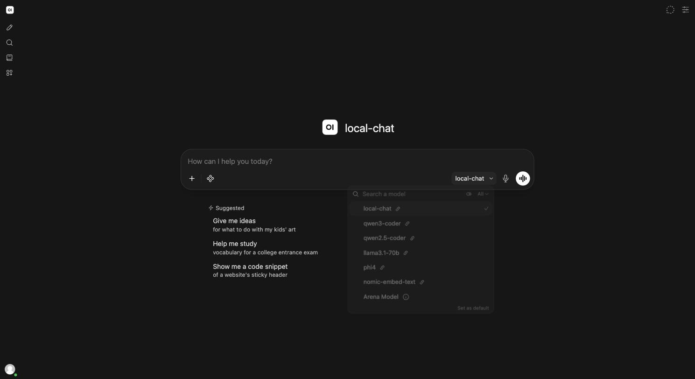
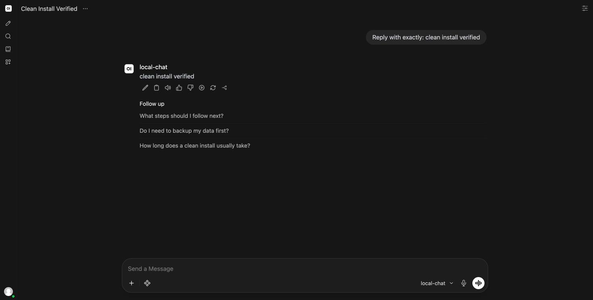
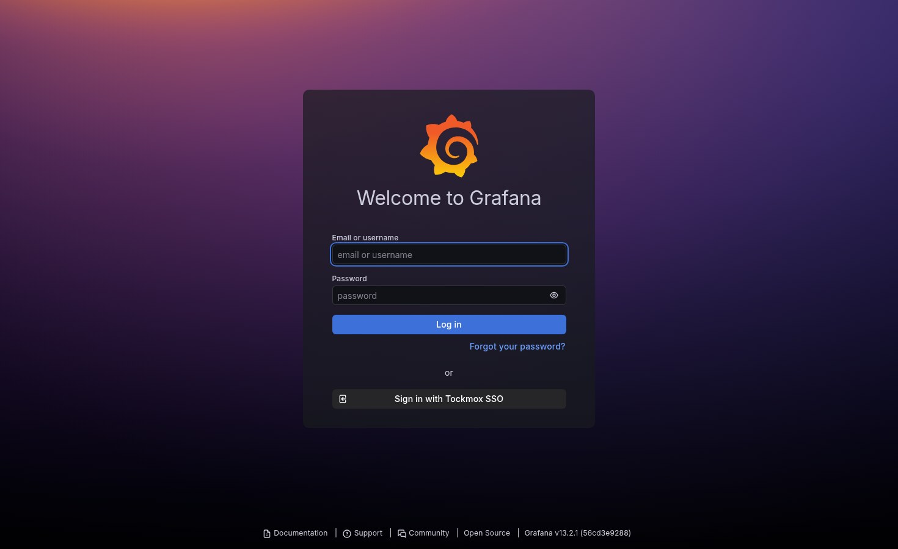

# Sign in for the first time

**Your first hour.** The install finished and every layer reports Healthy.
Nothing works yet, and that is expected: **Tockmox ships no accounts.** This
page is the path from a green ArgoCD to a console you can actually use.

**Three things are yours to supply**, each marked **YOU SUPPLY:** at the point
you need it: your internal domain, a password for the break-glass administrator,
and the details of the user you make for yourself. Everything else is a command
to run or a screen to click, in order.

**The order is not decorative.** Step 1 before step 2 because a certificate
warning on the identity provider is a habit worth not forming. Step 2 before
step 3 because a fresh Authentik has no administrator and every other console
federates to it.

## Before you begin

| What you need | Why | How to check |
|---|---|---|
| A finished install, [settled](../deployment/install.md#the-readiness-bar) | Nothing below works against a half-synced cluster, and a missing Secret presents as a login failure | The readiness check in install.md, run **twice** at least three minutes apart, printing nothing both times |
| `kubectl` against that cluster | Step 1 reads a Secret | `kubectl get nodes` |
| A browser on a machine whose DNS resolves your console hostnames | Every step after the first is a browser step | `kubectl get ingress -A -o jsonpath='{range .items[*]}{.spec.rules[0].host}{"\n"}{end}'`, then `dig +short` one of them |
| Your `global.internalDomain` | Every URL below is `<something>.<internalDomain>` | `export SITE_REPO=YOUR_SITE_REPO_PATH`, then `grep internalDomain "$SITE_REPO/site/values/global.yaml"` |
| A password manager | Step 2 creates the account that can lock you out of everything else | You have one open |

**Estimate, not a measurement: 30 to 60 minutes**, most of it waiting for
Authentik's first sync and reading screens you have not seen before.

Everywhere below writes `YOUR_INTERNAL_DOMAIN`, substitute your
`global.internalDomain`.

## Where each command runs

| Marked | Runs on |
|---|---|
| **WORKSTATION** | Your own machine, against the cluster kubeconfig |
| **CLIENT** | A shell on the machine you browse from. It may be the same machine as the workstation and it is still a separate pass, because the trust store being tested is that machine's |
| **BROWSER** | A browser on a machine that trusts the CA from step 1 |

**No command block on this page contains a `#` comment line**, and that is
enforced by CI: `INTERACTIVE_COMMENTS` is off in an interactive macOS zsh, so a
pasted comment line returns `zsh: command not found: #`. Whatever those comments
used to carry is now in the prose beside the block, where a copy button cannot
take it.

## What you will have at the end

The CA trusted on the machine you browse from, a break-glass administrator whose
password is in your password manager, a normal user account of your own in a
group, and a chat completion that came back from a model on your hardware.

## Use `https`, not `http` ... Required, before any browser step

Both schemes answer, which is the problem. **Over `http` the console renders,
the model list populates, and a real chat completion succeeds ... and sign-on
fails**, for a reason the browser reports as a generic provider error. It is the
worst possible shape for a misconfiguration to take, and it costs an afternoon
if you meet it in step 4 rather than here.

Type `https://` into the address bar, and fix any bookmark that does not have
it. The anatomy, and the related trap when you change `global.certIssuer`, are
in
[identity § reach the consoles over https](../administration/identity.md#reach-the-consoles-over-https-not-http).

**Success condition ... WORKSTATION.** Every console Ingress lists a TLS Secret,
which is what makes `https` the scheme to use:

```bash
kubectl get ingress -A \
  -o jsonpath='{range .items[*]}{.spec.rules[0].host}{"\t"}{.spec.tls[*].secretName}{"\n"}{end}'
```

Every line has a second column. **A hostname with an empty second column is
serving plain `http`**, and no amount of typing `https://` will change that ...
go and finish [TLS and trust § step 1](../administration/tls-and-trust.md#1-point-globalcertissuer-at-an-issuer--required)
first.

## 1. Trust the CA ... Required

Tockmox issues its own certificates from a private CA. Until that CA is in your
trust store every console shows a browser warning, and worse, **some clients
fail silently rather than warning.**

**WORKSTATION**

```bash
kubectl -n tockmox-platform get secret tockmox-ca-root \
  -o jsonpath='{.data.ca\.crt}' | base64 -d > tockmox-ca.crt
```

Installing it differs per operating system and per browser, and each store is a
separate pass. The per-OS commands, the uninstall command beside each one, and
the check that asserts on the connection rather than on the absence of a warning
are in [TLS and trust](../administration/tls-and-trust.md).

**Do not click through the warning instead.** A click-through exception covers
the page and not the WebSocket the chat console delivers replies over, so you
get a console where every request succeeds and every reply hangs forever, with
nothing anywhere naming the certificate. The full anatomy is in
[TLS and trust § clicking through the browser warning is not a workaround](../administration/tls-and-trust.md#clicking-through-the-browser-warning-is-not-a-workaround).

**Success condition ... CLIENT**, meaning a shell on the machine you will browse
from. Run it there rather than on the workstation if they differ: the store this
tests is the one that machine's `curl` consults, and the export on the first
line is what makes the block self-contained on a machine that has none of your
other variables.

```bash
export INTERNAL_DOMAIN=YOUR_INTERNAL_DOMAIN
curl -sS -o /dev/null -w '%{http_code} %{ssl_verify_result}\n' \
  "https://grafana.$INTERNAL_DOMAIN/"
```

Prints `200 0`. A `curl` exit code of 60 means the CA is not in the store `curl`
consulted, which is usually a different store from the one you installed into.

## 2. Bootstrap Authentik ... Required

**This is the step people miss.** A fresh Authentik has no administrator, and
the consoles wired to it (Grafana, Open WebUI and Argo Workflows) federate to
it. Until you do this, Grafana's login redirects into a provider that cannot
authenticate anyone. Each of the three also keeps a local break-glass login
that sits outside the group model, so nothing in Authentik shows who holds one
([identity § break-glass](../administration/identity.md#break-glass-deliberately)).

**BROWSER:** open `https://auth.YOUR_INTERNAL_DOMAIN/`. On a fresh install it
redirects to `/setup`, which is Authentik's initial-configuration flow.

**YOU SUPPLY:** the password for the built-in `akadmin` account. Set it there,
and **put it in your password manager before you leave the screen.** This is the
account that can lock you out of everything else.

**Success condition:** you can sign out and sign back in as `akadmin` with the
password you just set, and the **Admin interface** button is present.

### If `/setup` does not appear ... Conditional

**If** you get a normal login page instead of the setup flow, this instance has
already been bootstrapped by something. **It was not Tockmox.** Checked against
the 0.6.0 tree on 2026-09-01, nothing in this repository sets an initial
administrator password: the `tockmox-authentik` Secret carries
`AUTHENTIK_SECRET_KEY` and `AUTHENTIK_POSTGRESQL__PASSWORD` and nothing else,
and neither `AUTHENTIK_BOOTSTRAP_PASSWORD` nor `AUTHENTIK_BOOTSTRAP_TOKEN`
appears anywhere in the tree.

Confirm what your Secret actually holds before hunting for a password that is
not there:

**WORKSTATION** ... prints the key NAMES, never the values

```bash
kubectl -n tockmox-authentik get secret tockmox-authentik \
  -o go-template='{{range $k, $v := .data}}{{$k}}{{"\n"}}{{end}}'
```

If it lists only the two names above,
whoever bootstrapped this instance did so outside Tockmox and holds the
password. The Secret inventory is in
[secrets](../administration/secrets.md#secrets-the-platform-expects-you-to-create).

## 3. Make yourself a real user ... Required

**Do not use `akadmin` day to day.** It is the break-glass account, and an
emergency account you log in with every morning is not an emergency account.

**YOU SUPPLY:** your own username, email and password.

**BROWSER**, in Authentik: **Directory → Users → New User**. Four things about
this screen are not obvious. The last three were confirmed on 2026-08-18 against
Authentik 2026.5.6:

- **Give the user an email address. Authentik lets you leave it blank, and the
  consoles do not.** A user with no email cannot sign in to Open WebUI, which
  reports **"The email or password provided is incorrect. Please check for typos
  and try logging in again."** That message names a password, and there is no
  password to get wrong, because sign-in is SSO. Do not go looking for a reset.
  What the other consoles do with that user, as of 0.7.1 (measured 2026-10-04
  on the 0.7.1 rc4 lab install): Grafana signs the user in as Viewer, with the
  login taken from `preferred_username` (the `email || preferred_username`
  attribute path, TM-0667). Argo Workflows and Miniflux signed the same user
  in on the 0.6.0 release candidate; they were not re-measured on 0.7.1.
  History: on the 0.6.0 release candidate (measured 2026-09-16) Grafana failed
  the same user with **"Login failed"** and **"InternalError"** in the browser
  and `unsuccessful response status code 404` from a `userinfo//emails` URL in
  its log; that is fixed. Open WebUI still refuses. The address does not have
  to receive mail, but Open WebUI needs it to be there.
- **Never give two people the same email address.** Open WebUI merges accounts
  that sign in with the same address, so the second person lands in the first
  person's account, with its role and its history. Authentik does not enforce
  unique addresses (measured: its user email field is neither unique nor
  required), so nothing will stop you. The merge is the chart's
  merge-by-email setting for Open WebUI; see the
  [values reference](../values.md). Anyone who can edit their own email
  in Authentik could do the same to themselves, so check that your user-settings
  flow does not allow it (not verified here).

- **It asks for a user type first.** Pick **Internal User**. The radio button
  looks pre-selected but is not, and **Next** stays disabled until you actually
  click it.
- **The new user does not appear in the list afterwards.** The default view is
  the `Root` folder; created users land in **`users`**. Click that folder in the
  left-hand tree and they are there.
- **The password is not on the "Credentials / Tokens" tab.** It is
  **Overview → Recovery → Set password**. The Credentials tab is for tokens and
  MFA devices.

Then add yourself to a group: **Groups tab → Add to existing group**. Two groups
ship with the identity layer, and every console keys its roles on these exact
names:

| Group | Grafana | Open WebUI | Argo Workflows |
|---|---|---|---|
| `tockmox-admins` | Admin | admin | Full workflow control |
| `tockmox-users` | Viewer | user | Read-only |

**The group is the authorisation, not a decoration on top of it.** The shipped
identity layer binds Grafana, Open WebUI and Argo Workflows to both groups, so a
user in neither group is **refused by Authentik** for all three: Authentik
records a login but never authorizes an application, and no console receives
the identity, so none of them signs the user in or maps a role. What each
console would do with such a user (Open WebUI refuses at the callback, Grafana
would sign them in as Viewer, Argo would give them no ServiceAccount) only
applies if you turn the bindings off with `sso.access.enabled: false`. Apps you
add yourself are not bound unless their own blueprint binds them. The
environment variables behind the console behaviour, and the one case where
arrival order does decide a role (the first Open WebUI account), are in
[identity § the group is the authorisation](../administration/identity.md#the-group-is-the-authorisation-not-a-decoration-on-top-of-it).

**If the Groups or Users pane looks empty**, press **Refresh**. The list panes
load lazily and render empty for a moment; the objects were in the database the
whole time.

**Success condition:** your user appears under the `users` folder, its email
field holds an address that no other user holds, its Groups tab lists one of the
two names above, and you have set its password.

## 4. Sign in to the chat console ... Required

**Be the first person to sign in here, as a `tockmox-admins` member.** Open
WebUI makes the first account it ever creates an administrator, whatever that
person's groups say, and it keeps that account an administrator for as long as
it is the only one. So if a `tockmox-users` member reaches the chat console
before any administrator has, they get the admin panel. Measured 2026-10-04 on
a 0.7.1 greenfield: a `tockmox-users` member who signed in first read `admin`
twice, and dropped to `user` only on their next sign-in after an administrator
had arrived. Signing in first yourself closes the window: the next people
arrive as a second, third, ... account and get the role their group maps to.
To close it by construction instead, see
[identity § the first Open WebUI account](../administration/identity.md#the-first-open-webui-account-is-an-administrator).

**BROWSER:** open `https://chat.YOUR_INTERNAL_DOMAIN/`.

The console offers both a local login form and an SSO button. **Use SSO.** The
local form exists because Open WebUI ships with it; accounts created there are
invisible to Authentik and will not have the roles your groups grant.


**Success condition:** you land in the console signed in as your own user, and
if you put yourself in `tockmox-admins` an admin panel is available.

**If the SSO redirect 404s, or the provider says the client is unknown**,
Authentik's blueprints have not applied yet. They arrive with the identity layer;
give the sync a minute. Verified on a fresh install, the SSO button issues a
`302` to:

```
https://auth.YOUR_INTERNAL_DOMAIN/application/o/authorize/
  ?response_type=code
  &client_id=tockmox-openwebui
  &redirect_uri=https://chat.YOUR_INTERNAL_DOMAIN/oauth/oidc/callback
  &scope=openid+email+profile
  &state=...&nonce=...
```

**If the login dies after the provider, at the token step**, with an error
mentioning certificate verification, that is the in-cluster trust store rather
than yours:
[troubleshooting](../operations/troubleshooting.md#sso-login-dies-at-the-token-step-with-a-certificate-verify-failure).

## 5. Send a message ... Required

Pick a model from the selector and send anything.





**Success condition:** a reply streams back and completes. **A cursor that
blinks forever is step 1 unfinished** ...
[clicking through the browser warning is not a workaround](../administration/tls-and-trust.md#clicking-through-the-browser-warning-is-not-a-workaround)
explains why that failure names nothing.

**If the model list is empty** and the console is otherwise working, the gateway
is reachable and has no models configured. That is
**`litellm.proxy_config.model_list`** in your site's `ai.yaml`, not a console
problem. **Not `modelGateway`**, which is a real key that holds only the
gateway's database and will accept a model list without error and ignore it.
See [the AI plane](ai-plane.md).

### What just happened

Your prompt did **not** go to the model directly. It went to LiteLLM, the model
gateway, which holds the only credential that can reach your inference host. The
console authenticates to the gateway with a scoped virtual key that can list
models and complete chats and nothing else.

That is the point of the gateway: compromise the console and the attacker gets a
chat session, not your inference infrastructure. The measurement behind that
sentence ... what the console's own key is allowed and refused ... is in
[secrets § the console's model-gateway key](../administration/secrets.md#the-consoles-model-gateway-key-is-a-post-install-step).

## 6. Look at the platform watching itself ... Optional

What you get: the dashboards, and a first look at the alerting path. What you
lose by skipping: nothing today, and no idea what normal looks like when
something is wrong later.

**BROWSER:** open `https://grafana.YOUR_INTERNAL_DOMAIN/`. It redirects to
`/login`; use the SSO button for the same reason as before.




**Success condition:** you are signed in as your own user and the shipped
dashboards are listed.

Three things worth knowing on day one:

- **Dashboards are ConfigMaps.** Anything labelled `grafana_dashboard: "1"` is
  picked up automatically, which is how you add your own without touching
  Grafana's database. See [customising](../administration/customising.md).
- **Datasource discovery is scoped to the monitoring namespace** deliberately.
  Anyone able to write a labelled ConfigMap anywhere else could otherwise point
  Grafana at an endpoint of their choosing.
- **Alerts route through Alertmanager to ntfy**, so they reach a phone rather
  than an inbox nobody reads. That path needs the ntfy credentials from
  [secrets](../administration/secrets.md); it is the one part of the alerting
  chain that cannot be minted without them.

## Daily use, once it is yours

| To do this | Do this | Why it is not `kubectl edit` |
|---|---|---|
| Add a model | Add an entry to `litellm.proxy_config.model_list` in your site repo's `ai.yaml` ([the shape](ai-plane.md#point-the-console-at-the-gateway)), commit, push | You never log into a server to add a model, and the change is reviewable in git |
| Add a person | Create the user in Authentik, add them to a group | Removing them from the group removes their access everywhere at once |
| Add your own application | Drop a manifest in your site repo's `apps/` directory; the `site-apps` Application syncs it | Worked example in [adding an application](../administration/adding-an-application.md) |
| Change configuration | Always in the site repo | ArgoCD's `selfHeal` reverts live edits, which is the feature working. Why an in-cluster edit does not stick is in [architecture](../architecture.md#why-an-edit-made-in-the-cluster-does-not-stick) |

**When something looks wrong**, in this order: is the Application Synced, is the
pod Running, does the pod's log say anything. Most first-week problems are a
missing Secret, and the pod names the one it wants.
[Troubleshooting](../operations/troubleshooting.md) has the failures that are
not obvious.

## History and corrections

What the steps above used to say, and when it changed. Nothing here is needed to finish the page.

<a id="history-the-initial-password"></a>

### The initial password

This page said the initial password "came from your `tockmox-authentik`
Secret" until 2026-09-01. It never did: anyone who went looking found two
keys, neither of them a password, and had no way to tell whether that was a
broken install or a wrong sentence. Checked against the 0.6.0 tree on
2026-09-01, nothing in this repository sets an initial Authentik password; the
`/setup` flow is the only way one comes to exist.

## Next

Four things worth reaching for once the basics are boring, in the order they pay
off:

| Do this | Where |
|---|---|
| **Prove your backups**, by running a real restore into a new cluster | [backup and restore](../operations/backup-restore.md) |
| **Decline what you do not want.** Every application has a switch and every capability is a group of them | [capabilities](../administration/capabilities.md) and [profiles](../deployment/profiles.md) |
| **Point the AI plane at better hardware.** The gateway talks to any OpenAI-compatible endpoint, so moving the inference host is one value and no downtime for the console | [the AI plane](ai-plane.md) |
| **Understand the self-check spine.** `tockmox-selfcheck` runs a heartbeat and alerts when monitoring itself goes quiet, which is the failure ordinary monitoring cannot report | [monitoring](../operations/monitoring.md) |

## About the screenshots

The images on this page were captured against a freshly installed cluster on
**2026-08-19**, signed in over `https` with the CA trusted, as a
`tockmox-admins` member whose only credential is the one Authentik identity.
Argo Workflows, same session, same identity:


**Still owed:** the `/setup` initial-configuration flow and the Authentik
new-user screens. Both are only capturable during a fresh bootstrap, and the
2026-08-19 install was bootstrapped server-side. They will come from the next
greenfield run.

## What is not certified here

The dated observations on this page ... the Authentik 2026.5.6 screens on
2026-08-18, the group-versus-arrival-order result, the screenshots on 2026-08-19
... are measurements from specific installs, and each carries its date.

**They are not a claim that this page has been executed start to finish as
written**, and step 2's setup flow in particular has not been walked since the
2026-08-19 install, which arrived already bootstrapped. Documented procedures
are verified by running them, not by reviewing them ... the
[testing standard](../testing-standard.md) says which paths are covered and
which are not yet.

<!-- tockmox:footer:begin -->

---

<sub>Tockmox v0.8.1 &middot; &copy; 2026 Tockmox LLC &middot; code Apache-2.0, docs CC BY 4.0 &middot; Tockmox is a trademark</sub>
<!-- tockmox:footer:end -->
